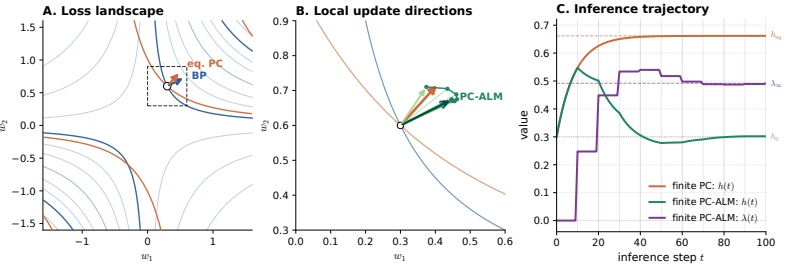
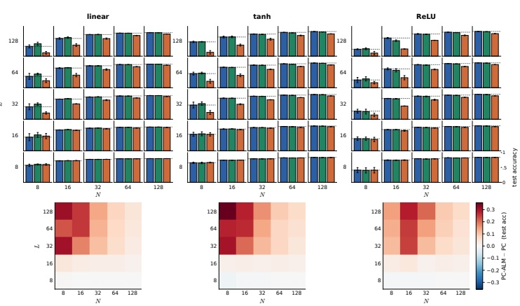
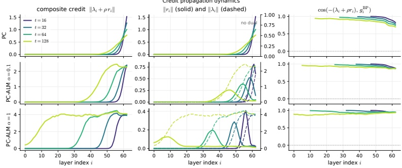
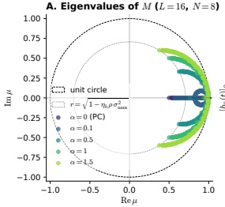
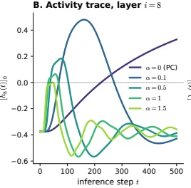
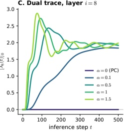
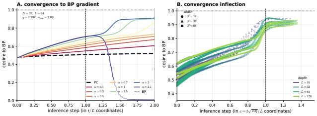

arXiv:2605.31022v1 [cs.LG] 29 May 2026

# Augmented Lagrangian Predictive Coding

## Abstract

预测编码（Predictive Coding, PC）是反向传播（Backpropagation, BP）的一种局部学习替代方案，它通过局部能量最小化动力学而非全局反向传递来训练深度网络。我们提出增广拉格朗日预测编码（Augmented Lagrangian Predictive Coding, PC-ALM），它维持 PC 的推理预算不变，但通过accumulating per-layer constraint errors into a layer-local Lagrange multiplier.将逐层约束误差累积进一个层局部（layer-local）的拉格朗日乘子，使每次权重更新都向 BP 对齐。在线性 PC 网络中，PC-ALM 收敛到一个平衡态，其中精确的 BP 梯度仅通过层局部更新即可在网络中分布。我们在深度达 128 的非线性 PC 网络中分析 PC-ALM，并表明它在所有宽度-深度组合下都匹配 BP 的性能，尤其是在 PC 表现不佳的深而窄的网络中。PC-ALM 在每一层的激活中引入了循环（recurrent）动力学。与 PC 在标量能量上的热流（heat flow）相比，PC-ALM 的动力学由增广拉格朗日上的对偶上升（dual ascent）驱动。我们观察到在极深的网络中出现"弹道式"（ballistic）信用传播，信用信号在各层之间均匀分布，而 PC 的信用传播则是缓慢的、扩散式的。除算法本身之外，增广拉格朗日框架提供了 PC 的一种推广，并可能为分布式系统如何通过纯局部动力学计算和传播类 BP 的信用信号提供洞见。

## 1 Introduction

现代深度学习依赖反向传播（BP）。然而生物电路无法实现 BP，至少无法精确实现 [Lillicrap et al., 2020]。原因之一是 BP 是一个全局算法：尽管 BP 的链式法则在空间上使更新局部化，网络仍必须与匹配的前向激活并行地创建误差变量，然后以精确编排的步骤序列对权重更新进行门控。这一差距促使研究者探索 BP 的局部替代方案——在其中状态、误差和权重变量作为一个单一动力系统演化，且仅需要层局部的耦合。预测编码（PC）是研究得较为活跃的层局部 BP 替代方案之一 [Whittington and Bogacz, 2017, Millidge et al., 2021, Salvatori et al., 2026]。在预测编码网络（Predictive Coding Network, PCN）中，每一层之间引入一个均方误差项，其总和即为 PC 能量。对该能量做梯度下降可得到一个层局部动力系统，用于更新激活状态（PC 推理）和权重（PC 学习）。在权重固定时，激活平衡态产生的激活模式不同于典型前向传播所得的模式，从而导致相应的权重更新与 BP 梯度对齐但并不相等。

在本文中，我们将 PC 置于一类更广泛的、涉及增广拉格朗日（Augmented Lagrangian, AL）的局部学习方法之中。在 AL 上做对偶上升——即乘子法（Method of Multipliers, MM）[Hesten, 1969]——在某些情况下可得到一个局部算法，并已被广泛用于网络训练的分散式方法中（例如 Taylor et al. [2016]）。我们表明 MM 可以用来替代 PC 的推理步骤，但有一个本质差别：在平衡态下，拉格朗日乘子恰好收敛到监督损失的梯度信号。

这一联系并不完全是新的。LeCun [1988] 观察到，标准拉格朗日的乘子在可行性处恰好就是 BP 的伴随变量（adjoint）。有趣的是，增广拉格朗日本质上就是

>图 1：标量两层网络（ $y = w_2w_1x$； $h = w_1x$； $x = y = 1$）中的 PC-ALM 信用对齐。(A) BP 损失景观，以及 BP 与平衡态 PC 的等损失曲线。(B) 箭头为 BP、平衡态 PC 和 PC-ALM 在不同迭代次数下的负权重梯度。(C) 推理轨迹。PC 将 h 稳定在 $h_{eq}$；PC-ALM 将 h 拉回 $h_0 = w_1x$，同时 $\lambda$ 收敛到 BP 伴随变量 $\lambda_\infty = (y - w_2h_0)w_2$。这里我们在每个对偶步之前取 10 个原变量步，以突出对偶量作为误差滞后积分器的作用；在算法 1 中我们则在一次原变量步与一次对偶步之间交替。

标准拉格朗日加上 PC 能量（在共享的监督损失项意义上），这表明 PC 与增广拉格朗日方法之间存在紧密的联系。

贡献：PC-ALM。MM 的一个警告是，要精确计算 BP 需要其内层求解收敛到平衡态，而对一般的非线性网络这并不能保证 [Wang et al., 2019]。然而我们注意到，这一困难 PC 同样存在。尽管如此，PC 文献以经验方式处理了该问题：固定一个有限的推理预算并直接评估性能 [Innocenti et al., 2025, 2026, Pinchetti et al., 2025]，其理由通常是使用接近平衡态的良好初始化。受此启发，我们为 MM 开发了一个有限推理变体，称为 PC-ALM（Augmented Lagrangian Method，增广拉格朗日法），它与 PC 使用相同的推理迭代预算。

从机制上看，PC-ALM 为每一层引入一个对偶变量（即拉格朗日乘子）来修改 PC 推理，该变量累积预测误差并反馈到局部激活中。在固定步数的推理之后，权重更新作用于一个由对偶变量平移后的预测误差复合信号。这种循环（recurrence）在 PC 快速推理与缓慢权重更新之间的中间时间尺度上引入了稳定的振荡瞬态。

我们首先证明，在线性 PC 网络中，PC-ALM 收敛到一个具有精确 BP 梯度的解。我们的核心实验发现是：在非线性网络中，当推理预算相同时，PC-ALM 能够弥合 PC 与 BP 之间的差距。遵循 Innocenti et al. [2026] 的做法，我们在图像分类任务上把 PC-ALM 测试到深度 128。PC-ALM 在所有宽度-深度组合下都匹配 BP，包括 PC 显著劣于 BP 的深而窄网络。

我们进一步从实验上观察到，PC-ALM 展现出令人惊讶的动力学性质。已知 PC 网络会把信用信号集中在监督损失附近 [Pinchetti et al., 2025]。相反，PC-ALM 将信用近乎均匀地分布到整个网络。最后我们观察到，在标准 PC 即使达到平衡态也会停滞的极深网络中，PC-ALM 的原-对偶（primal-dual）动力学加速了信用传播的波前。

## 2 相关工作

我们的工作借鉴了生物可信深度学习（biologically plausible deep learning）文献与分布式优化文献之间一个尚未被充分探索的联系。

**预测编码。** 在生物可信深度学习中，一个核心研究方向是让学习更加局部化。预测编码起源于计算神经科学，最初作为皮层推理的一个模型 [Rao and Ballard, 1999, Friston and Kiebel, 2009]，此后作为 BP 的一种层局部近似不断发展 [Millidge et al., 2021, Salvatori et al., 2026]，且仅使用 Hebb 可塑性。Millidge et al. [2022a] 建立了一个统一的推理与学习框架，Salvatori et al. [2022] 将 PC 扩展到任意图拓扑，Alonso et al. [2024] 刻画了 PC 推理的优化困难并提出了加速求解器。该领域当前的实证水平由 Pinchetti et al. [2025] 确立：他们发现 PC 在中小规模图像分类任务上能够匹敌 BP，但在深度网络上明显落后。Innocenti et al. [2024] 表明平衡态下的 PC 能量只包含严格鞍点（strict saddle），Innocenti et al. [2025] 引入了 $\mu$P 式参数化（$\mu$PC），使深度 PC 网络能够稳定训练；后续工作 [Innocenti et al., 2026] 将 PC-BP 差距刻画为网络宽度与深度的函数。

**用于网络训练的增广拉格朗日与 ADMM。** 另一个研究群体通过交替方向乘子法（ADMM）或增广拉格朗日方法训练网络，其动机通常是可扩展性、条件数或分布式优化，而非生物可信性。Carreira-Perpiñán and Wang [2014] 引入了带二次罚能量的辅助坐标法（method of auxiliary coordinates），并指出了它与增广拉格朗日方法的联系。Taylor et al. [2016] 使用单个输出层的 Bregman/乘子校正，并报告在其设定下完整的逐约束乘子是不稳定的。Zeng et al. [2021] 为每一层的一致性约束附加乘子，并在光滑激活假设下证明了对 KKT 点的 $O(1/k)$ 收敛性。Wang et al. [2025] 将 Elman RNN 的训练写成在仿射约束与非线性约束上都带乘子的形式，利用 ReLU 的分段线性结构以闭式解求解每个块，并证明收敛到 KKT 点；将其应用于前馈 MLP 时，这类似于带独立的仿射约束与激活约束/乘子的 PC-ALM。Evens et al. [2021] 将前馈网络训练表述为一个非线性最优控制问题，并应用带 Gauss–Newton 与正向动态规划的 ALM。Frerix et al. [2018] 提出了 ProxProp，这是网络训练的一种仅含罚项的表述：一次前向传播，随后按逆序在二次罚能量上做一遍梯度步扫描，即可精确复现一个 BP 步。ProxProp 不携带乘子，也不执行外层对偶迭代。提升式训练（lifted-training）方法 [Askari et al., 2018, Li et al., 2018, Gu et al., 2020, Zach and Estellers, 2019, Wang and Benning, 2023, Wang et al., 2026] 用针对激活的罚项或松弛（近端、Fenchel/拉格朗日松弛、对比式、Bregman）替代硬性层约束，但一般不在推理状态中携带持久的逐样本层乘子。Zhou et al. [2026] 在按数据/客户端划分的本地参数副本上运行随机 ADMM 并使用一致性乘子，其切分轴与本文采用的层局部分解不同。这些方法在携带乘子时，通常是在 ADMM/ALM 的块轮次或局部子问题更新之后才更新乘子。

## 3 背景

我们首先回顾用于训练深度前馈网络的约束优化形式。

**约束网络。** 考虑一个深度为 $L$ 的前馈网络，权重为 $\theta = \{W_i\}_{i=1}^L$，逐元素非线性为 $\sigma$（例如恒等、tanh、ReLU）。给定输入 $x \in \mathbb{R}^{n_0}$ 和目标 $y \in \mathbb{R}^{n_L}$，前向传播从 $h_0 = x$ 出发计算 $h_i = \sigma(W_i h_{i-1})$，其中 $i = 1, \ldots, L-1$，并以 $W_L h_{L-1}$ 作为线性读出。我们可以将该优化问题写为

 $$ \begin{aligned}\min_{\theta,h}\quad&\frac{1}{2}\big\|\boldsymbol{y}-W_{L}h_{L-1}\big\|^{2}\\ s.t.\quad&h_{i}=\sigma(W_{i}h_{i-1}),\quad i=1,\ldots,L-1,\end{aligned} \tag1 $$ 

其中激活 $h = \{h_i\}_{i=1}^{L-1}$ 与权重 $\theta$ 同为优化变量。

**作为二次罚的预测编码。** 对 (1) 做罚松弛，即用平方误差项替换每一层的约束，得到 PC 能量 [Whittington and Bogacz, 2017, Millidge et al., 2022a, Salvatori et al., 2022]：

 $$ \mathcal{F}_{\mathrm{P C}}(h,\theta)~=~\frac{1}{2}\big\|\boldsymbol{y}-W_{L}h_{L-1}\big\|^{2}~+~\frac{\rho}{2}\sum_{i=1}^{L-1}\big\|h_{i}-\sigma(W_{i}h_{i-1})\big\|^{2}, $$ 

其中 $\rho$ 为罚强度。

图 2：Fashion-MNIST 上的宽度-深度结果。在预算 $T = 2L$ 下，PC-ALM 在全部 N、L 与激活函数范围内都匹配 BP。在深而窄的网络中，PC-ALM 优于 PC。

**平衡态 PC。** 对每个样本 $(x, y)$，PC 交替执行两个步骤：

 $$ \begin{array}{l l l}{\mathrm{i n f e r e n c e}\colon}&{h^{\star}}&{=\mathrm{a r g}\operatorname*{m i n}_{h}\mathcal{F}_{\mathrm{P C}}(h,\theta),}\\ \end{array} $$ 

 $$ \begin{array}{l l l}{\mathrm{l e a r n i n g:}}&{\theta\leftarrow\theta-\eta_{\theta}\nabla_{\theta}\mathcal{F}_{\mathrm{P C}}(h^{\star},\theta).}\\ \end{array} $$ 

推理步骤取代了标准深度网络的前向与反向传播。这种交替步骤意在反映底层系统的快（推理）与慢（学习）两种动力学。

**有限推理 PC。** 如所写，式 (3a) 中的 argmin 全局依赖于所有层的激活。然而，对该 argmin 做梯度下降会解耦为层局部更新：

 $$ h_{i}(t+1)~=~h_{i}(t)~-~\eta_{h}\nabla_{h_{i}}\mathcal{F}_{\mathrm{P C}}(h(t),\theta),\quad i=1,\ldots,L-1,\quad t=0,\ldots,T-1. $$ 

每个 $h_i$ 只出现在 $\mathcal{F}_{\mathrm{PC}}$ 的两项中，因此 $\nabla_{h_i} \mathcal{F}_{\mathrm{PC}}$ 只依赖于 $h_{i-1}(t)$、$h_i(t)$、$h_{i+1}(t)$ 以及相邻的权重 $W_i$、$W_{i+1}$。激活通常从其前向传播取值初始化。一般地，达到收敛所需的推理步数取决于网络架构 [Alonso et al., 2024]；实践中，该迭代通常要么运行到数值收敛 [Innocenti et al., 2024]，要么运行固定的 $T$ 步预算 [Innocenti et al., 2025, Pinchetti et al., 2025]。我们称之为有限推理 PC，以区别于理想化的平衡态情形。

**增广拉格朗日。** 为 (1) 的约束附加乘子 $\lambda = \{\lambda_i\}_{i=1}^{L-1}$ 并保留二次罚，即得到增广拉格朗日 [Hesten, 1969, Powell, 1969, Bertsekas, 1976]：

 $$ \mathcal{L}_{\rho}(h,\theta,\lambda)\;=\;\frac{1}{2}\big\|y-W_{L}h_{L-1}\big\|^{2}+\sum_{i=1}^{L-1}\lambda_{i}^{\top}\big(h_{i}-\sigma(W_{i}h_{i-1})\big)\;+\frac{\rho}{2}\sum_{i=1}^{L-1}\big\|h_{i}-\sigma(W_{i}h_{i-1})\big\|^{2}. $$ 

固定 $\lambda \equiv 0$ 即退化为 PC 能量：$\mathcal{F}_{\mathrm{PC}}(h, \theta) = \mathcal{L}_{\rho}(h, \theta, 0)$。令 $\rho = 0$ 则退化为 (1) 的标准拉格朗日。

**乘子法。** 回到 (1) 中的约束优化问题，我们可以通过对 AL 做对偶上升（即乘子法 [Hestenes, 1969, Powell, 1969, Bertsekas, 1976]）来求解激活 h。对每个样本，初始化 $\lambda_i \equiv 0$，并在原变量更新与对偶更新之间交替

图 3：扩散式与弹道式信用传播的对比。ReLU 残差 MLP，N = 32、L = 64，在初始化状态下对一个 Fashion-MNIST 样本进行。中间一幅图显示预测误差 $r_i$（左轴刻度）在网络中领先于对偶量 $\lambda_i$（右轴刻度）。与 PC 相比，PC-ALM 使信用在网络中的传播更快也更均匀。

 $$ \mathrm{p r i m a l:}\quad h\leftarrow\operatorname{a r g}\operatorname*{m i n}_{h}\mathcal{L}_{\rho}(h,\theta,\lambda), $$ 

 $$ \mathrm{dual:}\quad\lambda_{i}\leftarrow\lambda_{i}+\rho\left(h_{i}-\sigma(W_{i} h_{i-1})\right),\quad i=1,\ldots,L-1, $$ 

对 $k = 1, \ldots, K$ 个外层轮次执行，直至满足收敛准则。此处乘子法被用来求解"推理"步骤，但求解的是约束问题 (1)，而不是 PC 的二次松弛 (2)。因此，对于收敛后的稳定状态 $(h^\star, \lambda^\star)$，激活 $h^\star$ 恰好就是一次前向传播所得到的值。然而，收敛后的对偶量 $\lambda^\star$ 代表了有意义的局部误差信号，由此得到权重更新：

 $$ \begin{array}{r}{\mathrm{l e a r n i n g}\colon\;\theta\;\leftarrow\;\theta-\eta_{\theta}\;\nabla_{\theta}\mathcal{L}_{\rho}(h^{\star},\theta,\lambda^{\star}),}\end{array} $$ 

如下文展开所示，这恰好对应于一次 BP 更新。

**乘子即反向传播梯度。** LeCun [1988] 观察到，在 (1) 的任意 KKT 点上，标准拉格朗日（即 $\rho = 0$ 时的 (5)）的乘子与反向传播的伴随变量一致。当 h 固定在前向传播取值处时，从输出端回代可以以闭式恢复 $\lambda$，且 KKT 点处的 $\lambda$ 在每一层都等于 BP 的伴随变量（附录 A）。

**通过增广拉格朗日的局部算法。** 这一等价关系提示了一条通过对标准拉格朗日做对偶上升来迭代求取 BP 伴随变量的路径，该过程可按层分解（对偶分解的一个特例）。然而，在深度网络的非凸拉格朗日上，该迭代会因 $\lambda$ 无界而发散 [Nocedal and Wright, 2006]。增广拉格朗日 (5) 在不改变 KKT 解的前提下稳定了对偶更新，但代价是破坏了逐层分解；此时原变量 argmin (6a) 会在全局耦合所有激活。优化文献通常用 ADMM [Boyd et al., 2011] 来解决这一问题。我们指出，像 PC 那样用梯度下降求解原变量 argmin 同样保持了层局部性，因为第 i 层的 $\nabla_h L_\rho$ 只依赖于相邻层的激活与乘子。虽然这并未消除达到全局最小值的困难，但类 PC 的原变量更新与对偶更新相配合，提示了一条可能实现层局部学习、且梯度比 PC 更贴近 BP 的途径。

## 4 方法：PC-ALM

乘子法 (6) 在内部 argmin 之外套了一层外层对偶循环，而该内部问题在每一外层轮次都必须求解。达到这种内部驻点性是实践中 PC 推理的核心瓶颈 [Pinchetti et al., 2025]，MM 也继承了这一点。因此我们提出 PC-ALM，它是 MM 的一个有限推理变体，使用与有限推理 PC 相同的推理预算 $T$。PC-ALM 将 (6a) 中的 argmin 替换为在 $\mathcal{L}_{\rho}$ 上的单步梯度下降，紧接着执行对偶更新，并循环 $T - 1$ 次，最后再执行一次原变量步。完整流程见算法 1。

算法 1 PC-ALM 训练

1: 给定数据集 $D$、罚参数 $\rho$、推理步数 $T$、步长 $\eta_{h}, \alpha, \eta_{\theta}$
2: 对每个批次 $B \subset D$ 执行
3: 对每个样本 $(x, y) \in B$ 并行执行
4: $h_{0} \leftarrow x$；对 $i=1,\ldots,L-1$ 有 $h_{i} \leftarrow \sigma(W_{i}h_{i-1})$ $\triangleright$ 前向初始化
5: 对 $i=1,\ldots,L-1$ 置 $\lambda_{i} \leftarrow 0$
6: 对 $t=1,\ldots,T-1$ 执行
7: 对 $i=1,\ldots,L-1$ 有 $h_{i} \leftarrow h_{i} - \eta_{h} \nabla_{h_{i}}\mathcal{L}_{\rho}(h,\theta,\lambda)$ $\triangleright$ 原变量步
8: 对 $i=1,\ldots,L-1$ 有 $\lambda_{i} \leftarrow \lambda_{i} + \alpha(h_{i}-\sigma(W_{i}h_{i-1}))$ $\triangleright$ 对偶步
9: 结束循环
10: 对 $i=1,\ldots,L-1$ 有 $h_{i} \leftarrow h_{i} - \eta_{h} \nabla_{h_{i}}\mathcal{L}_{\rho}(h,\theta,\lambda)$ $\triangleright$ 末次原变量步
11: 结束循环
12: 对 $i=1,\ldots,L$ 有 $W_{i} \leftarrow W_{i} - \eta_{\theta}\frac{1}{|B|}\sum_{(x,y)\in B}\nabla_{W_{i}}\mathcal{L}_{\rho}(h,\theta,\lambda)$ $\triangleright$ 学习步
13: 结束循环

**推理梯度。** 为分析 $\mathcal{F}_{\mathrm{PC}}$ 与 $\mathcal{L}_{\rho}$ 的差异，我们将 $\mathcal{L}_{\rho}$ 改写为更易解释的形式。对 (5) 中的每个交叉项配方（completing the square），

 $$ \lambda_{i}^{\top}r_{i}+\frac{\rho}{2}\left\|r_{i}\right\|^{2}=\frac{\rho}{2}\left\|h_{i}-\left(\sigma(W_{i}h_{i-1})-\lambda_{i}/\rho\right)\right\|^{2}-\frac{1}{2\rho}\left\|\lambda_{i}\right\|^{2}, $$ 

其中 $r_i := h_i - \sigma(W_i h_{i-1})$ 表示第 $i$ 层的残差（或预测误差）。将 (8) 代回 (5)，

 $$ \mathcal{L}_{\rho}(h,\theta,\lambda)~=~\frac{1}{2}\left\|y-W_{L}h_{L-1}\right\|^{2}~+~\frac{\rho}{2}\sum_{i=1}^{L-1}\left\|h_{i}-\left(\sigma(W_{i}h_{i-1})-\lambda_{i}/\rho\right)\right\|^{2}~-~\frac{1}{2\rho}\sum_{i=1}^{L-1}\left\|\lambda_{i}\right\|^{2}. $$ 

最后一项不含 $h$ 依赖，因此在 $\nabla_h \mathcal{L}_\rho$ 中消失。前两项就是 PC 自由能 (2)，只是每个预测目标从 $\sigma(W_i h_{i-1})$ 平移到了 $\sigma(W_i h_{i-1}) - \lambda_i / \rho$。对 $1 \leq i \leq L - 2$ 关于 $h_i$ 求导，

 $$ \begin{array}{r}{\nabla_{h_{i}}\mathcal{F}_{\mathrm{P C}}\;=\;\rho r_{i}\;-\;W_{i+1}^{\top}\mathrm{d i a g}\big(\sigma^{\prime}\big(W_{i+1}h_{i}\big)\big)\;\rho r_{i+1},}\end{array} $$ 

 $$ \nabla_{h_{i}}\mathcal{L}_{\rho}\;=\;(\rho r_{i}+\lambda_{i})\;-\;W_{i+1}^{\top}\operatorname{d i a g}\bigl(\sigma^{\prime}(W_{i+1}h_{i})\bigr)\bigl(\rho r_{i+1}+\lambda_{i+1}\bigr). $$ 

在 PC-ALM 中，每个预测目标相对于 PC 都平移了 $-\lambda_i/\rho$。

**对偶步。** 每次活动量（activity）步之后，乘子累积残差：

 $$ \lambda_{i}\leftarrow\lambda_{i}+\alpha r_{i},\qquad i=1,\ldots,L-1. $$ 

经典的 MM 更新 (6b) 在对活动量求解至驻点的情况下使用速率 $\rho$。PC-ALM 改为只做一次内部梯度步，因此 $r_i$ 在约束不可行之外还带有未稳定的原变量梯度；我们对对偶速率使用一个单独的超参数 $\alpha$。$\alpha = 0$ 退化为 PC；$\alpha = \rho$ 且内部 argmin 求解到底则退化为 MM。

**权重更新。** 在 $T - 1$ 轮原-对偶循环和一次末次原变量步之后，权重按如下方式更新：

 $$ \theta\ \leftarrow\ \theta-\eta_{\theta}\nabla_{\theta}\mathcal{L}_{\rho}(h,\theta,\lambda). $$ 

权重梯度处的复合信号 $\lambda_i + \rho r_i$ 中，$\lambda_i$ 来自累积的对偶历史，$\rho r_i$ 来自最终 $h$ 处的残差。由 (9)，这相当于把 PC 权重更新中的每个预测目标平移 $-\lambda_i/\rho$。

图 4：线性 PC-ALM 的推理动力学。(A) 块迭代矩阵 M 的特征值。(B, C) 原变量与对偶神经元的活动量轨迹。

### 4.1 解读

PC-ALM 为每一层增加了一个与 $h_i$ 形状相同的逐层拉格朗日乘子 $\lambda_i$。在单个样本上，活动量循环 $t = 0, \ldots, T - 1$ 将 $h$ 初始化在前向传播取值处，并置 $\lambda \equiv 0$。因此第一个活动量步就是一个标准 PC 步；在 $\lambda \equiv 0$ 时，(11) 退化为 (10)。随后第一个对偶步将第 $i$ 层的残差 $r_i$ 注入 $\lambda_i$。从第二个活动量步开始，第 $i$ 层的活动量梯度看到的就不再只是 $\rho r_i$，而是增广后的信号 $\rho r_i + \lambda_i$——一个经由前若干步累积的乘子引入的滞后校正。

在收敛时，激活 $h_i$ 回到其前向传播取值（约束 $h_i = \sigma(W_i h_{i-1})$ 得到恢复，$r_i \to 0$），而 $\lambda_i$ 已累积为该层处的 BP 伴随变量（附录 A）。在整个推理循环中，$\lambda_i$ 累积了第 $i$ 层约束对相邻激活施加的全部压力，而在不动点处，这一累积压力恰好就是链式法则梯度。

图 1 用一个标量两层例子说明了这一点。在平衡态 PC 与 BP 不一致的某个固定权重下，对偶量累积到 BP 伴随变量 $\lambda_{\infty} = (y - w_2 h_0) w_2$，而激活则回到其前向传播取值 $h_0 = w_1 x$。因此 PC-ALM 的权重更新旋转到了 BP 的方向上。

## 5 实验结果

下面我们给出关于 PC-ALM 的一系列理论与实证结果。

### 5.1 线性 PC-ALM 在平衡态下计算精确的 BP 梯度

PC-ALM 是 MM 的一种非精确表述，因为每个原变量步只是一次单步梯度而不是完整的 argmin。尽管如此，我们证明：在线性 PC 网络中，在稳定性条件下，PC-ALM 精确收敛到约束优化问题的 KKT 点（附录 C，命题 3）。因此，在线性 PCN 中，PC-ALM 是一个层局部动力系统，能将精确的 BP 梯度信号分布到整个网络。

### 5.2 稳定性与振荡模式

我们还给出了 PC-ALM 的稳定性条件。线性 PC-ALM 动力学由一个迭代矩阵 $M$（式 (17)）支配，稳定性要求其谱半径小于 1（即所有特征值都位于开单位圆内）。去掉监督损失对应的块（$B=0$）后，该条件约化为仅含约束的逐模式（modewise）条件

 $$ \underbrace{\eta_{h}\sigma_{i}^{2}2\rho<4}_{\mathrm{P C}}\quad\underbrace{\eta_{h}\sigma_{i}^{2}\left(2\rho+\alpha\right)<4}_{\mathrm{P C-A L M}} $$ 

在约束算子 $A$ 的每一个奇异模式 $\sigma_i$ 处成立（附录 C，推论 1）。当 $\alpha = 0$ 时我们得到 PC 的稳定性条件。我们使用的平均场参数化（附录 B）能够在很大的网络深度与宽度范围内稳定 $\sigma_{\max}$。取 $\rho = 1$，我们大致得到 $\eta_{\max} \approx 0.5$ 和 $\alpha_{\max} \approx 2$。

PC-ALM 的振荡模式见图 4。值得注意的是，在标准 PC 中所有激活动力学都是梯度流，不会产生振荡瞬态（例如图 4 中 $\alpha = 0$ 时特征值都落在实轴上）。PC-ALM 的复特征值位于一个环带内，内半径为 $\sqrt{1 - \eta_h \rho \sigma_{\max}(A)^2}$，外半径为 1。对偶速率 $\alpha$ 使这些特征值沿该圆滑动，从而设定振荡频率。

重要的是，收敛到 KKT 解以及它所提供的 BP 梯度，并不依赖于 $\eta_{h}$ 和 $\alpha$ 的具体稳定取值；这些取值只影响通往平衡态的瞬态动力学形态。

### 5.3 PC-ALM 在深而窄的网络中弥合 PC-BP 差距

在线性分析之外，我们在非线性 PCN 上对 PC-ALM 做实验检验。我们在 Innocenti et al. [2026] 的平均场参数化下，于残差 MLP 中扫描 $(N, L) \in \{8, 16, 32, 64, 128\}^2$（细节见附录 F），并在相同推理预算下于 Fashion-MNIST 和 MNIST 上比较 PC、PC-ALM 与 BP，激活函数分别取恒等、tanh 和 ReLU。PC 的性能沿深度轴退化，复现了 Innocenti et al. [2026] 的深而窄失效模式。PC-ALM 在预算 $T = L$ 时恢复了 BP 差距的一部分（图 10），而在预算 $T = 2L$ 时，在全部 $N$、$L$ 与激活函数组合上都完全弥合了该差距（图 2）。更多实验细节见附录 F。

### 5.4 PC-ALM 对重新参数化具有鲁棒性

我们考察 PC-ALM 的性能是否源于平均场参数化的选择——该参数化对 PC 和 BP 都有稳定作用。固定 $(N, L) = (32, 64)$，我们在 Innocenti et al. [2026] 的平均场端点附近扫描两个参数化探针：在 $\gamma_0 = 1$ 时从标准参数化到平均场的插值 $\lambda_{\mathrm{sp}} \in \{0, 0.25, 0.5, 0.75, 1\}$，以及在 $\lambda_{\mathrm{sp}} = 1$ 时从惰性（lazy）到丰富（rich）的轴 $\gamma_0 \in \{0.1, 0.5, 1, 2, 3, 4\}$。在所有取值上，PC-ALM 都匹配 BP 的性能（图 6、图 7），表明即使在不利的参数化区间内它也能保持稳定与鲁棒。

### 5.5 弹道式信用传播波前

除上述实验验证外，我们还注意到 PC-ALM 具有若干令人惊讶的动力学性质。已知 PCN 会表现出跨层的信号衰减 [Pinchetti et al., 2025]。我们在图 3（上）中复现了这一结果。令人惊讶的是，PC-ALM 的原-对偶动力学加速了信用传播波前在网络中的推进，直至复合信号 $\lambda_i + \rho r_i$ 均匀分布。预测误差分量 $r_i$ 传播在滞后的对偶量 $\lambda_i$ 之前（图 3，中间一列）。附录 D 给出了线性波前的计算。我们称之为弹道式信用传播，以区别于 PC 的扩散式传播。

### 5.6 PC-ALM 的 BP 对齐在可预测的推理步处出现拐点

我们观察到，在低推理预算下 PC-ALM 给 PC 带来的提升不大但可测量；然而，在使用默认超参数 $\alpha = 1$ 时，这一提升会在约为网络深度两倍的推理步处"跳变"到更强的 BP 对齐。该现象见图 5（面板 A），其中 BP 对齐曲线出现一个拐点，其位置由 $\alpha$ 控制。$\alpha$ 越大，拐点被拉到越靠前的推理步。我们发现该现象在所有深度和宽度上都存在。此外，拐点的位置在很宽的网络深度与宽度范围内都可预测，即出现在 $t \approx L / \sqrt{\alpha \eta_h}$ 处（图 5，面板 B），相关论证见附录 D。

### 5.7 PC-ALM 具有推理效率

从实用角度看，PC-ALM 使 PC 的激活内存开销翻倍，但额外计算量不大。在平均场缩放（mean-field scaling）下，Innocenti et al. [2026] 表明增大宽度会使 PC 的梯度更接近 BP，于是有两条通往 BP 对齐的途径：加宽 PC，或

图 5：在初始化网络上 PC-ALM 权重梯度与 BP 权重梯度之间的余弦相似度。(A) 对齐程度随迭代次数的变化，迭代次数以 $L$ 归一化。(B) 对齐程度随迭代次数 $t$ 的变化，横轴以 $c = t\sqrt{\alpha\eta_{h}}/L$ 为单位，覆盖不同的深度与宽度。

**固定宽度下的 PC-ALM。** 要达到与 BP 的 0.9 余弦相似度，PC-ALM 的效率高出一个数量级。结果见图 8，相关论证见附录 E。

## 6 讨论

我们提出了 PC-ALM，它是有限推理 PC 的一个推广，源自对前馈神经网络增广拉格朗日做有限推理对偶上升。PC 与 PC-ALM 处理的是两个不同的优化问题——PC 处理的是其二次松弛，PC-ALM 处理的是原始约束问题。除 PC-ALM 多出的对偶更新之外，二者共享相同的推理预算，但展现出不同的动力学性质。我们验证了 PC-ALM 对线性 PCN 是稳定的，并通过对预测误差的层局部累积，在全网络范围内提供与 BP 精确对齐的信用信号。在非线性网络中，我们进一步发现 PC-ALM 具有鲁棒性并能匹配 BP 的性能，尤其是在 PC 与 BP 出现分歧的参数区间内。我们在附录 G 中详述了当前工作的局限性。

### 6.1 与其他基于拉格朗日的方法的联系

PC-ALM 属于这样一类训练方法：它们首先把前馈训练写成约束问题 min Loss $(h_{L}, y)$，约束为 $h_{\ell} = \sigma(W_{\ell}h_{\ell-1})$，然后为层约束附加拉格朗日乘子和/或二次罚。该家族中的方法在以下方面各有不同：(i) 保留增广拉格朗日的哪些项；(ii) 如何求解内部活动量子问题；(iii) 若有乘子，如何恢复它们。标准 PC 仅依赖罚项。

与 PC 一样，BlockProp 算法 [Gotmare et al., 2018] 也使用二次罚，但动机不同——跨层块（block）的模型并行训练。作者使用 L2 粘合罚，并指出在其实验中 Taylor 式拉格朗日乘子是多余的且稳定性更差。他们进一步表明，采用单层块与二次粘合能量的 BlockProp 等价于 Scellier and Bengio [2017] 的平衡传播（Equilibrium Propagation, EP）。EP 本身绕开了对偶上升的不稳定性问题，采用的是一条不同路线：它不迭代乘子，而是通过"推动"（nudging）隐式地恢复乘子——即在自由不动点（$\beta = 0$，EP 记号）与弱钳制不动点（$\beta \to 0^+$）之间对能量梯度做有限差分。该方法产生对比式 Hebb 更新，能在从不把 $\lambda^*$ 作为状态携带的情况下估计它。因此 EP 需要两个不动点阶段；而 PC-ALM 在单个循环中同时运行原变量与对偶更新。对偶传播（Dual Propagation）[Høier et al., 2023] 将 EP 的推动思想扩展为单阶段的二联神经元（dyadic-neuron）方案，其中每个神经元在受推动状态之间的差值所起的作用，在结构上类似于 PC-ALM 的乘子。Scurria [2026] 的最新工作与 PC-ALM 相似，但走的是标准拉格朗日路线；然而，他们所得到的二联 BP 的类似原-对偶动力学，要求约束算子方程满足某些幂零性（nilpotency）假设。我们在附录 H 中详述了更多相关工作。

## 参考文献

Nicolas Alonso, Jeffrey L. Krichmar, and Emre Neftci. Understanding and improving optimization in predictive coding networks. In Proceedings of the AAAI Conference on Artificial Intelligence,

