# Mixture-of-Top- $k$ Attention：通过可扩展快权重实现高效注意力

Qishuai Wen, Zhiyuan Huang, Wei He, Xianghan Meng, and Chun-Guang Li

北京邮电大学

{wqs, huangzhiyuan, mengxianghan, wei.he, lichunguang}@bupt.edu.cn

## 摘要

Transformers 中朴素的自注意力机制可以看作一个两层快权重（fast-weight）MLP，其权重由输入动态诱导，隐藏维度等于序列长度 $N$。随着上下文扩展，这种 $N$-宽度 MLP 的表达能力增强，但对于极长序列却变得无法扩展。最近，这种快权重视角催生了混合专家（MoE）注意力机制，它将序列划分为刚性块，把它们当作快权重专家，并将 token 稀疏地路由到这些专家。本文中，我们将这一视角提升为一个统一框架，用于高效注意力机制，把它们解释为通过路由或压缩使快权重可扩展，并将它们组织为一个五维分类法。然后，我们提出 Mixture-of-Top- $k$ Attention (MiTA)，它使用一小组路标查询（landmark queries）来收集 top- $k$ 被注意到的键值对，作为查询感知且可变形的路由专家，同时将 $N$-宽度 MLP 压缩为一个更窄的共享专家。因此，我们的 MiTA 将先前 MoE 注意力的灵活性从刚性专家提升为可变形快权重专家，并将先前 top- $k$ 注意力的可扩展性从查询特定的集合提升为可复用的 top- $k$ 集合。我们在视觉任务上进行了大量实验，展示了 MiTA 的卓越有效性和效率，并揭示了有趣的性质，如涌现的 token 剪枝效应以及从标准注意力的轻松泛化。代码见 https://github.com/QishuaiWen/MiTA。

## 1 引言

注意力是 Transformers 的核心操作，支撑了当今深度学习的成功与广泛应用。直观地说，注意力学习将上下文存储为键值关联，并通过查询检索这种短期记忆 [1]。然而，这种全对全（all-to-all）查找范式在序列长度上带来了二次方的计算和内存复杂度，从而阻碍了它向长序列的扩展。为此，人们探索了大量高效注意力方法，但仍然缺乏一个统一的原则 [2]。

近年来，若干研究方向汇聚到一个有前景的观点：两层 MLP 的参数可以看作键值对 [3]，而全注意力中的键值对可以看作 MLP 的快（即输入相关的）权重 [4, 5]。因此，追求高效注意力可以被构建为一个快权重扩展问题，并从慢权重（即参数）扩展方法中汲取灵感，例如权重共享（weight tying）[6]、模型剪枝 [7] 和条件计算（conditional computation）[8]。

沿着这一方向的最新工作表明，受混合专家（MoE）启发的稀疏注意力可以扩展有效序列长度、带来实际墙钟时间加速，并支持大规模预训练 [9, 10]。与专家是静态且结构化的模型参数（即慢权重）的传统 MoE 不同，它们的专家是输入相关的快权重 [11]，更确切地说是键值对的子集。通过将查询稀疏地路由到快权重专家，MoE 注意力将复杂度从序列长度 $N$ 的二次方降低为线性。

粗略地说，通过 MoE 扩展快权重的核心挑战在于如何从非结构化键值对中构造快权重专家。例如，鉴于许多模态中存在的空间和时间局部性先验，一个直接、硬件友好但朴素的方法是将序列划分为连续的、不重叠的、固定大小的块，并将这些块视为快权重专家（即块或分段的混合）[9, 10, 23, 24]。之后，通过将每个块聚合为单个向量（例如通过平均池化或参数化模块）来获得路由向量。

由于将 $N$-宽度快权重 MLP 拆分为这种刚性块的混合既粗糙又次优，后续工作 [25] 试图改进这种拆分方案。值得注意的是，我们认为 top-$k$ 注意力 [21, 22] 可以被解释为从 $N$-宽度 MLP 中衍生出 $N$ 个 $k$-宽度子 MLP，方法是通过收集每个查询所注意到的 top-$k$ 键值对。因此，先前 MoE 注意力方法中的刚性（固定形状）专家被具有 top-$k$ 键值对的 top-$k$ 注意力所取代。然而，与全注意力中快权重 MLP 的宽度不同，在它们的 top-$k$ 注意力中，这种 top-$k$ 键值对集合的数量始终等于 $N$，这仍然限制了其可扩展性。

另一方面，与上述通过访问快权重子集来扩展快权重的方法不同，线性注意力 [12] 和测试时训练（TTT）[17] 将 $N$-宽度 MLP 压缩为一个（或多个 [13]）轻量模块，类似于模型压缩 [26] 和知识蒸馏 [27]。因此，从快权重扩展的视角来看，我们将本文讨论的现有高效注意力方法的扩展方法分为两大类：a) 通过路由扩展，b) 通过压缩扩展（见图 1 的说明）。仅通过压缩扩展会牺牲对原始键值对的精确访问；而仅通过路由扩展则缺乏对完整上下文的全局摘要。尽管这两种方法并不互斥，但大多数现有方法通常只采用其中之一。

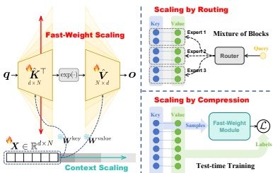

图 1：随着上下文扩展，由全注意力诱导的两层快权重 MLP 的宽度相应增加。我们将高效快权重扩展方法分为两种策略：a) 通过路由扩展，b) 通过压缩扩展，并分别以一种代表性方法说明：MoBA [9] 和 TTT [17]。
 

在本文中，我们首先将快权重扩展视角提升为一个五维分类法，它容纳了广泛范围的先前高效注意力方法（见表 1）。虽然这样的分类法绝不算完整，但它为统一框架铺平了道路，并作为一个有用的设计原则。然后，我们提出 Mixture-of-Top-$k$ Attention (MiTA)，它使用一小组路标查询来收集 top-$k$ 被注意到的键值对，作为查询感知且可变形的路由专家，同时将 $N$-宽度 MLP 压缩为一个更窄的共享专家。因此，我们的 MiTA 将先前 MoE 注意力的灵活性从刚性专家提升为查询感知且可变形的专家，并将先前 top-$k$ 注意力的可扩展性从 $N$ 个私有（即查询特定的）集合提升为可调数量的 $m$ 个可复用 top-$k$ 集合；并且 b) 将两种扩展策略，即路由和压缩，结合在一起，从而解决了分类法中识别出的局限。

具体来说，我们的 MiTA 使用路标查询来查询原始键值对，以获得相应的路标值。得到的路标查询-值对（即压缩后的键值对）构成共享专家，其中路标查询作为键，路标值作为值。同时，MiTA 通过收集每个路标查询所注意到的 top-$k$ 键值对，将原始键值对重新组织为路由专家。如图 2 所示，对于每个查询，MiTA 将这些压缩后的键值对与原始键值对的一个路由子集拼接起来。

##### 贡献。本文的贡献有三方面：

1. 在概念上，我们引入了一个统一视角，将高效注意力机制视为扩展快权重，系统地将现有方法组织为一个五维分类法，并自然地揭示其局限：专家的刚性、top-k 集合的不可复用性，以及结合路由与压缩的必要性。

2. 在技术上，我们提出了一种新颖的高效注意力机制 MiTA，它构造可调数量的查询感知、可变形专家（等价于可复用且可路由的 top-k 集合），并通过路由和压缩两种方式实现可扩展的快权重，从而以一种有原则的方式解决这些局限。

3. 在实验上，我们在视觉任务上验证了 MiTA 的有效性和效率，表明我们的 MiTA 以更少的墙钟时间大幅超越强基线，并高效地在相当程度上逼近全注意力的表达能力。

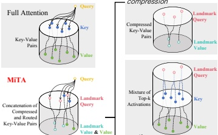

图 2：我们的 MiTA 图示。在全注意力中，每个查询注意所有键值对。在我们的 MiTA 中，它注意少量（如上所示 3 个）压缩键值对与原始键值对的一个路由子集（如上所示 2 个）的拼接。
 

## 2 相关工作

### 2.1 快权重扩展

与慢权重（即在训练后保持不变并编码持久知识的模型参数）不同，快权重是输入条件化的，并充当临时参数。它们可以看作短期记忆 [28]，在元学习 [29] 中起着重要作用。虽然大多数扩展工作集中于扩展慢权重（例如增加模型宽度和深度）[30, 31]，但扩展 Transformers 的序列长度实际上隐式地扩展了快权重。

例如，测试时训练（TTT）[17] 有效地将全注意力中的 $N$-宽度两层快权重 MLP 压缩为一个更小的快权重模块，线性注意力 [12] 同样被压缩为一个线性层 [5]，Linformer [14] 被压缩为一个更窄的 MLP。MoE 注意力不是通过压缩完整快权重 MLP 来扩展，而是将其分解为专家，并通过路由稀疏地访问它们。

我们的 MiTA 结合了上述两种策略。它将完整键值对压缩为一个更小的集合（一个更窄的 MLP），提供了一个粗糙但全局的摘要，然后利用路标查询的 top-k 激活来识别底层专家，从而实现精确检索。

### 2.2 受 MoE 启发的稀疏注意力

先前的稀疏注意力方法通常关注固定稀疏模式的设计（例如局部窗口、轴向条带 [32] 和垂直斜线模式 [33]）或可学习的模式（例如哈希桶 [34] 和 k-means 聚类 [35]）。为了保持全局连通性，还引入了共享记忆（即注意所有 token 且被所有 token 注意的 token）[36]。然而，这些模式要么依赖于任务 [37]，要么过于繁重而无法实现墙钟时间加速 [38]。

最近，受混合专家（MoE）启发的稀疏注意力已被应用于大语言模型的预训练，以更少的开销产生扩展的有效上下文 [9, 10]。其关键优势是路由机制，它能在键值缓存内实现查询感知的选择。因此，尽管选择粒度粗糙（例如均匀划分、不重叠的块），稀疏模式却高度灵活，并且可以因查询而异。

在本文中，我们认为，除了路由之外，专家也可以是查询感知且可变形的。具体来说，对于任意长的序列，我们可以通过收集语义相关的键值对来构建固定但可配置数量的专家。一个动机类似的研究方向是用可变形、内容自适应的 token 化方案 [40] 取代 ViTs [39] 中固定、不重叠的矩形分块。

### 2.3 可变形注意力

更广泛地说，作为 MoE 背后的思想，条件计算已通过卷积神经网络中的可变形卷积 [41] 得到探索。可变形注意力由 Zhu 等人 [18] 引入用于目标检测，随后由 Xia 等人 [19] 推广到视觉 Transformer。给定一个查询，可变形注意力虽然对键是盲的，但会预测相对于一小组默认键位置的偏移量，从而诱导出查询感知、可变形的稀疏注意力模式（即我们语境中的快权重专家）。

最近的 top-$k$ 注意力方法，例如 Spark Attention [21] 和 DeepSeek Sparse Attention [22]，分别已被应用于 Gemma 3n 和 DeepSeek-V3.2 的训练，也可以看作改进的可变形注意力。与先前可变形注意力仅从查询预测空间位置不同，这些方法通过允许每个查询对完整键进行轻量略读（例如使用部分特征 [21] 或低精度 (FP8) [22]）来定位 top-$k$ 键值对。

我们的 MiTA 保留了 top-k 注意力的关键优势，即构造同时依赖于查询和键的可变形专家（即稀疏模式）。然而，与上述方法不同，我们用更高效的、对可复用稀疏模式的逐查询路由，取代了逐查询偏移预测 [18, 19] 或轻量略读 [21, 22]，从而进一步提高了可扩展性。

## 3 方法

### 3.1 高效注意力作为快权重扩展

本小节首先给出等价于全注意力的快权重 MLP 的数学表述，然后将高效注意力重新解释为一个快权重扩展问题。从这个视角出发，将给出一个关于先前高效注意力方法如何扩展快权重的分类法。

快权重 MLP。
形式上，全注意力（即缩放点积注意力 [42]）可以写为：

$$  \mathrm{A t t e n}(\boldsymbol{q},\boldsymbol{K},\boldsymbol{V})=\boldsymbol{V}\mathrm{s o f t m a x}\left(\boldsymbol{K}^{\top}\boldsymbol{q}/\sqrt{d}\right),   \tag*{(1)}$$

其中 $q \in \mathbb{R}^d$ 是一个查询，而 $K$, $V \in \mathbb{R}^{d \times N}$ 的列分别是键和值。相比之下，一个 $D$宽度两层 MLP，即 Transformers 中的前馈网络（FFN），为：

 $$ \mathrm{M L P}_{\sigma}(\boldsymbol{x}\mid\boldsymbol{W}_{1};\boldsymbol{W}_{2})=\boldsymbol{W}_{2}\sigma\left(\boldsymbol{W}_{1}^{\top}\boldsymbol{x}+\boldsymbol{b}_{1}\right)+\boldsymbol{b}_{2}, $$ 

其中 $\boldsymbol{x} \in \mathbb{R}^d$ 是输入向量，$\boldsymbol{W}_1, \boldsymbol{W}_2 \in \mathbb{R}^{d \times D}$ 是权重，$\boldsymbol{b}_1 \in \mathbb{R}^D$ 和 $\boldsymbol{b}_2 \in \mathbb{R}^d$ 是偏置 $^1$，$\boldsymbol{\sigma}(\cdot)$ 是逐元素激活函数（例如 ReLU）。注意式 (1) 中的全注意力等价于以下 MLP：

$$  \mathrm{M L P}_{\mathrm{e x p}}(\boldsymbol{q}\mid\hat{\boldsymbol{K}};\hat{\boldsymbol{V}})=\hat{\boldsymbol{V}}\exp\left(\hat{\boldsymbol{K}}^{\top}\boldsymbol{q}\right),   \tag*{(3)}$$

$$  \hat{\boldsymbol{K}}=\boldsymbol{K}/\sqrt{d},\hat{\boldsymbol{V}}=\boldsymbol{V}/\left(\exp(\hat{\boldsymbol{K}}^{\top}\boldsymbol{q})^{\top}\mathbf{1}_{N}\right),   \tag*{(4)}$$

其中权重由缩放后的键和值给出，偏置全为零，激活函数是指数函数 $\exp(\cdot)$。因此，我们证明了式 (1) 中的全注意力等价于式 (3) 中的 $N$-宽度、快权重、两层 MLP。

无界快权重扩展。由于式 (3) 中快权重 MLP 的隐藏维度始终等于序列长度 $N$，逐查询开销随 $N$ 线性增长，而不是像式 (2) 中的慢权重 MLP 那样固定。因此，在全对全查找范式下，处理 $N$ 个查询会产生总计 $\mathcal{O}(N^2)$ 的开销。这种无界、快速的增长阻止了将快权重扩展到任意长的序列。虽然在高效注意力的文献中这一挑战通常被描述为全注意力的二次复杂度，但我们将其称为无界快权重扩展问题。

快权重扩展分类法。尽管我们已在第 2 节讨论了相关的高效注意力方法，但它们尚未被系统地组织到一个统一的快权重扩展视角中。因此，我们提出一个五维分类法：a) 扩展策略，即扩展 $N$-宽度快权重 MLP，要么将其压缩为一个轻量模块，要么将每个查询路由到其子集；b) 专家数量，即构造了多少个快权重专家（特别地，通过压缩扩展通常产生单个共享专家）；c) 专家类型，即每个专家采用什么模块（例如 MLP 或线性层）；d) 专家构造，即如何从键值对形成专家；以及 e) 路由拓扑，即查询-专家的分配模式。现有方法到该分类法的映射总结在表 1 中。我们将深入讨论推迟到附录 B。

### 3.2 Mixture-of-Top-k Attention (MiTA)

受通过我们的快权重扩展视角识别出的局限所启发，我们的方法有两个设计目标：a) 从刚性专家转向查询感知、可变形专家，并从私有（即查询特定的）键值对转向可复用的 top-k 键值对；以及 b) 结合压缩和路由。我们从更简单的第二个目标开始，并表明它自然导向更重要的第一个目标。

注意，通过压缩扩展和通过路由扩展都有其固有的局限。压缩完整快权重 MLP 不可避免地会丢弃信息，尽管信息损失可以通过采用更温和的压缩方案（例如分段压缩 [13]）或压缩到一个更具表达力的模块（例如通过测试时训练 [17]）来缓解。相比之下，通过路由扩展是忠实且无损的，但通常缺乏对上下文的全局视图。

为了结合两种策略的优势，即在保留紧凑全局摘要的同时实现精确的 token 级检索，我们引入一小组路标查询 $\tilde{Q} \in \mathbb{R}^{d \times m}$，其中 $m \ll N$。这些路标查询探测完整的键值缓存，然后通过交叉注意力将其压缩为一个全局快权重模块，同时通过收集每个路标查询的 top- $k$ 激活（即被注意到的）键值对来形成可变形快权重专家。

这一设计受两个观察的启发：a) 寄存器 token 可以注意到图像中不同的语义区域 [43]；以及 b) 类别嵌入 [44]（或目标查询 [45] 和掩码嵌入 [46]）为密集预测任务 [47] 甚至图像生成 [48] 提供了紧凑的全局摘要。路标查询可以通过多种方式获得，例如通过分配一

专家内的键值条目
 

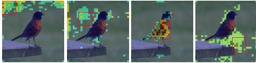

路由到该专家的查询
 

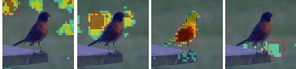

图 3：专家收集的键值对以及被路由的查询的可视化。红框标记了通过平均池化获得路标查询的局部窗口。注意力热力图（在注意力头上平均）指示每个专家内的键值对（上排）以及路由到它的查询（下排）。值得注意的是，专家的键值对和路由的查询都不局限于局部窗口。
 

组可学习的慢权重，或者通过使用卷积模块对序列进行下采样。在本工作中，我们简单地对均匀间隔、等大小的窗口应用平均池化，如图 3 所示。

具体来说，第 $i$ 个路标查询 $\tilde{q}_{i}$（共 $m$ 个）如下定义第 $i$ 个专家 $\mathcal{E}_{i}$：

$$  \mathcal{E}_{i}(\boldsymbol{q})=\mathrm{A t t e n}(\boldsymbol{q},\boldsymbol{K}^{(i)},\boldsymbol{V}^{(i)}),\;i\in\{1,\ldots,m\},   \tag*{(5)}$$

$$  \boldsymbol{K}^{(i)}=\boldsymbol{K}_{:,{\mathcal{I}}_{i}},~V^{(i)}=V_{:,{\mathcal{I}}_{i}}\in\mathbb{R}^{d\times k},   \tag*{(6)}$$

$$  \mathcal{I}_{i}=\mathrm{T o p}_{k}\left(\boldsymbol{K}^{\top}\tilde{\boldsymbol{q}}_{i}\right)\in\{1,\ldots,N\}^{k},   \tag*{(7)}$$

其中 $q$ 是路由到专家 $\mathcal{E}_i$ 的查询，$K^{(i)}$, $V^{(i)}$ 是由 $\tilde{q}_i$ 激活的 top- $k$ 键值对。这种方法有效地将完整键值对重新组织为 top- $k$ 键值对的混合（即一个可变形专家的混合）。我们直接使用 $\tilde{q}_i$ 作为专家 $\mathcal{E}_i$ 的路由向量。那么从 $N$ 个查询 $Q \in \mathbb{R}^{d \times N}$ 到 $m$ 个专家的路由 logits 为 $Q^\top \tilde{Q} \in \mathbb{R}^{N \times m}$。我们将查询 $q$ 在这些 logits 下被路由到的第 $j$ 个专家的索引记为 $e_j(q) \in \{1, \ldots, m\}$。

此外，关于可以看作共享专家 [49] 的压缩全局模块，我们使用路标查询通过交叉注意力提取一小组路标值 $\tilde{V} \in \mathbb{R}^{d \times m}$。对应于第 $i$ 个路标查询的第 $i$ 个路标值由下式给出：

$$  \tilde{\boldsymbol{v}}_{i}=\mathrm{A t t e n}(\tilde{\boldsymbol{q}}_{i},\boldsymbol{K},\boldsymbol{V}).   \tag*{(8)}$$

然后，共享专家 $\tilde{\mathcal{E}}$ 定义为：

$$  \tilde{\mathcal{E}}(\boldsymbol{q})=\mathrm{A t t e n}(\boldsymbol{q},\tilde{\boldsymbol{Q}},\tilde{\boldsymbol{V}}),   \tag*{(9)}$$

其中路标查询在标准注意力中充当键。注意，式 (7) 和式 (8) 中的计算可以在很大程度上共享，其中路标查询都在查询键。同样，式 (9) 可以复用路由 logits。因此，两种扩展策略的计算在我们的 MiTA 中紧密耦合。

我们不是采用一种直接的 MoE 实现（它在每个专家内部隔离计算并通过加权和聚合它们的输出），而是将专家拼接为单个标准注意力，如图 2 所示。因此，我们的 MiTA 可以写为：

$$  \mathrm{M i T A}(\boldsymbol{q})=\boldsymbol{V}^{\star}\operatorname{s o f t m a x}(\boldsymbol{K}^{\star}{}^{\top}\boldsymbol{q}/\sqrt{d}),   \tag*{（10）}$$

$$  K^{\star}=[\tilde{Q},K^{(e_{1}(q))},\ldots,K^{(e_{s}(q))}],   \tag*{（11）}$$

$$  V^{\star}=[\tilde{V},V^{(e_{1}(q))},\ldots,V^{(e_{s}(q))}],   \tag*{（12）}$$

其中 $K^\star, V^\star \in \mathbb{R}^{d \times (m+ks)}$ 是查询 $q$ 在我们的 MiTA 中注意的键值对，$s$ 是每个查询被路由到的专家数量（不计共享专家）。注意，在实践中，得益于在线 softmax [50]，注意力仍然可以按专家计算然后组合，正如 Lu 等人 [9] 的 FlashAttention [51] 实现那样。

实现。MiTA 概念上简单但有效，但在技术上要真正实现墙钟时间加速并非易事。特别地，我们以 $s = 1$（如 Llama 4）实现式 (10) 中的 MiTA，即每个查询被送入共享专家，并恰好被路由到一个额外的快权重专家。我们 MiTA 的伪代码见算法 1（附录 B），它通过根据专家的分配 $e_1(q)$ 对查询排序来将查询与专家匹配。更一般但更复杂的 $s > 1$ 情况可以通过 MoBA [9] 实现，代价是速度降低。

复杂度分析。仅式 (10) 的计算复杂度为 $\mathcal{O}(N(m+ks))$，而全注意力产生 $\mathcal{O}(N^2)$；在实践中，$N \gg m + ks$。此外，式 (8) 和式 (10) 中的交叉注意力操作可以通过 FlashAttention 系列 [38, 51, 52] 加速。主要瓶颈来自式 (6) 中的 gather（收集）操作：它涉及不规则（随机）内存访问，因此很可能使整个流水线成为内存受限的。尽管如此，Deepseek Sparse Attention 表明这一局限可以通过其优化实现 [22, Fig. 3] 来缓解。此外，与先前的 top- $k$ 注意力 [21, 22]（它为每个查询实例化一个私有快权重专家，共 $N$ 个专家）且没有路由不同，我们的 MiTA 使用固定（但可调）数量（即 $m$）的快权重专家，这更硬件友好，代价是一个 $N$-到-$m$ 的路由步骤，这一点在 MoBA [9] 中已有探索。总之，MiTA 所需的硬件操作已由先前的工程导向工作验证，这使我们能够聚焦于快权重扩展视角、其分类法、可调数量的查询感知、可变形快权重专家的构造，以及压缩与路由的结合。

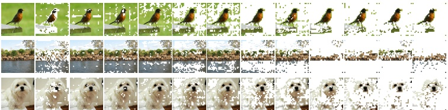

图 4：MiTA 的 token 剪枝效应。每一行可视化每一层中被选为专家的键值对（在头上聚合）的位置；最左边的图像显示原始输入。在后面的层中，大多数 token 被有效"剪枝"（即未被选为专家），注意力集中在与类别相关的区域。这些示例从 ImageNet-1K 训练集中采样。
 

## 4 实验

为了验证我们的 MiTA 的效果，我们在 ImageNet-1K [53] 上进行图像分类实验，并在 ADE20K [54] 上进行语义分割实验。此外，我们在 Long Range Arena 基准 [55] 上评估 MiTA 的长序列建模能力，并报告其在极长序列上相对于全注意力的墙钟训练/推理速度。详细的消融研究见附录 A。此外，我们在固定训练模型下研究 MiTA 在变化专家数量 (m) 和宽度 (k) 下的鲁棒性（或泛化性），并考察 Transformers 跨注意力机制的更广泛的算法泛化；细节见附录 C。

表 2：从头训练在 ImageNet-1K 上的结果。Bias：使用 agent bias [16]；DWC：使用深度可分离卷积；Gate：以数据相关门控将注意力输出加到残差上。PolaFormer [56]、MHLA [13] 和 FLatten [57] 是线性注意力的变体。BRA [20] 和 Agent Attention [16] 可以看作 MiTA 的退化情形，分别仅通过路由和仅通过压缩扩展。
 

<table border=1 style='margin: auto; word-wrap: break-word;'><tr><td style='text-align: center; word-wrap: break-word;'>方法</td><td style='text-align: center; word-wrap: break-word;'># 参数</td><td style='text-align: center; word-wrap: break-word;'>FLOPs</td><td style='text-align: center; word-wrap: break-word;'>准确率 (%)</td></tr><tr><td style='text-align: center; word-wrap: break-word;'>DeiT-T</td><td style='text-align: center; word-wrap: break-word;'>5.7M</td><td style='text-align: center; word-wrap: break-word;'>1.2G</td><td style='text-align: center; word-wrap: break-word;'>72.2</td></tr><tr><td style='text-align: center; word-wrap: break-word;'>Linear-DeiT-T</td><td style='text-align: center; word-wrap: break-word;'>5.7M</td><td style='text-align: center; word-wrap: break-word;'>1.1G</td><td style='text-align: center; word-wrap: break-word;'>68.0</td></tr><tr><td style='text-align: center; word-wrap: break-word;'>PolaFormer-DeiT-T</td><td style='text-align: center; word-wrap: break-word;'>5.7M</td><td style='text-align: center; word-wrap: break-word;'>1.2G</td><td style='text-align: center; word-wrap: break-word;'>68.1</td></tr><tr><td style='text-align: center; word-wrap: break-word;'>MHLA-DeiT-T</td><td style='text-align: center; word-wrap: break-word;'>5.7M</td><td style='text-align: center; word-wrap: break-word;'>1.1G</td><td style='text-align: center; word-wrap: break-word;'>69.2</td></tr><tr><td style='text-align: center; word-wrap: break-word;'>Flatten-DeiT-T</td><td style='text-align: center; word-wrap: break-word;'>6.1M</td><td style='text-align: center; word-wrap: break-word;'>1.1G</td><td style='text-align: center; word-wrap: break-word;'>70.2</td></tr><tr><td style='text-align: center; word-wrap: break-word;'>BRA-DeiT-T</td><td style='text-align: center; word-wrap: break-word;'>5.7M</td><td style='text-align: center; word-wrap: break-word;'>1.1G</td><td style='text-align: center; word-wrap: break-word;'>70.2</td></tr><tr><td style='text-align: center; word-wrap: break-word;'>Agent-DeiT-T</td><td style='text-align: center; word-wrap: break-word;'>5.7M</td><td style='text-align: center; word-wrap: break-word;'>1.1G</td><td style='text-align: center; word-wrap: break-word;'>70.3</td></tr><tr><td style='text-align: center; word-wrap: break-word;'>Agent-DeiT-T $^{Bias}$</td><td style='text-align: center; word-wrap: break-word;'>6.0M</td><td style='text-align: center; word-wrap: break-word;'>1.2G</td><td style='text-align: center; word-wrap: break-word;'>71.1</td></tr><tr><td style='text-align: center; word-wrap: break-word;'>MiTA-DeiT-T</td><td style='text-align: center; word-wrap: break-word;'>5.7M</td><td style='text-align: center; word-wrap: break-word;'>1.1G</td><td style='text-align: center; word-wrap: break-word;'>71.1 (-1.1)</td></tr><tr><td style='text-align: center; word-wrap: break-word;'>MiTA-DeiT-T $^{DWC}$</td><td style='text-align: center; word-wrap: break-word;'>5.7M</td><td style='text-align: center; word-wrap: break-word;'>1.1G</td><td style='text-align: center; word-wrap: break-word;'>73.4 (+1.2)</td></tr><tr><td style='text-align: center; word-wrap: break-word;'>DeiT-S</td><td style='text-align: center; word-wrap: break-word;'>22M</td><td style='text-align: center; word-wrap: break-word;'>4.6G</td><td style='text-align: center; word-wrap: break-word;'>79.9</td></tr><tr><td style='text-align: center; word-wrap: break-word;'>Agent-DeiT-S</td><td style='text-align: center; word-wrap: break-word;'>22M</td><td style='text-align: center; word-wrap: break-word;'>4.4G</td><td style='text-align: center; word-wrap: break-word;'>78.5</td></tr><tr><td style='text-align: center; word-wrap: break-word;'>Agent-DeiT-S $^{Bias}$</td><td style='text-align: center; word-wrap: break-word;'>23M</td><td style='text-align: center; word-wrap: break-word;'>4.4G</td><td style='text-align: center; word-wrap: break-word;'>79.1</td></tr><tr><td style='text-align: center; word-wrap: break-word;'>MiTA-DeiT-S</td><td style='text-align: center; word-wrap: break-word;'>22M</td><td style='text-align: center; word-wrap: break-word;'>4.4G</td><td style='text-align: center; word-wrap: break-word;'>79.8 (-0.1)</td></tr><tr><td style='text-align: center; word-wrap: break-word;'>MiTA-DeiT-S $^{DWC}$</td><td style='text-align: center; word-wrap: break-word;'>22M</td><td style='text-align: center; word-wrap: break-word;'>4.4G</td><td style='text-align: center; word-wrap: break-word;'>80.6 (+0.7)</td></tr><tr><td style='text-align: center; word-wrap: break-word;'>MiTA-DeiT-S $^{DWC}$, Gate</td><td style='text-align: center; word-wrap: break-word;'>22M</td><td style='text-align: center; word-wrap: break-word;'>4.7G</td><td style='text-align: center; word-wrap: break-word;'>81.2 (+1.3)</td></tr></table>

表 3：在 ImageNet-1K 上与 SOTA 和高效 ViT 的比较。我们与最近的先进 ViT 变体 ViT-5 [58]，以及 DeiT 和 DeiT-III [59] 等强基线进行比较。我们还纳入高效 ViT，包括稀疏模型（SViTE [60] 和 Sparsifiner [61]）和通过压缩扩展的模型（InLine [62] 和 Agent Attention）。
 

<table border=1 style='margin: auto; word-wrap: break-word;'><tr><td style='text-align: center; word-wrap: break-word;'>方法</td><td style='text-align: center; word-wrap: break-word;'># 参数</td><td style='text-align: center; word-wrap: break-word;'>FLOPs</td><td style='text-align: center; word-wrap: break-word;'>准确率 (%)</td></tr><tr><td style='text-align: center; word-wrap: break-word;'>ViT-5-S</td><td style='text-align: center; word-wrap: break-word;'>22M</td><td style='text-align: center; word-wrap: break-word;'>4.7G</td><td style='text-align: center; word-wrap: break-word;'>82.2</td></tr><tr><td style='text-align: center; word-wrap: break-word;'>DeiT-S</td><td style='text-align: center; word-wrap: break-word;'>22M</td><td style='text-align: center; word-wrap: break-word;'>4.6G</td><td style='text-align: center; word-wrap: break-word;'>79.9</td></tr><tr><td style='text-align: center; word-wrap: break-word;'>DeiT-III-S</td><td style='text-align: center; word-wrap: break-word;'>22M</td><td style='text-align: center; word-wrap: break-word;'>4.6G</td><td style='text-align: center; word-wrap: break-word;'>81.4</td></tr><tr><td style='text-align: center; word-wrap: break-word;'>SViTE-S</td><td style='text-align: center; word-wrap: break-word;'>11M</td><td style='text-align: center; word-wrap: break-word;'>2.5G</td><td style='text-align: center; word-wrap: break-word;'>79.7</td></tr><tr><td style='text-align: center; word-wrap: break-word;'>Sparsifiner-S</td><td style='text-align: center; word-wrap: break-word;'>23M</td><td style='text-align: center; word-wrap: break-word;'>4.5G</td><td style='text-align: center; word-wrap: break-word;'>79.9</td></tr><tr><td style='text-align: center; word-wrap: break-word;'>InLine-DeiT-S</td><td style='text-align: center; word-wrap: break-word;'>17M</td><td style='text-align: center; word-wrap: break-word;'>5.0G</td><td style='text-align: center; word-wrap: break-word;'>80.2</td></tr><tr><td style='text-align: center; word-wrap: break-word;'>Agent-DeiT-S $^{Bias,DWC}$</td><td style='text-align: center; word-wrap: break-word;'>23M</td><td style='text-align: center; word-wrap: break-word;'>4.4G</td><td style='text-align: center; word-wrap: break-word;'>80.5</td></tr><tr><td style='text-align: center; word-wrap: break-word;'>MHLA-DeiT-S $^{DWC}$</td><td style='text-align: center; word-wrap: break-word;'>22M</td><td style='text-align: center; word-wrap: break-word;'>4.2G</td><td style='text-align: center; word-wrap: break-word;'>81.0</td></tr><tr><td style='text-align: center; word-wrap: break-word;'>MiTA-ViT-5-S</td><td style='text-align: center; word-wrap: break-word;'>22M</td><td style='text-align: center; word-wrap: break-word;'>4.5G</td><td style='text-align: center; word-wrap: break-word;'>81.3 (-0.9)</td></tr><tr><td style='text-align: center; word-wrap: break-word;'>MiTA-ViT-5-S $^{DWC}$</td><td style='text-align: center; word-wrap: break-word;'>22M</td><td style='text-align: center; word-wrap: break-word;'>4.5G</td><td style='text-align: center; word-wrap: break-word;'>81.7 (-0.5)</td></tr></table>

表 4：ADE20K 语义分割结果。$\triangledown$：注意力机制被直接替换，而非原生预训练。Mask Transformer 是开创性工作 Segmenter [44] 为基于 Transformer 的分割引入的解码器，而 DEPICT [47] 和 CBT [63] 是对它的两项有原则的改进。
 

<table border=1 style='margin: auto; word-wrap: break-word;'><tr><td style='text-align: center; word-wrap: break-word;'>骨干网络</td><td style='text-align: center; word-wrap: break-word;'>分割头</td><td style='text-align: center; word-wrap: break-word;'>分辨率</td><td style='text-align: center; word-wrap: break-word;'>FLOPs</td><td style='text-align: center; word-wrap: break-word;'>mIoU (%)</td></tr><tr><td style='text-align: center; word-wrap: break-word;'>ViT-T</td><td style='text-align: center; word-wrap: break-word;'>Mask Trans.</td><td style='text-align: center; word-wrap: break-word;'>$512^{2}$</td><td style='text-align: center; word-wrap: break-word;'>13G</td><td style='text-align: center; word-wrap: break-word;'>38.1</td></tr><tr><td style='text-align: center; word-wrap: break-word;'>ViT-T</td><td style='text-align: center; word-wrap: break-word;'>DEPICT</td><td style='text-align: center; word-wrap: break-word;'>$512^{2}$</td><td style='text-align: center; word-wrap: break-word;'>13G</td><td style='text-align: center; word-wrap: break-word;'>39.3</td></tr><tr><td style='text-align: center; word-wrap: break-word;'>ViT-T</td><td style='text-align: center; word-wrap: break-word;'>CBT</td><td style='text-align: center; word-wrap: break-word;'>$512^{2}$</td><td style='text-align: center; word-wrap: break-word;'>12G</td><td style='text-align: center; word-wrap: break-word;'>39.1</td></tr><tr><td style='text-align: center; word-wrap: break-word;'>MiTA-ViT-T $^{\nabla}$</td><td style='text-align: center; word-wrap: break-word;'>CBT</td><td style='text-align: center; word-wrap: break-word;'>$512^{2}$</td><td style='text-align: center; word-wrap: break-word;'>7G ( $\downarrow$42%)</td><td style='text-align: center; word-wrap: break-word;'>36.5 (-2.6)</td></tr><tr><td style='text-align: center; word-wrap: break-word;'>ViT-S</td><td style='text-align: center; word-wrap: break-word;'>Mask Trans.</td><td style='text-align: center; word-wrap: break-word;'>$512^{2}$</td><td style='text-align: center; word-wrap: break-word;'>38G</td><td style='text-align: center; word-wrap: break-word;'>45.3</td></tr><tr><td style='text-align: center; word-wrap: break-word;'>ViT-S</td><td style='text-align: center; word-wrap: break-word;'>DEPICT</td><td style='text-align: center; word-wrap: break-word;'>$512^{2}$</td><td style='text-align: center; word-wrap: break-word;'>35G</td><td style='text-align: center; word-wrap: break-word;'>46.7</td></tr><tr><td style='text-align: center; word-wrap: break-word;'>ViT-S</td><td style='text-align: center; word-wrap: break-word;'>CBT</td><td style='text-align: center; word-wrap: break-word;'>$512^{2}$</td><td style='text-align: center; word-wrap: break-word;'>33G</td><td style='text-align: center; word-wrap: break-word;'>45.8</td></tr><tr><td style='text-align: center; word-wrap: break-word;'>MiTA-ViT-S $^{\nabla}$</td><td style='text-align: center; word-wrap: break-word;'>CBT</td><td style='text-align: center; word-wrap: break-word;'>$512^{2}$</td><td style='text-align: center; word-wrap: break-word;'>25G ( $\downarrow$24%)</td><td style='text-align: center; word-wrap: break-word;'>44.5 (-1.3)</td></tr><tr><td style='text-align: center; word-wrap: break-word;'>ViT-B</td><td style='text-align: center; word-wrap: break-word;'>Mask Trans.</td><td style='text-align: center; word-wrap: break-word;'>$512^{2}$</td><td style='text-align: center; word-wrap: break-word;'>128G</td><td style='text-align: center; word-wrap: break-word;'>48.5</td></tr><tr><td style='text-align: center; word-wrap: break-word;'>ViT-B</td><td style='text-align: center; word-wrap: break-word;'>DEPICT</td><td style='text-align: center; word-wrap: break-word;'>$512^{2}$</td><td style='text-align: center; word-wrap: break-word;'>111G</td><td style='text-align: center; word-wrap: break-word;'>49.2</td></tr><tr><td style='text-align: center; word-wrap: break-word;'>ViT-B</td><td style='text-align: center; word-wrap: break-word;'>CBT</td><td style='text-align: center; word-wrap: break-word;'>$512^{2}$</td><td style='text-align: center; word-wrap: break-word;'>111G</td><td style='text-align: center; word-wrap: break-word;'>49.3</td></tr><tr><td style='text-align: center; word-wrap: break-word;'>MiTA-ViT-B $^{\nabla}$</td><td style='text-align: center; word-wrap: break-word;'>CBT</td><td style='text-align: center; word-wrap: break-word;'>$512^{2}$</td><td style='text-align: center; word-wrap: break-word;'>95G ( $\downarrow$14%)</td><td style='text-align: center; word-wrap: break-word;'>48.1 (-1.2)</td></tr><tr><td style='text-align: center; word-wrap: break-word;'>ViT-L</td><td style='text-align: center; word-wrap: break-word;'>Mask Trans.</td><td style='text-align: center; word-wrap: break-word;'>$640^{2}$</td><td style='text-align: center; word-wrap: break-word;'>667G</td><td style='text-align: center; word-wrap: break-word;'>51.8</td></tr><tr><td style='text-align: center; word-wrap: break-word;'>ViT-L</td><td style='text-align: center; word-wrap: break-word;'>DEPICT</td><td style='text-align: center; word-wrap: break-word;'>$640^{2}$</td><td style='text-align: center; word-wrap: break-word;'>628G</td><td style='text-align: center; word-wrap: break-word;'>52.9</td></tr><tr><td style='text-align: center; word-wrap: break-word;'>ViT-L</td><td style='text-align: center; word-wrap: break-word;'>CBT</td><td style='text-align: center; word-wrap: break-word;'>$640^{2}$</td><td style='text-align: center; word-wrap: break-word;'>622G</td><td style='text-align: center; word-wrap: break-word;'>53.3</td></tr><tr><td style='text-align: center; word-wrap: break-word;'>MiTA-ViT-L $^{\nabla}$</td><td style='text-align: center; word-wrap: break-word;'>CBT</td><td style='text-align: center; word-wrap: break-word;'>$640^{2}$</td><td style='text-align: center; word-wrap: break-word;'>508G ( $\downarrow$18%)</td><td style='text-align: center; word-wrap: break-word;'>50.5 (-2.8)</td></tr></table>

基线。注意，并非表 1 中列出的所有方法都包含在我们的实验中，原因如下：(i) 尽管具有代表性，但许多已过时；(ii) 一些专为语言任务设计，因此在我们视觉设定下无法直接比较。尽管如此，我们纳入了与基于相似思想的视觉对应方法的比较。
 

### 4.1 图像分类

当前 ImageNet-1K 上高效注意力的进展通常伴随深度可分离卷积等额外组件，这模糊了所提高效机制与全注意力之间的表达力差距。为此，我们在表 2 中报告公平的比较。具体来说，我们使用 DeiT [64] 配方训练所有模型，仅改变注意力机制。同时，在表 3 中，我们将基于 MiTA 的最佳性能 ViT 变体与先进的和高效的 ViT 进行比较。

实现细节。我们使用 224 的图像尺寸和 16 的 patch 大小，并为 MiTA 设置 s = 1，m = k = 25。$^{2}$ 在此设置下，每个查询注意 m + ks = 50 个键值对。

结果。如表 2 所示，在没有额外组件的情况下，MiTA 以大幅优势超越其他高效注意力（至少 0.8%，最多 3.1%）。尽管 Agent Attention 可以通过使用 agent bias $^{3}$ 缩小差距，但它在小尺寸模型上仍比 MiTA 低 0.7%。此外，这个技巧的一个严重局限是它目前不被 FlashAttention 支持。如表 3 所示，当配备 ViT-5 [58] 中探索的架构修改时，MiTA 超越一系列强 ViT 基线，并以较小的差距逼近最先进性能，同时使用更少的 FLOPs。

### 4.2 语义分割

ADE20K [54] 是一个以场景为中心的语义分割数据集，它需要更高的图像分辨率以保留对象边界等细粒度细节。在表 4 中，我们将 MiTA 应用于骨干网络以进行高效视觉编码，并与具有 ViT 骨干和基于 Transformer 分割头的方法进行比较。

表 5：LRA 基准上的结果。对于每个任务，我们报告准确率和训练吞吐量（步/秒），以及跨任务的平均准确率和总训练墙钟时间（小时）。${}^{\ddagger}$：仅路由变体（即移除了压缩或局部窗口分支），其中通过增加 k 保持每个查询注意的条目数不变。
 

<table border=1 style='margin: auto; word-wrap: break-word;'><tr><td style='text-align: center; word-wrap: break-word;'>方法</td><td style='text-align: center; word-wrap: break-word;'>ListOps (2K)</td><td style='text-align: center; word-wrap: break-word;'>Text (4K)</td><td style='text-align: center; word-wrap: break-word;'>Retrieval (4K)</td><td style='text-align: center; word-wrap: break-word;'>Image (1K)</td><td style='text-align: center; word-wrap: break-word;'>Pathfinder (1K)</td><td style='text-align: center; word-wrap: break-word;'>平均 / 总计</td></tr><tr><td style='text-align: center; word-wrap: break-word;'>Standard Atten</td><td style='text-align: center; word-wrap: break-word;'>37.35/12.7</td><td style='text-align: center; word-wrap: break-word;'>63.63/3.8</td><td style='text-align: center; word-wrap: break-word;'>79.90/1.9</td><td style='text-align: center; word-wrap: break-word;'>40.38/5.7</td><td style='text-align: center; word-wrap: break-word;'>69.68/5.7</td><td style='text-align: center; word-wrap: break-word;'>58.19/10.6</td></tr><tr><td style='text-align: center; word-wrap: break-word;'>Reformer</td><td style='text-align: center; word-wrap: break-word;'>18.55/34.1</td><td style='text-align: center; word-wrap: break-word;'>65.08/16.8</td><td style='text-align: center; word-wrap: break-word;'>78.77/8.5</td><td style='text-align: center; word-wrap: break-word;'>44.04/8.3</td><td style='text-align: center; word-wrap: break-word;'>69.04/8.5</td><td style='text-align: center; word-wrap: break-word;'>55.10/4.5</td></tr><tr><td style='text-align: center; word-wrap: break-word;'>Linformer</td><td style='text-align: center; word-wrap: break-word;'>38.05/35.0</td><td style='text-align: center; word-wrap: break-word;'>56.69/24.6</td><td style='text-align: center; word-wrap: break-word;'>78.41/13.7</td><td style='text-align: center; word-wrap: break-word;'>39.56/11.9</td><td style='text-align: center; word-wrap: break-word;'>67.13/11.9</td><td style='text-align: center; word-wrap: break-word;'>55.97/3.1</td></tr><tr><td style='text-align: center; word-wrap: break-word;'>Performer</td><td style='text-align: center; word-wrap: break-word;'>17.84/28.0</td><td style='text-align: center; word-wrap: break-word;'>65.13/16.5</td><td style='text-align: center; word-wrap: break-word;'>77.18/8.9</td><td style='text-align: center; word-wrap: break-word;'>36.64/8.1</td><td style='text-align: center; word-wrap: break-word;'>70.20/8.0</td><td style='text-align: center; word-wrap: break-word;'>53.40/4.7</td></tr><tr><td style='text-align: center; word-wrap: break-word;'>Nyströmformer</td><td style='text-align: center; word-wrap: break-word;'>29.69/22.0</td><td style='text-align: center; word-wrap: break-word;'>65.84/16.7</td><td style='text-align: center; word-wrap: break-word;'>79.68/8.8</td><td style='text-align: center; word-wrap: break-word;'>36.83/4.5</td><td style='text-align: center; word-wrap: break-word;'>72.50/4.5</td><td style='text-align: center; word-wrap: break-word;'>56.91/7.3</td></tr><tr><td style='text-align: center; word-wrap: break-word;'>Agent Atten</td><td style='text-align: center; word-wrap: break-word;'>36.59/40.1</td><td style='text-align: center; word-wrap: break-word;'>63.86/38.9</td><td style='text-align: center; word-wrap: break-word;'>79.98/24.3</td><td style='text-align: center; word-wrap: break-word;'>38.92/19.5</td><td style='text-align: center; word-wrap: break-word;'>71.77/19.1</td><td style='text-align: center; word-wrap: break-word;'>58.22/1.9</td></tr><tr><td style='text-align: center; word-wrap: break-word;'>MoBA $^{\ddagger}$</td><td style='text-align: center; word-wrap: break-word;'>37.10/30.4</td><td style='text-align: center; word-wrap: break-word;'>62.35/15.8</td><td style='text-align: center; word-wrap: break-word;'>76.64/8.2</td><td style='text-align: center; word-wrap: break-word;'>37.92/8.6</td><td style='text-align: center; word-wrap: break-word;'>69.67/8.4</td><td style='text-align: center; word-wrap: break-word;'>56.74/4.6</td></tr><tr><td style='text-align: center; word-wrap: break-word;'>MiTA $^{\ddagger}$</td><td style='text-align: center; word-wrap: break-word;'>37.20/25.4</td><td style='text-align: center; word-wrap: break-word;'>64.09/22.2</td><td style='text-align: center; word-wrap: break-word;'>79.92/13.1</td><td style='text-align: center; word-wrap: break-word;'>40.17/5.3</td><td style='text-align: center; word-wrap: break-word;'>72.66/6.3</td><td style='text-align: center; word-wrap: break-word;'>58.81/5.5</td></tr><tr><td style='text-align: center; word-wrap: break-word;'>MiTA</td><td style='text-align: center; word-wrap: break-word;'>37.20/52.2( $\times 4.1$)</td><td style='text-align: center; word-wrap: break-word;'>63.47/37.7( $\times 9.9$)</td><td style='text-align: center; word-wrap: break-word;'>79.88/19.6( $\times 10.3$)</td><td style='text-align: center; word-wrap: break-word;'>40.72/13.6( $\times 2.4$)</td><td style='text-align: center; word-wrap: break-word;'>73.26/15.3( $\times 2.7$)</td><td style='text-align: center; word-wrap: break-word;'>58.91/2.4( $\downarrow 77\%$)</td></tr></table>

实现细节。ViT 骨干 [65] 在 ImageNet-21K 上以 384 的图像尺寸和 16 的 patch 大小预训练。在 ADE20K 上训练时我们使用一致的 16 的 patch 大小，并为 MiTA 设置 $s = 1$，$m = k = 49$。在此设置下，每个查询注意 $m + ks = 98$ 个键值对，而在全注意力中为 1,024（对于 $512^2$ 图像分辨率）或 1,600（$640^2$ 分辨率）。

结果。如表 4 所示，MiTA 显著降低了 FLOPs（最多 42%），同时实现了可比较的分割性能。注意 MiTA 在此并未被充分利用，因为骨干网络并非用它原生预训练。

### 4.3 长序列评估

作为长序列建模的初步验证，我们在 Long Range Arena (LRA) 基准 [55] 上评估 MiTA，并与若干经典高效注意力方法 [34, 14, 66, 67] 进行比较。我们在表 5 中报告它们在 LRA 上的准确率和训练吞吐量（以及墙钟时间），而 MiTA 相对标准注意力的推理吞吐量提升如图 5 所示。

实现细节。训练配置遵循 Xiong 等人 [67]，超参数在所有方法间保持一致以进行公平比较。因此，所报告的准确率未经过调优以充分利用每种方法的最佳性能。我们为 MiTA 设置 s = 1 和 m = k = 128。表 5 和图 5 中报告的吞吐量和墙钟时间是在 24GB RTX 4090 上测量的。标准注意力使用 PyTorch 的融合内核（即 FlashAttention）实现。更具体地说，图 5 中的结果是在嵌入维度为 128 的三层 Transformer 上测量的，批大小针对每次运行进行调整以最大化吞吐量。

结果。如表 5 所示，MiTA 实现了与标准注意力相当的准确率，同时提供了大幅加速，将总训练时间减少了 77%。值得注意的是，MiTA 的仅路由变体也表现良好但更慢，因为收集更多键值对会产生更高开销。这表明，使用一个共享的、压缩的键值对集合可以有效地表示数千个被路由的原始对。

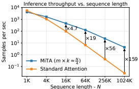

图 5：推理吞吐量。
 

## 5 结论

我们采用快权重扩展作为高效注意力的统一视角，并引入一个五维分类法来识别先前方法的局限。此外，我们提出了一种新颖的高效注意力方法，称为 Mixture-of-Top-$k$ Attention (MiTA)，它构造可调数量的查询感知且可变形的快权重专家，并将两种不同的扩展策略桥接在一起，从而解决它们固有的局限。我们对分类法和我们的 MiTA 都进行了详细分析，从快权重扩展视角为开发高效注意力提出了一条有原则且有前景的路径。

## 参考文献

[1] Alberto Bietti, Vivien Cabannes, Diane Bouchacourt, Hervé Jégou, and Léon Bottou. Birth of a transformer: A memory viewpoint. In NeurIPS, 2023.

[2] Jintao Zhang, Rundong Su, Chunyu Liu, Jia Wei, Ziteng Wang, Pengle Zhang, Haoxu Wang, Huiqiang Jiang, Haofeng Huang, Chendong Xiang, Haocheng Xi, Shuo Yang, Xingyang Li, Yuezhou Hu, Tianyu Fu, Tianchen Zhao, Yicheng Zhang, Youhe Jiang, Chang Chen, Kai Jiang, Huayu Chen, Min Zhao, Xiaoming Xu, Jun Zhu, and Jianfei Chen. A survey of efficient attention methods: Hardware-efficient, sparse, compact, and linear attention. 2025.

[3] Mor Geva, Roei Schuster, Jonathan Berant, and Omer Levy. Transformer feed-forward layers are key-value memories. In EMNLP, 2021.

[4] Imanol Schlag, Kazuki Irie, and Jürgen Schmidhuber. Linear transformers are secretly fast weight programmers. In ICML, 2021.

[5] Dongchen Han, Yining Li, Tianyu Li, Zixuan Cao, Ziming Wang, Jun Song, Yu Cheng, Bo Zheng, and Gao Huang. ViT $^{3}$: Unlocking test-time training in vision. arXiv preprint arXiv:2512.01643, 2025.

[6] Bohong Wu, Mengzhao Chen, Xiang Luo, Shen Yan, Qifan Yu, Fan Xia, Tianqi Zhang, Hongrui Zhan, Zheng Zhong, Xun Zhou, et al. Parallel loop transformer for efficient test-time computation scaling. arXiv preprint arXiv:2510.24824, 2025.

[7] Hongrong Cheng, Miao Zhang, and Javen Qinfeng Shi. A survey on deep neural network pruning: Taxonomy, comparison, analysis, and recommendations. TPAMI, 46(12):10558–10578, 2024.

[8] Carlos Riquelme, Joan Puigcerver, Basil Mustafa, Maxim Neumann, Rodolphe Jenatton, André Susano Pinto, Daniel Keysers, and Neil Houlsby. Scaling vision with sparse mixture of experts. In NeurIPS, 2021.

[9] Enzhe Lu, Zhejun Jiang, Jingyuan Liu, Yulun Du, Tao Jiang, Chao Hong, Shaowei Liu, Weiran He, Enming Yuan, Yuzhi Wang, et al. MoBA: Mixture of block attention for long-context llms. arXiv preprint arXiv:2502.13189, 2025.

[10] Jingyang Yuan, Huazuo Gao, Damai Dai, Junyu Luo, Liang Zhao, Zhengyan Zhang, Zhenda Xie, Yuxing Wei, Lean Wang, Zhiping Xiao, et al. Native sparse attention: Hardware-aligned and natively trainable sparse attention. In ACL, 2025.

[11] Jürgen Schmidhuber. Learning to control fast-weight memories: An alternative to dynamic recurrent networks. Neural Computation, 4(1):131–139, 1992.

[12] Angelos Katharopoulos, Apoorv Vyas, Nikolaos Pappas, and François Fleuret. Transformers are RNNs: Fast autoregressive transformers with linear attention. In ICML, 2020.

[13] Kewei Zhang, Ye Huang, Yufan Deng, Jincheng Yu, Junsong Chen, Huan Ling, Enze Xie, and Daquan Zhou. MHLA: Restoring expressivity of linear attention via token-level multi-head. arXiv preprint arXiv:2601.07832, 2026.

[14] Sinong Wang, Belinda Z Li, Madian Khabsa, Han Fang, and Hao Ma. Linformer: Self-attention with linear complexity. arXiv preprint arXiv:2006.04768, 2020.

[15] Wenhai Wang, Enze Xie, Xiang Li, Deng-Ping Fan, Kaitao Song, Ding Liang, Tong Lu, Ping Luo, and Ling Shao. Pyramid vision transformer: A versatile backbone for dense prediction without convolutions. In ICCV, 2021.

[16] Dongchen Han, Tianzhu Ye, Yizeng Han, Zhuofan Xia, Siyuan Pan, Pengfei Wan, Shiji Song, and Gao Huang. Agent attention: On the integration of softmax and linear attention. In ECCV, 2024.

[17] Yu Sun, Xinhao Li, Karan Dalal, Jiarui Xu, Arjun Vikram, Genghan Zhang, Yann Dubois, Xinlei Chen, Xiaolong Wang, Sanmi Koyejo, Tatsunori Hashimoto, and Carlos Guestrin. Learning to (learn at test time): RNNs with expressive hidden states. In ICML, 2025.

[18] Xizhou Zhu, Weijie Su, Lewei Lu, Bin Li, Xiaogang Wang, and Jifeng Dai. Deformable DETR: Deformable transformers for end-to-end object detection. In ICLR, 2021.

[19] Zhuofan Xia, Xuran Pan, Shiji Song, Li Erran Li, and Gao Huang. Vision transformer with deformable attention. In CVPR, 2022.

[20] Lei Zhu, Xinjiang Wang, Zhanghan Ke, Wayne Zhang, and Rynson W. H. Lau. BiFormer: Vision transformer with bi-level routing attention. In CVPR, 2023.

[21] Chong You, Kan Wu, Zhipeng Jia, Lin Chen, Srinadh Bhojanapalli, Jiaxian Guo, Utku Evci, Jan Wassenberg, Praneeth Netrapalli, Jeremiah J Willcock, et al. Spark transformer: Reactivating sparsity in FFN and attention. In NeurIPS, 2025.

[22] Aixin Liu, Aoxue Mei, Bangcai Lin, Bing Xue, Bingxuan Wang, Bingzheng Xu, Bochao Wu, Bowei Zhang, Chaofan Lin, Chen Dong, et al. DeepSeek-v3.2: Pushing the frontier of open large language models. arXiv preprint arXiv:2512.02556, 2025.

[23] Jianzong Wu, Liang Hou, Haotian Yang, Xin Tao, Ye Tian, Pengfei Wan, Di Zhang, and Yunhai Tong. VMoBA: Mixture-of-block attention for video diffusion models. arXiv preprint arXiv:2506.23858, 2025.

[24] Shengqu Cai, Ceyuan Yang, Lvmin Zhang, Yuwei Guo, Junfei Xiao, Ziyan Yang, Yinghao Xu, Zhenheng Yang, Alan Yuille, Leonidas Guibas, et al. Mixture of contexts for long video generation. arXiv preprint arXiv:2508.21058, 2025.

[25] Weinan Jia, Yuning Lu, Mengqi Huang, Hualiang Wang, Binyuan Huang, Nan Chen, Mu Liu, Jidong Jiang, and Zhendong Mao. MoGA: Mixture-of-groups attention for end-to-end long video generation. arXiv preprint arXiv:2510.18692, 2025.

[26] Jimmy Ba and Rich Caruana. Do deep nets really need to be deep? In NeurIPS, 2014.

[27] Geoffrey Hinton, Oriol Vinyals, and Jeff Dean. Distilling the knowledge in a neural network. arXiv preprint arXiv:1503.02531, 2015.

[28] Ali Behrouz, Peilin Zhong, and Vahab Mirrokni. Titans: Learning to memorize at test time. arXiv preprint arXiv:2501.00663, 2024.

[29] Louis Kirsch, James Harrison, Jascha Sohl-Dickstein, and Luke Metz. General-purpose in-context learning by meta-learning transformers. arXiv preprint arXiv:2212.04458, 2022.

[30] Jared Kaplan, Sam McCandlish, Tom Henighan, Tom B Brown, Benjamin Chess, Rewon Child, Scott Gray, Alec Radford, Jeffrey Wu, and Dario Amodei. Scaling laws for neural language models. arXiv preprint arXiv:2001.08361, 2020.

[31] Mingxing Tan and Quoc Le. EfficientNet: Rethinking model scaling for convolutional neural networks. In ICML, 2019.

[32] Xiaoyi Dong, Jianmin Bao, Dongdong Chen, Weiming Zhang, Nenghai Yu, Lu Yuan, Dong Chen, and Baining Guo. CSWin transformer: A general vision transformer backbone with cross-shaped windows. In CVPR, 2022.

[33] Huiqiang Jiang, Yucheng Li, Chengruidong Zhang, Qianhui Wu, Xufang Luo, Surin Ahn, Zhenhua Han, Amir H. Abdi, Dongsheng Li, Chin-Yew Lin, Yuqing Yang, and Lili Qiu. MInference 1.0: Accelerating pre-filling for long-context LLMs via dynamic sparse attention. In NeurIPS, 2024.

[34] Nikita Kitaev, Lukasz Kaiser, and Anselm Levskaya. Reformer: The efficient transformer. In ICLR, 2020.

[35] Aurko Roy, Mohammad Saffar, Ashish Vaswani, and David Grangier. Efficient content-based sparse attention with routing transformers. TACL, 9:53–68, 2021.

[36] Iz Beltagy, Matthew E Peters, and Arman Cohan. Longformer: The long-document transformer. arXiv preprint arXiv:2004.05150, 2020.

[37] Xunhao Lai, Jianqiao Lu, Yao Luo, Yiyuan Ma, and Xun Zhou. FlexPrefill: A context-aware sparse attention mechanism for efficient long-sequence inference. In ICLR, 2025.

[38] Tri Dao, Dan Fu, Stefano Ermon, Atri Rudra, and Christopher Ré. FlashAttention: Fast and memory-efficient exact attention with IO-awareness. NeurIPS, 2022.

[39] Alexey Dosovitskiy, Lucas Beyer, Alexander Kolesnikov, Dirk Weissenborn, Xiaohua Zhai, Thomas Unterthiner, Mostafa Dehghani, Matthias Minderer, Georg Heigold, Sylvain Gelly, Jakob Uszkoreit, and Neil Houlsby. An image is worth 16x16 words: Transformers for image recognition at scale. In ICLR, 2021.

[40] Zhiyang Chen, Yousong Zhu, Chaoyang Zhao, Guosheng Hu, Wei Zeng, Jinqiao Wang, and Ming Tang. DPT: Deformable patch-based transformer for visual recognition. In ACMMM, 2021.

[41] Jifeng Dai, Haozhi Qi, Yuwen Xiong, Yi Li, Guodong Zhang, Han Hu, and Yichen Wei. Deformable convolutional networks. In ICCV, 2017.

[42] Ashish Vaswani, Noam Shazeer, Niki Parmar, Jakob Uszkoreit, Llion Jones, Aidan N Gomez, Łukasz Kaiser, and Illia Polosukhin. Attention is all you need. NeurIPS, 2017.

[43] Timothée Darcet, Maxime Oquab, Julien Mairal, and Piotr Bojanowski. Vision transformers need registers. In ICLR, 2024.

[44] Robin Strudel, Ricardo Garcia, Ivan Laptev, and Cordelia Schmid. Segmenter: Transformer for semantic segmentation. In ICCV, 2021.

[45] Nicolas Carion, Francisco Massa, Gabriel Synnaeve, Nicolas Usunier, Alexander Kirillov, and Sergey Zagoruyko. End-to-end object detection with transformers. In ECCV, 2020.

[46] Bowen Cheng, Alex Schwing, and Alexander Kirillov. Per-pixel classification is not all you need for semantic segmentation. In NeurIPS, 2021.

[47] Qishuai Wen and Chun-Guang Li. Rethinking decoders for transformer-based semantic segmentation: A compression perspective. In NeurIPS, 2024.

[48] Qihang Yu, Mark Weber, Xueqing Deng, Xiaohui Shen, Daniel Cremers, and Liang-Chieh Chen. An image is worth 32 tokens for reconstruction and generation. In NeurIPS, 2024.

[49] Damai Dai, Chengqi Deng, Chenggang Zhao, R. X. Xu, Huazuo Gao, Deli Chen, Jiashi Li, Wangding Zeng, Xingkai Yu, Y. Wu, Zhenda Xie, Y. K. Li, Panpan Huang, Fuli Luo, Chong Ruan, Zhifang Sui, and Wenfeng Liang. DeepSeekMoE: Towards ultimate expert specialization in mixture-of-experts language models. In ACL, 2024.

[50] Maxim Milakov and Natalia Gimelshein. Online normalizer calculation for softmax. arXiv preprint arXiv:1805.02867, 2018.

[51] Tri Dao. FlashAttention-2: Faster attention with better parallelism and work partitioning. In ICLR, 2024.

[52] Jay Shah, Ganesh Bikshandi, Ying Zhang, Vijay Thakkar, Pradeep Ramani, and Tri Dao. FlashAttention-3: Fast and accurate attention with asynchrony and low-precision. In NeurIPS, 2024.

[53] Jia Deng, Wei Dong, Richard Socher, Li-Jia Li, Kai Li, and Li Fei-Fei. ImageNet: A large-scale hierarchical image database. In CVPR, 2009.

[54] Bolei Zhou, Hang Zhao, Xavier Puig, Tete Xiao, Sanja Fidler, Adela Barriuso, and Antonio Torralba. Semantic understanding of scenes through the ade20k dataset. IJCV, 127(3):302–321, 2019.

[55] Yi Tay, Mostafa Dehghani, Samira Abnar, Yikang Shen, Dara Bahri, Philip Pham, Jinfeng Rao, Liu Yang, Sebastian Ruder, and Donald Metzler. Long range arena: A benchmark for efficient transformers. In ICLR, 2021.

[56] Weikang Meng, Yadan Luo, Xin Li, Dongmei Jiang, and Zheng Zhang. PolaFormer: Polarity-aware linear attention for vision transformers. In ICLR, 2025.

[57] Dongchen Han, Xuran Pan, Yizeng Han, Shiji Song, and Gao Huang. FLatten transformer: Vision transformer using focused linear attention. In ICCV, 2023.

[58] Feng Wang, Sucheng Ren, Tiezheng Zhang, Predrag Neskovic, Anand Bhattad, Cihang Xie, and Alan Yuille. ViT-5: Vision transformers for the mid-2020s. arXiv preprint arXiv:2602.08071, 2026.

[59] Hugo Touvron, Matthieu Cord, and Hervé Jégou. DeiT III: Revenge of the ViT. In ECCV, 2022.

[60] Tianlong Chen, Yu Cheng, Zhe Gan, Lu Yuan, Lei Zhang, and Zhangyang Wang. Chasing sparsity in vision transformers: An end-to-end exploration. In NeurIPS, 2021.

[61] Cong Wei, Brendan Duke, Ruowei Jiang, Parham Aarabi, Graham W Taylor, and Florian Shkurti. Sparsifiner: Learning sparse instance-dependent attention for efficient vision transformers. In CVPR, 2023.

[62] Dongchen Han, Yifan Pu, Zhuofan Xia, Yizeng Han, Xuran Pan, Xiu Li, Jiwen Lu, Shiji Song, and Gao Huang. Bridging the divide: Reconsidering softmax and linear attention. In NeurIPS, 2024.

[63] Qishuai Wen, Zhiyuan Huang, and Chun-Guang Li. Towards interpretable and efficient attention: Compressing all by contracting a few. In NeurIPS, 2025.

[64] Hugo Touvron, Matthieu Cord, Matthijs Douze, Francisco Massa, Alexandre Sablayrolles, and Hervé Jégou. Training data-efficient image transformers & distillation through attention. In ICML, 2021.

[65] Andreas Peter Steiner, Alexander Kolesnikov, Xiaohua Zhai, Ross Wightman, Jakob Uszkoreit, and Lucas Beyer. How to train your ViT? Data, augmentation, and regularization in vision transformers. TMLR, 2022.

[66] Krzysztof Marcin Choromanski, Valerii Likhosherstov, David Dohan, Xingyou Song, Andreea Gane, Tamás Sarlós, Peter Hawkins, Jared Quincy Davis, Afroz Mohiuddin, Lukasz Kaiser, David Benjamin Belanger, Lucy J. Colwell, and Adrian Weller. Rethinking attention with performers. In ICLR, 2021.

[67] Yunyang Xiong, Zhanpeng Zeng, Rudrasis Chakraborty, Mingxing Tan, Glenn Fung, Yin Li, and Vikas Singh. Nyströmformer: A nyström-based algorithm for approximating self-attention. In AAAI, 2021.

[68] Daniel Bolya, Cheng-Yang Fu, Xiaoliang Dai, Peizhao Zhang, Christoph Feichtenhofer, and Judy Hoffman. Token merging: Your vit but faster. In ICLR, 2023.

[69] Liang Zhao, Xiachong Feng, Xiaocheng Feng, Weihong Zhong, Dongliang Xu, Qing Yang, Hongtao Liu, Bing Qin, and Ting Liu. Length extrapolation of transformers: A survey from the perspective of positional encoding. In EMNLP, 2024.

## 附录

### A 消融研究

在表 6 中，我们消融 MiTA 中三个关键的设计选择：1) 路标提取策略；2) 专家数量 (m) 和每个专家的键值对数量 (k)；以及 3) 路由和压缩的独立效果。在以下段落中，我们分析这些结果及其含义。

表 6：在与表 2 相同的设置下的消融研究。
 

<table border=1 style='margin: auto; word-wrap: break-word;'><tr><td style='text-align: center; word-wrap: break-word;'>设置</td><td style='text-align: center; word-wrap: break-word;'>准确率</td><td style='text-align: center; word-wrap: break-word;'>$\Delta$</td></tr><tr><td colspan="3">路标提取</td></tr><tr><td style='text-align: center; word-wrap: break-word;'>随机选择</td><td style='text-align: center; word-wrap: break-word;'>70.6</td><td style='text-align: center; word-wrap: break-word;'>-0.5</td></tr><tr><td style='text-align: center; word-wrap: break-word;'>可学习参数</td><td style='text-align: center; word-wrap: break-word;'>66.3</td><td style='text-align: center; word-wrap: break-word;'>-4.8</td></tr><tr><td style='text-align: center; word-wrap: break-word;'>1D 平均池化</td><td style='text-align: center; word-wrap: break-word;'>70.4</td><td style='text-align: center; word-wrap: break-word;'>-0.7</td></tr><tr><td style='text-align: center; word-wrap: break-word;'>2D 平均池化</td><td style='text-align: center; word-wrap: break-word;'>71.1</td><td style='text-align: center; word-wrap: break-word;'>默认</td></tr><tr><td style='text-align: center; word-wrap: break-word;'>卷积</td><td style='text-align: center; word-wrap: break-word;'>67.0</td><td style='text-align: center; word-wrap: break-word;'>-4.1</td></tr><tr><td style='text-align: center; word-wrap: break-word;'>深度可分离卷积</td><td style='text-align: center; word-wrap: break-word;'>68.8</td><td style='text-align: center; word-wrap: break-word;'>-2.3</td></tr><tr><td style='text-align: center; word-wrap: break-word;'>Token Merging [68]</td><td style='text-align: center; word-wrap: break-word;'>71.3</td><td style='text-align: center; word-wrap: break-word;'>+0.2</td></tr><tr><td colspan="3">$m \times k$</td></tr><tr><td style='text-align: center; word-wrap: break-word;'>$16 \times 16$</td><td style='text-align: center; word-wrap: break-word;'>70.0</td><td style='text-align: center; word-wrap: break-word;'>-1.1</td></tr><tr><td style='text-align: center; word-wrap: break-word;'>$16 \times 25$</td><td style='text-align: center; word-wrap: break-word;'>71.0</td><td style='text-align: center; word-wrap: break-word;'>-0.1</td></tr><tr><td style='text-align: center; word-wrap: break-word;'>$25 \times 16$</td><td style='text-align: center; word-wrap: break-word;'>70.5</td><td style='text-align: center; word-wrap: break-word;'>-0.6</td></tr><tr><td style='text-align: center; word-wrap: break-word;'>$25 \times 25$</td><td style='text-align: center; word-wrap: break-word;'>71.1</td><td style='text-align: center; word-wrap: break-word;'>默认</td></tr><tr><td style='text-align: center; word-wrap: break-word;'>$25 \times 36$</td><td style='text-align: center; word-wrap: break-word;'>71.7</td><td style='text-align: center; word-wrap: break-word;'>+0.6</td></tr><tr><td style='text-align: center; word-wrap: break-word;'>$36 \times 25$</td><td style='text-align: center; word-wrap: break-word;'>71.2</td><td style='text-align: center; word-wrap: break-word;'>+0.1</td></tr><tr><td style='text-align: center; word-wrap: break-word;'>$36 \times 36$</td><td style='text-align: center; word-wrap: break-word;'>71.7</td><td style='text-align: center; word-wrap: break-word;'>+0.6</td></tr><tr><td colspan="3">压缩 &amp; 路由</td></tr><tr><td style='text-align: center; word-wrap: break-word;'>压缩并路由</td><td style='text-align: center; word-wrap: break-word;'>71.1</td><td style='text-align: center; word-wrap: break-word;'>默认</td></tr><tr><td style='text-align: center; word-wrap: break-word;'>仅压缩</td><td style='text-align: center; word-wrap: break-word;'>70.3</td><td style='text-align: center; word-wrap: break-word;'>-0.8</td></tr><tr><td style='text-align: center; word-wrap: break-word;'>仅路由</td><td style='text-align: center; word-wrap: break-word;'>70.8</td><td style='text-align: center; word-wrap: break-word;'>-0.3</td></tr><tr><td colspan="3">每个专家的键值条目数 - $k$</td></tr><tr><td style='text-align: center; word-wrap: break-word;'>25</td><td style='text-align: center; word-wrap: break-word;'>69.5</td><td style='text-align: center; word-wrap: break-word;'>71.0</td></tr><tr><td style='text-align: center; word-wrap: break-word;'>15</td><td style='text-align: center; word-wrap: break-word;'>68.8</td><td style='text-align: center; word-wrap: break-word;'>70.3</td></tr><tr><td style='text-align: center; word-wrap: break-word;'>9</td><td style='text-align: center; word-wrap: break-word;'>68.3</td><td style='text-align: center; word-wrap: break-word;'>69.8</td></tr><tr><td style='text-align: center; word-wrap: break-word;'>4</td><td style='text-align: center; word-wrap: break-word;'>67.1</td><td style='text-align: center; word-wrap: break-word;'>68.2</td></tr><tr><td style='text-align: center; word-wrap: break-word;'>1</td><td style='text-align: center; word-wrap: break-word;'>66.3</td><td style='text-align: center; word-wrap: break-word;'>66.6</td></tr><tr><td style='text-align: center; word-wrap: break-word;'>8</td><td style='text-align: center; word-wrap: break-word;'>67.0</td><td style='text-align: center; word-wrap: break-word;'>68.3</td></tr><tr><td style='text-align: center; word-wrap: break-word;'>16</td><td style='text-align: center; word-wrap: break-word;'>74.0</td><td style='text-align: center; word-wrap: break-word;'>73.2</td></tr><tr><td style='text-align: center; word-wrap: break-word;'>25</td><td style='text-align: center; word-wrap: break-word;'>75.0</td><td style='text-align: center; word-wrap: break-word;'>74.8</td></tr><tr><td style='text-align: center; word-wrap: break-word;'>36</td><td style='text-align: center; word-wrap: break-word;'>74.8</td><td style='text-align: center; word-wrap: break-word;'>75.4</td></tr><tr><td style='text-align: center; word-wrap: break-word;'>49</td><td style='text-align: center; word-wrap: break-word;'>74.9</td><td style='text-align: center; word-wrap: break-word;'>74.8</td></tr><tr><td style='text-align: center; word-wrap: break-word;'>73.5</td><td style='text-align: center; word-wrap: break-word;'>72.9</td><td style='text-align: center; word-wrap: break-word;'>73.8</td></tr><tr><td style='text-align: center; word-wrap: break-word;'>68.1</td><td style='text-align: center; word-wrap: break-word;'>68.9</td><td style='text-align: center; word-wrap: break-word;'>69.2</td></tr></table>

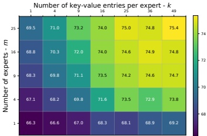

图 6：在 CIFAR-100 上对 m 和 k 的消融研究。由于显存不足 (OOM)，未进行其他 $(m, k)$ 的实验。
 

路标提取。我们简单的默认选择——对均匀划分、不重叠的矩形区域进行平均池化——甚至优于参数化替代方案。这可能源于这样一个事实：路标查询同时承担压缩键和路由器的双重角色，可能导致梯度冲突，并提示了一个进一步改进 MiTA 的方向。我们还观察到，更先进的方法，如 ToMe [68]，可以改进 MiTA。然而，ToMe 必须反复应用才能实现激进的压缩，使其成为一个不够轻量、不够优雅的解决方案。

超参数 m 和 k。当 m 或 k 增大时性能都会提高，这是预期的，因为 m 或 k 越大，MiTA 越接近全注意力，当 m = k = N 时恢复全注意力。更重要的是，我们观察到性能对 k 比对 m 更敏感；也就是说，增加 k 通常比增加 m 更有益。这一趋势在图 6 中得到进一步验证。这一发现支持了我们的动机：为每个查询独立收集 top-k 激活（例如 Spark Attention [21] 和 DeepSeek Sparse Attention [22] 中那样）是冗余的，许多这样的激活反而可以通过路由共享。对于实际使用，我们提供一个简单的经验法则：首先选择一个固定比例 $\frac{m \times k}{N}$；然后从 $m = k$ 开始，并在后续调优中探索 $k > m$。

压缩与路由。路由比压缩更关键。尽管如此，引入压缩进一步提高了性能，同时提供了显著的加速，如表 5 所示。

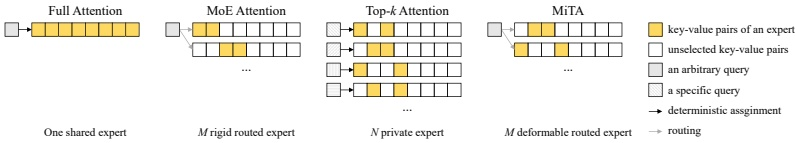

图 7：相关注意力方法的可视化比较。
 

### B 将 MiTA 融入快权重扩展分类法

虽然 MiTA 是在第 3.2 节从结合两种互补扩展策略的视角引入的，但我们发现它也丰富了第 3.1 节提出的快权重扩展分类法的其余维度。本小节将简要讨论其中每一个。

专家构造。这一核心维度决定了专家类型和数量，从而决定了路由拓扑。一个重要的考量是构造以什么为条件：仅查询（例如 DAT [19]）、仅键值对（例如 MHLA [13]），还是两者兼有。当使用键值对时，构造可以是内容相关因而可变形的（例如 DSA [22]），或仅仅是由位置驱动的（例如 MoBA [9]）。虽然大多数高效注意力方法以上述某一方面为条件，但我们的 MiTA 通过从查询中提取路标查询，然后探测完整键值池，从而以所有这些方面为条件。我们在图 4 中说明了这种设计带来的一个好处。

专家类型和数量。专家类型可以分为三类：a) 线性层（例如线性注意力），b) MLP（例如稀疏注意力和 PVT [15]），c) 任意模块（例如测试时训练）。MiTA 的通过路由扩展分支限于 MLP 专家，与稀疏注意力一样。然而，通过压缩扩展分支可以通过测试时训练实现，从而推广到其他模块。至于专家数量，MiTA 通过超参数 m 控制它。这种设计的一个好处已在复杂度分析中讨论。另一个好处是它通过路由机制实现了专家组合。

路由拓扑。在 MiTA 中，有一个固定数量的基础稀疏模式（即快权重专家），这是相对于只有单个专家的高效注意力的实质性改进，但仍远少于具有 N 个专家的先前 top-k 注意力 [21, 22]。关键在于，为了弥补这一局限，MiTA 可以求助于路由机制来组合这 m 个基础专家：当将每个查询路由到 s 个专家时，有效稀疏模式的数量（即专家的组合数）为 $(s)$。特别地，当 s = 1 时，路由可能退化为聚类，将信息流限制在每个聚类内。因此，我们量化了一个专家收集的键值对与路由到它的查询之间的位置重叠。如图 8 所示，重叠在各层间始终保持适度，这表明 s = 1 的 MiTA 执行的是路由而非硬聚类。

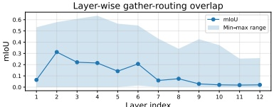

图 8：逐层位置重叠（专家收集的键值对与路由到它的查询之间）用 mIoU 量化，在专家和注意力头上平均。
 

算法 1 Mixture-of-Top-$k$ Attention (MiTA)

Require: 查询、键、值矩阵 $Q, K, V \in \mathbb{R}^{d \times N}$；路标查询数量 $m$；每个快权重专家的宽度 $k$；每个查询被路由到共享专家和 $s = 1$ 个额外专家。

1: // 获得路标查询
2: $\tilde{Q} = \text{AdaptiveAvgPool}(Q, \text{output\_size}=m)$ // [d, m]
3: // 通过路标查询查找键值对
4: $S^{\text{kv}} = K^{\top} \tilde{Q} / \sqrt{d}$ // [N, m]
5: // 收集 top-$k$ 激活的键值对
6: $\mathcal{I}^{\text{kv}} = \text{Flatten}(\text{TopK}(S^{\text{kv}}^{\top}, k, \text{dim}=1))$ // [m*k]
7: $K^{\text{expt}}, V^{\text{expt}} = K[:, \mathcal{I}^{\text{kv}}], V[:, \mathcal{I}^{\text{kv}}]$ // [d, m*k]
8: // 获得路标值（构造共享专家）
9: $\tilde{V} = V \text{softmax}(S^{\text{kv}})$ // [d, m]
10: // 始终将查询路由到共享专家
11: $O^{\text{share}} = \text{FlashAttention}(Q, \tilde{Q}, \tilde{V})$
12: // 将查询稀疏地路由到其他专家
13: $\mathcal{I}^{\text{expt}} = \text{ArgSort}(\text{ArgMax}(\tilde{Q}^{\top} Q, \text{dim}=0))$ // [N]
14: $O^{\text{expt}} = \text{FlashAttention}(Q[:, \mathcal{I}^{\text{expt}}], K^{\text{expt}}, V^{\text{expt}}, \text{cu\_seqlens\_q} = \text{CumSum}(\text{BinCount}(\mathcal{I}^{\text{expt}})), \text{cu\_seqlens\_k}=[0, k, 2k, \ldots, m k])$
15: // 通过在线 softmax 组合结果
16: $O = \text{Combine}(O^{\text{share}}, O^{\text{expt}})$ // [d, N]
17: return $O$

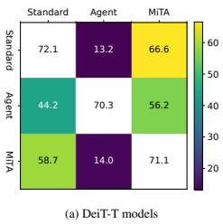

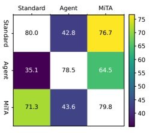

(b) DeiT-S 模型
 

图 9：使用不同推理注意力的评估。x 轴索引训练注意力，y 轴索引推理注意力。我们从热力图中省略对角线项，因为它们不是我们关注的。目前仅包含标准注意力、Agent Attention 和 MiTA。
 

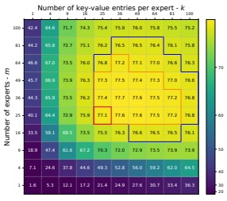

(a) MiTA-ViT-T @512
 

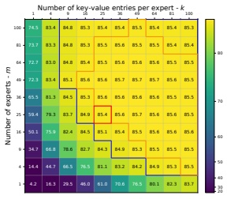

(b) MiTA-ViT-L @224
 

图 10：MiTA 在 $m$ 和 $k$ 上的泛化。红框标记训练（或微调）的 $(m, k)$ 及其在 ImageNet-1K 上对应的基线准确率。橙色边界标记超过基线准确率的推理 $(m, k)$ 配置，蓝色边界标记达到基线准确率 99% 的配置。放大查看效果最佳。
 

### C 算法泛化

广义上，泛化通常指超出训练数据的性能，例如从训练集到验证集、长度外推 [69]（从训练分辨率到新分辨率）。受高效注意力统一视角的启发，本工作研究了一个新的泛化维度：算法泛化，即超出训练算法（例如注意力机制）的性能。

在图 10 中，我们研究 MiTA 跨超参数的泛化：专家数量 m 和专家宽度 k。注意，改变算法的超参数类似于改变输入分辨率。此外，在图 9 中，我们研究一种注意力机制如何泛化到其他机制。具体来说，给定一个用一种注意力机制（训练注意力）训练的模型，我们在测试时用不同的机制（推理注意力）替换它。除了模型参数固定的泛化设定之外，我们还在表 7 中用不同的微调注意力对在大规模数据集上预训练的模型进行微调。

实现细节。表 4 中的 ViTs [65] 在 ImageNet-21K 上以 224 的图像尺寸和 16 的 patch 大小预训练。我们使用所列注意力机制（包括标准注意力），用 AdamW 优化器对它们微调 50 个 epoch。图 10(a) 中的模型类似地微调，但从以 384 图像尺寸预训练的 ViT 开始。图 9 中的模型与表 2 中的相同。

结果。图 10 表明，MiTA 在扩大专家数量和宽度时泛化良好：许多配置超过了原始结果。这表明了一个有前景的策略：为效率起见用较小的 m 和 k 训练 MiTA，然后在推理时增加 m 或 k 以获得增益。在图 9 中，我们观察到标准注意力和 MiTA 相互泛化得比其他组合更好，特别是在用标准注意力训练并用 MiTA 测试时，它以线性复杂度保留了超过 95% 的原始性能。关于微调，表 7 表明，用标准注意力预训练的参数更容易迁移到 MiTA，而 Agent Attention 即使在增加 agent token 数量时也难以缩小这一差距。

表 7：微调结果。我们在 ImageNet-1K 上微调 ImageNet-21K 预训练的 ViTs [65]，用 Agent Attention 或 MiTA Attention 替换标准注意力。$^{\dagger}$：agent token（即路标查询）数量从 49（默认）增加到 64。
 

<table border=1 style='margin: auto; word-wrap: break-word;'><tr><td style='text-align: center; word-wrap: break-word;'>方法</td><td style='text-align: center; word-wrap: break-word;'>Tiny</td><td style='text-align: center; word-wrap: break-word;'>Small</td><td style='text-align: center; word-wrap: break-word;'>Base</td><td style='text-align: center; word-wrap: break-word;'>Large</td></tr><tr><td style='text-align: center; word-wrap: break-word;'>标准注意力</td><td style='text-align: center; word-wrap: break-word;'>76.9</td><td style='text-align: center; word-wrap: break-word;'>81.2</td><td style='text-align: center; word-wrap: break-word;'>84.4</td><td style='text-align: center; word-wrap: break-word;'>85.9</td></tr><tr><td style='text-align: center; word-wrap: break-word;'>线性注意力</td><td style='text-align: center; word-wrap: break-word;'>73.2</td><td style='text-align: center; word-wrap: break-word;'>78.6</td><td style='text-align: center; word-wrap: break-word;'>79.8</td><td style='text-align: center; word-wrap: break-word;'>80.7</td></tr><tr><td style='text-align: center; word-wrap: break-word;'>Agent Attention</td><td style='text-align: center; word-wrap: break-word;'>74.6</td><td style='text-align: center; word-wrap: break-word;'>79.7</td><td style='text-align: center; word-wrap: break-word;'>81.4</td><td style='text-align: center; word-wrap: break-word;'>83.5</td></tr><tr><td style='text-align: center; word-wrap: break-word;'>Agent Attention $^{\dagger}$</td><td style='text-align: center; word-wrap: break-word;'>74.7</td><td style='text-align: center; word-wrap: break-word;'>79.9</td><td style='text-align: center; word-wrap: break-word;'>81.5</td><td style='text-align: center; word-wrap: break-word;'>83.8</td></tr><tr><td style='text-align: center; word-wrap: break-word;'>MiTA Attention</td><td style='text-align: center; word-wrap: break-word;'>75.6 (-1.3)</td><td style='text-align: center; word-wrap: break-word;'>80.9 (-0.3)</td><td style='text-align: center; word-wrap: break-word;'>82.8 (-1.6)</td><td style='text-align: center; word-wrap: break-word;'>85.5 (-0.4)</td></tr></table>

### D 局限

本工作主要聚焦于视觉领域，我们没有在大语言模型的解码阶段评估所提方法。这一选择主要是由于我们有限的计算资源。尽管如此，该方法及相关工作是以模态无关的方式呈现的，我们也讨论了它们在视觉之外的应用性。我们将应用于大语言模型视为未来工作的一个重要方向。本文的主要贡献是概念性的，即一个促进有原则改进的统一视角，而非一个领域特定的实例化。
