arXiv:1803.03635v5 [cs.LG] 4 Mar 2019

# THE LOTTERY TICKET HYPOTHESIS: FINDING SPARSE, TRAINABLE NEURAL NETWORKS

Jonathan Frankle

MIT CSAIL

jfrankle@csail.mit.edu

Michael Carbin

MIT CSAIL

mcarbin@csail.mit.edu

## ABSTRACT

Neural network pruning techniques can reduce the parameter counts of trained networks by over 90%, decreasing storage requirements and improving computational performance of inference without compromising accuracy. However, contemporary experience is that the sparse architectures produced by pruning are difficult to train from the start, which would similarly improve training performance.

We find that a standard pruning technique naturally uncovers subnetworks whose initializations made them capable of training effectively. Based on these results, we articulate the lottery ticket hypothesis: dense, randomly-initialized, feed-forward networks contain subnetworks (winning tickets) that—when trained in isolation—reach test accuracy comparable to the original network in a similar number of iterations. The winning tickets we find have won the initialization lottery: their connections have initial weights that make training particularly effective.

We present an algorithm to identify winning tickets and a series of experiments that support the lottery ticket hypothesis and the importance of these fortuitous initializations. We consistently find winning tickets that are less than 10-20% of the size of several fully-connected and convolutional feed-forward architectures for MNIST and CIFAR10. Above this size, the winning tickets that we find learn faster than the original network and reach higher test accuracy.

## 1 引言（Introduction）
a
消除神经网络中不必要权重的技术（剪枝，pruning）（LeCun et al., 1990; Hassibi & Stork, 1993; Han et al., 2015; Li et al., 2016）可以在不损害精度的情况下把参数量削减 90% 以上。这样做缩小了已训练网络的规模（Han et al., 2015; Hinton et al., 2015）或降低了能耗（Yang et al., 2017; Molchanov et al., 2016; Luo et al., 2017），使推理更加高效。然而，如果网络可以被缩小，我们为什么不直接训练这个更小的结构、从而让训练本身也更高效呢？当代的经验是，剪枝得到的架构难以从头开始训练，其精度低于原网络。 $^{1}$

来看一个例子。在图 1 中，我们从一个用于 MNIST 的全连接网络和用于 CIFAR10 的卷积网络中随机采样并训练子网络。随机采样模拟了 LeCun et al. (1990) 与 Han et al. (2015) 所用的非结构化剪枝的效果。在不同稀疏度下，虚线描绘了最小验证损失所在的迭代 $^{2}$ 以及该迭代处的测试精度。网络越稀疏，学习越慢，最终测试精度也越低。

 $^{1}$”从头训练一个剪枝后的模型，其表现比重训一个剪枝后的模型更差，这可能表明训练小容量网络是困难的。”（Li et al., 2016）”在重训过程中，对于在剪枝中存活下来的连接，保留其初始训练阶段的权重，要优于重新初始化被剪枝的层……梯度下降在网络初次训练时能找到好的解，但在重新初始化某些层并重训之后却做不到。”（Han et al., 2015）

 $^{2}$作为网络学习速度的代理指标，我们使用早停（early-stopping）准则会结束训练的那个迭代。本文通篇采用的特定早停准则是训练过程中验证损失最低的那个迭代。关于这一选择的更多细节见附录 C。

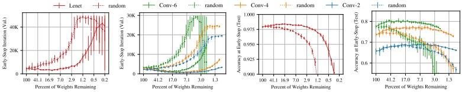

图 1：用于 MNIST 的 Lenet 架构与用于 CIFAR10 的 Conv-2、Conv-4、Conv-6 架构（见图 2）在不同初始规模下训练时，早停发生的迭代（左）与该迭代处的测试精度（右）。虚线为随机采样的稀疏网络（十次试验的平均）；实线为中奖彩票（五次试验的平均）。
 

在本文中，我们证明始终存在更小的子网络，它们能从初始状态开始训练，学习速度至少与其较大的对应网络一样快，同时达到相近的测试精度。图 1 中的实线显示了我们找到的网络。基于这些结果，我们提出彩票假说。

彩票假说（The Lottery Ticket Hypothesis）。一个随机初始化的稠密神经网络包含一个子网络，该子网络的初始化方式使得——当它被单独训练时——能在最多相同次数的迭代后达到原网络的测试精度。

更形式化地说，考虑一个稠密前馈神经网络  $f(x; \theta)$ ，其初始参数为  $\theta = \theta_0 \sim \mathcal{D}_\theta$ 。在训练集上用随机梯度下降（SGD）优化时，  $f$  在迭代  $j$  处达到最小验证损失  $l$ ，测试精度为  $a$ 。此外，考虑用掩码  $m \in \{0, 1\}^{|\theta|}$  作用于参数来训练  $f(x; m \odot \theta)$ ，使其初始化为  $m \odot \theta_0$ 。在同一训练集上用 SGD 优化（ $m$ 固定）时，  $f$  在迭代  $j'$  处达到最小验证损失  $l'$ ，测试精度为  $a'$ 。彩票假说预测存在这样的  $m$ ，使得  $j' \leq j$ （训练时间相当）、 $a' \geq a$ （精度相当）且  $\|m\|_0 \ll |\theta|$ （参数更少）。

我们发现，一种标准的剪枝技术能从全连接和卷积前馈网络中自动找出这类可训练子网络。我们将这些可训练子网络  $f(x; m \odot \theta_0)$  称为中奖彩票（winning tickets），因为我们找到的这些子网络凭借一种能够学习的权重与连接的组合赢得了初始化彩票。当它们的参数被随机重新初始化（即  $f(x; m \odot \theta'_0)$ ，其中  $\theta'_0 \sim \mathcal{D}_\theta$ ）时，中奖彩票不再能达到原网络的性能，这为以下观点提供了证据：这些较小的网络只有在恰当初始化时才能有效训练。

识别中奖彩票。我们通过训练一个网络并剪掉其幅度最小的权重来识别中奖彩票。剩余未被剪枝的连接构成中奖彩票的架构。我们工作的独特之处在于，每个未被剪枝的连接的值随后会被重置回其训练之前原网络中的初始值。这构成了我们的核心实验：

1. 随机初始化一个神经网络  $f(x;\theta_0)$ （其中  $\theta_0\sim\mathcal{D}_\theta$ ）。

2. 训练网络  $j$  次迭代，得到参数  $\theta_{j}$ 。

3. 剪掉  $\theta_{j}$  中  $p\%$  的参数，得到掩码  $m$ 。

4. 把剩余参数重置回其在  $\theta_0$  中的值，得到中奖彩票  $f(x; m\odot\theta_0)$ 。

如上所述，这种剪枝方法是一次性（one-shot）的：网络训练一次，剪掉 $p\%$ 的权重，存活权重被重置。然而，在本文中，我们聚焦于迭代剪枝（iterative pruning），它在 $n$ 轮中反复执行训练、剪枝和重置；每一轮剪掉上一轮存活权重中的 $p^{\frac{1}{n}}\%$。我们的结果表明，迭代剪枝找到的中奖彩票在比一次性剪枝更小的规模下就能匹配原网络的精度。

结果。我们在用于 MNIST 的全连接架构和用于 CIFAR10 的卷积架构上，跨多种优化策略（SGD、momentum、Adam）并使用 dropout、权重衰减、批归一化和残差连接等技术识别出中奖彩票。我们使用非结构化剪枝技术，因此这些中奖彩票是稀疏的。在更深层的网络中，我们基于剪枝寻找中奖彩票的策略对学习率敏感：在较高学习率下需要 warmup 才能找到中奖彩票。我们找到的中奖彩票规模为原网络的 10–20%（或更小）。

<table border=1 style='margin: auto; word-wrap: break-word;'><tr><td style='text-align: center; word-wrap: break-word;'>网络</td><td style='text-align: center; word-wrap: break-word;'>Lenet</td><td style='text-align: center; word-wrap: break-word;'>Conv-2</td><td style='text-align: center; word-wrap: break-word;'>Conv-4</td><td style='text-align: center; word-wrap: break-word;'>Conv-6</td><td style='text-align: center; word-wrap: break-word;'>Resnet-18</td><td style='text-align: center; word-wrap: break-word;'>VGG-19</td></tr><tr><td rowspan="3">卷积层</td><td rowspan="3"></td><td rowspan="3">64, 64, pool</td><td style='text-align: center; word-wrap: break-word;'>64, 64, pool</td><td style='text-align: center; word-wrap: break-word;'>64, 64, pool</td><td style='text-align: center; word-wrap: break-word;'>16, 3x[16, 16]</td><td style='text-align: center; word-wrap: break-word;'>2x64 pool 2x128</td></tr><tr><td rowspan="2">128, 128, pool</td><td style='text-align: center; word-wrap: break-word;'>128, 128, pool</td><td style='text-align: center; word-wrap: break-word;'>3x[32, 32]</td><td style='text-align: center; word-wrap: break-word;'>pool, 4x256, pool</td></tr><tr><td style='text-align: center; word-wrap: break-word;'>256, 256, pool</td><td style='text-align: center; word-wrap: break-word;'>3x[64, 64]</td><td style='text-align: center; word-wrap: break-word;'>4x512, pool, 4x512</td></tr><tr><td style='text-align: center; word-wrap: break-word;'>全连接层</td><td style='text-align: center; word-wrap: break-word;'>300, 100, 10</td><td style='text-align: center; word-wrap: break-word;'>256, 256, 10</td><td style='text-align: center; word-wrap: break-word;'>256, 256, 10</td><td style='text-align: center; word-wrap: break-word;'>256, 256, 10</td><td style='text-align: center; word-wrap: break-word;'>avg-pool, 10</td><td style='text-align: center; word-wrap: break-word;'>avg-pool, 10</td></tr><tr><td style='text-align: center; word-wrap: break-word;'>总/卷积权重</td><td style='text-align: center; word-wrap: break-word;'>266K</td><td style='text-align: center; word-wrap: break-word;'>4.3M / 38K</td><td style='text-align: center; word-wrap: break-word;'>2.4M / 260K</td><td style='text-align: center; word-wrap: break-word;'>1.7M / 1.1M</td><td style='text-align: center; word-wrap: break-word;'>274K / 270K</td><td style='text-align: center; word-wrap: break-word;'>20.0M</td></tr><tr><td style='text-align: center; word-wrap: break-word;'>迭代次数/批</td><td style='text-align: center; word-wrap: break-word;'>50K / 60</td><td style='text-align: center; word-wrap: break-word;'>20K / 60</td><td style='text-align: center; word-wrap: break-word;'>25K / 60</td><td style='text-align: center; word-wrap: break-word;'>30K / 60</td><td style='text-align: center; word-wrap: break-word;'>30K / 128</td><td style='text-align: center; word-wrap: break-word;'>112K / 64</td></tr><tr><td style='text-align: center; word-wrap: break-word;'>优化器</td><td style='text-align: center; word-wrap: break-word;'>Adam 1.2e-3</td><td style='text-align: center; word-wrap: break-word;'>Adam 2e-4</td><td style='text-align: center; word-wrap: break-word;'>Adam 3e-4</td><td style='text-align: center; word-wrap: break-word;'>Adam 3e-4</td><td colspan="2">$\leftarrow$ SGD 0.1-0.01-0.001 Momentum 0.9  $\rightarrow$</td></tr><tr><td style='text-align: center; word-wrap: break-word;'>剪枝率</td><td style='text-align: center; word-wrap: break-word;'>fc20%</td><td style='text-align: center; word-wrap: break-word;'>conv10% fc20%</td><td style='text-align: center; word-wrap: break-word;'>conv10% fc20%</td><td style='text-align: center; word-wrap: break-word;'>conv15% fc20%</td><td style='text-align: center; word-wrap: break-word;'>conv20% fc0%</td><td style='text-align: center; word-wrap: break-word;'>conv20% fc0%</td></tr></table>

图 2：本文测试的架构。卷积核为 3x3。Lenet 来自 LeCun et al. (1998)。Conv-2/4/6 是 VGG（Simonyan & Zisserman, 2014）的变体。Resnet-18 来自 He et al. (2016)。用于 CIFAR10 的 VGG-19 改编自 Liu et al. (2019)。初始化采用 Gaussian Glorot（Glorot & Bengio, 2010）。括号表示围绕层的残差连接。
 

（更小的规模）。在这一规模之下，它们在最多相同次数的迭代（训练时间相当）内达到或超过原网络的测试精度（精度相当）。当随机重新初始化时，中奖彩票的表现要差得多，这意味着单凭结构无法解释中奖彩票的成功。

彩票猜想（The Lottery Ticket Conjecture）。回到我们的动机问题，我们把假设扩展为一个未经检验的猜想：SGD 会寻找并训练一个由初始化良好的权重构成的子集。稠密、随机初始化的网络比剪枝得到的稀疏网络更容易训练，因为前者拥有更多可能的子网络，训练可以从中恢复出一个中奖彩票。

贡献（Contributions）。

- 我们证明，剪枝能找出可训练的子网络，它们在相近的迭代次数内达到与原网络（即其来源网络）相当的测试精度。

- 我们表明，剪枝找到的中奖彩票比原网络学得更快，同时达到更高的测试精度并具有更好的泛化能力。

- 我们提出彩票假说，作为关于神经网络构成的新视角来解释这些发现。

意义（Implications）。在本文中，我们对彩票假说进行了实证研究。既然我们已经证明了中奖彩票的存在，我们希望利用这一知识来：

提升训练性能。由于中奖彩票可以从初始状态单独训练，我们希望设计出能够尽早搜索中奖彩票并剪枝的训练方案。

设计更好的网络。中奖彩票揭示了特别擅长学习的稀疏架构与初始化的组合。我们可以从中奖彩票中汲取灵感，设计具有同样利于学习特性的新架构和初始化方案。我们甚至可能把为某个任务发现的中奖彩票迁移到许多其他任务上。

提升对神经网络的理论理解。我们可以研究为什么随机初始化的前馈网络似乎包含中奖彩票，以及这对优化（Du et al., 2019）和泛化（Zhou et al., 2018; Arora et al., 2018）的理论研究可能带来的启示。

## 2 全连接网络中的中奖彩票（Winning Tickets in Fully-Connected Networks）

在本节中，我们评估彩票假说在 MNIST 上训练的全连接网络上的适用性。我们使用图 2 中描述的 Lenet-300-100 架构（LeCun et al., 1998）。我们遵循第 1 节的流程：随机初始化并训练一个网络后，对网络进行剪枝，并把剩余连接重置回其原始初始值。我们采用一种简单的逐层剪枝启发式：在每层内移除一定比例幅度最小的权重（同 Han et al. (2015)）。通向输出的连接按网络其余部分一半的速率剪枝。我们在附录 G 中探索了其他超参数，包括学习率、优化策略（SGD、momentum）、初始化方案和网络规模。

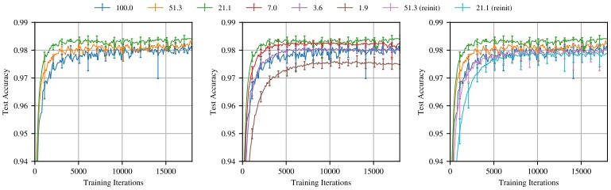

图 3：训练过程中 Lenet（迭代剪枝）的测试精度。每条曲线为五次试验的平均。标签  $P_{m}$ 表示剪枝后网络中剩余权重的比例。误差线为任意试验的最小值与最大值。
 

记号。 $P_m = \frac{\|m\|_0}{|\theta|}$ 是掩码  $m$ 的稀疏度，例如当 75% 的权重被剪掉时  $P_m = 25\%$ 。

迭代剪枝。我们找到的中奖彩票比原网络学得更快。图 3 描绘了将中奖彩票迭代剪枝到不同程度后训练时的平均测试精度。误差线为五次运行的最小值与最大值。在最初的几轮剪枝中，剪枝越多，网络学得越快、测试精度越高（图 3 左图）。一个包含原网络 51.3% 权重的中奖彩票（即  $P_m = 51.3\%$ ）比原网络更快地达到更高的测试精度，但比  $P_m = 21.1\%$ 时慢。当  $P_m < 21.1\%$ 时，学习变慢（中图）。当  $P_m = 3.6\%$ 时，中奖彩票回落到原网络的性能。类似规律在本文中反复出现。

图 4a 总结了每轮迭代剪掉 20% 时所有剪枝程度下的这一行为（蓝色）。左侧是每个网络达到最小验证损失（即早停准则会停止训练的时刻）的迭代与剪枝后剩余权重比例的关系；中间是该迭代处的测试精度。我们用满足早停准则的那个迭代作为网络学习速度的代理指标。

随着  $P_{m}$ 从 100% 降到 21%，中奖彩票学得更快，在 21% 处早停比原网络提前 38%。进一步剪枝导致学习变慢，当  $P_{m} = 3.6\%$ 时回落到原网络的早停性能。测试精度随剪枝而提高，当  $P_{m} = 13.5\%$ 时提升超过 0.3 个百分点；此后精度下降，当  $P_{m} = 3.6\%$ 时回落到原网络水平。

在早停点，训练精度（图 4a 右）随剪枝以与测试精度类似的模式上升，这似乎暗示中奖彩票优化得更有效但泛化并未更好。然而，在第 50,000 次迭代（图 4b），尽管几乎所有网络的训练精度都达到了 100%（附录 D，图 12），迭代剪枝得到的中奖彩票的测试精度仍有最高 0.35 个百分点的提升。这意味着中奖彩票的训练精度与测试精度之间的差距更小，表明其泛化能力得到了改善。

随机重新初始化。为了衡量中奖彩票初始化的重要性，我们保留中奖彩票的结构（即掩码 $m$ ），但随机采样一个新的初始化 $\theta'_0 \sim \mathcal{D}_\theta$ 。我们对每个中奖彩票随机重新初始化三次，图 4 中每个点共 15 次。我们发现初始化对中奖彩票的有效性至关重要。图 3 右图展示了针对迭代剪枝的这一实验。除了原网络以及  $P_m = 51\%$ 和 21% 的中奖彩票之外，还有随机重新初始化实验。中奖彩票在剪枝后学得更快，而被随机重新初始化后则学得越来越慢。

这一实验更广泛的结果是图 4a 中的橙色线。与中奖彩票不同，被重新初始化的网络学得比原网络越来越慢，且仅在少量剪枝后就损失测试精度。重新初始化的迭代中奖彩票的平均测试精度在  $P_m = 21.1\%$ 时从原始精度开始下降，而中奖彩票要到 2.9% 时才下降。当  $P_m = 21\%$ 时，中奖彩票达到最小验证损失的速度比重初始化时快 2.51 倍，且精度高出半个百分点。所有网络在  $P_m \geq 5\%$ 时都达到 100% 训练精度；图

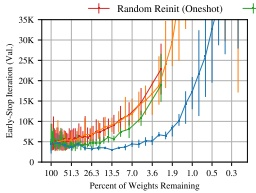

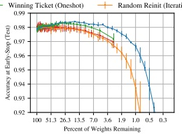

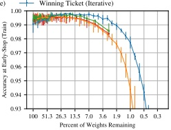

(a) 所有剪枝方法下的早停迭代与精度。
 

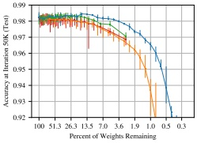

(b) 训练结束时的精度。
 

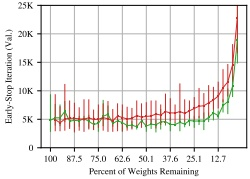

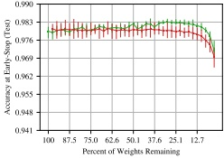

(c) 一次性剪枝下的早停迭代与精度。
 

图 4：一次性剪枝与迭代剪枝下 Lenet 的早停迭代与精度。五次试验的平均；误差线为最小值与最大值。在第 50,000 次迭代，迭代中奖彩票在  $P_m \geq 2\%$ 时训练精度  $\approx$ 100%（见附录 D，图 12）。
 

因此图 4b 表明，中奖彩票的泛化能力显著优于随机重新初始化的情况。这一实验支持了彩票假说对初始化的强调：原始初始化能够承受并从剪枝中受益，而随机重新初始化的性能则立即受损并持续下降。

一次性剪枝。虽然迭代剪枝能提取更小的中奖彩票，但反复训练意味着寻找它们的代价高昂。一次性剪枝使我们无需反复训练就能识别中奖彩票。图 4c 展示了一次性剪枝（绿色）与随机重新初始化（红色）的结果；一次性剪枝确实能找到中奖彩票。当  $67.5\% \geq P_m \geq 17.6\%$ 时，平均中奖彩票比原网络更早达到最小验证精度。当  $95.0\% \geq P_m \geq 5.17\%$ 时，测试精度高于原网络。然而，迭代剪枝得到的中奖彩票在更小的网络规模下学得更快、测试精度更高。图 4c 中的绿线和红线被复制到图 4a 的对数坐标轴上，使这一性能差距更加清晰。由于我们的目标是识别尽可能小的中奖彩票，本文其余部分将聚焦于迭代剪枝。

## 3 卷积网络中的中奖彩票（Winning Tickets in Convolutional Networks）

在此，我们把彩票假说应用到 CIFAR10 上的卷积网络，既提高了学习问题的复杂度，也增大了网络规模。我们考虑图 2 中的 Conv-2、Conv-4、Conv-6 架构，它们是 VGG（Simonyan & Zisserman, 2014）家族缩小后的变体。这些网络分别有 2、4、6 个卷积层，后接两个全连接层；每两个卷积层后进行一次最大池化。这些网络覆盖了从接近全连接到传统卷积网络的范围，Conv-2 中卷积层参数占比不到 1%，而 Conv-6 中接近三分之二。 $^{3}$

寻找中奖彩票。图 5（上）的实线展示了以图 2 中的逐层剪枝率对 Conv-2（蓝色）、Conv-4（橙色）、Conv-6（绿色）进行的迭代彩票实验。第 2 节中 Lenet 的规律再次出现：随着网络被剪枝，与原网络相比，它学得更快，测试精度上升。在这种情况下，结果更加显著。中奖

 $^{3}$附录 H 探索了其他超参数，包括学习率、优化策略（SGD、momentum）以及剪枝卷积层与全连接层的相对速率。

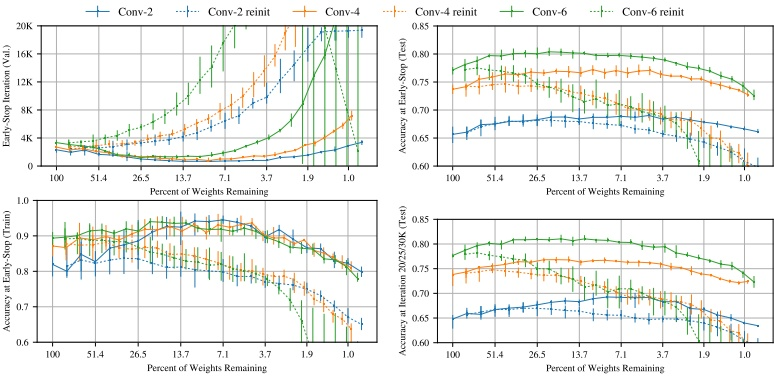

图 5：迭代剪枝与随机重新初始化时 Conv-2/4/6 架构的早停迭代以及测试、训练精度。每条实线为五次试验的平均；每条虚线为十五次重新初始化（每次试验三次）的平均。右下方的图描绘了在原网络训练最后一次迭代对应的迭代处（Conv-2 为 20,000、Conv-4 为 25,000、Conv-6 为 30,000）中奖彩票的测试精度；在该迭代处，中奖彩票在  $P_m \geq 2\%$ 时训练精度  $\approx 100\%$（见附录 D）。
 

彩票达到最小验证损失的速度最好时快 3.5 倍（Conv-2，$P_m = 8.8\%$ ）、3.5 倍（Conv-4，$P_m = 9.2\%$ ）和 2.5 倍（Conv-6，$P_m = 15.1\%$ ）。测试精度最好时提升 3.4 个百分点（Conv-2，$P_m = 4.6\%$ ）、3.5 个百分点（Conv-4，$P_m = 11.1\%$ ）和 3.3 个百分点（Conv-6，$P_m = 26.4\%$ ）。当 $P_m > 2\%$ 时，三个网络都保持在其原始平均测试精度之上。

与第 2 节一样，早停迭代处的训练精度随测试精度一起上升。然而，在 Conv-2 的 20,000、Conv-4 的 25,000 和 Conv-6 的 30,000 次迭代（这些迭代对应原网络的最后一次训练迭代），当  $P_m \geq 2\%$ 时所有网络的训练精度都达到 100%（附录 D，图 13），而中奖彩票仍保持更高的测试精度（图 5 右下）。这意味着中奖彩票的测试与训练精度之间的差距更小，表明其泛化能力更好。

随机重新初始化。我们重复第 2 节的随机重新初始化实验，其结果如图 5 中的虚线。随着持续剪枝，这些网络再次需要越来越长的时间来学习。与 MNIST 上的 Lenet（第 2 节）一样，随机重新初始化实验的测试精度下降得更快。然而，与 Lenet 不同，Conv-2 和 Conv-4 在早停时刻的测试精度最初保持稳定甚至有所提升，这表明——在中等程度的剪枝下——仅凭中奖彩票的结构就可能带来更高的精度。

Dropout。Dropout（Srivastava et al., 2014; Hinton et al., 2012）通过在每次训练迭代时随机禁用一部分单元（即随机采样子网络）来提高精度。Baldi & Sadowski (2013) 将 dropout 刻画为同时训练所有子网络的集成。由于彩票假说暗示这些子网络中的某一个就构成中奖彩票，自然要问 dropout 与我们寻找中奖彩票的策略之间是否存在相互作用。

图 6 展示了以 0.5 的 dropout 率训练 Conv-2、Conv-4、Conv-6 的结果。虚线为无 dropout 时的网络性能（即图 5 中的实线）。 $^{4}$ 使用 dropout 训练时，我们仍能找到中奖彩票。dropout 提高了初始测试精度（Conv-2、Conv-4、Conv-6 平均分别提高 2.1、3.0、2.4 个百分点），迭代剪枝进一步提高（平均分别最多再提高 2.3、4.6、4.7 个百分点）。迭代剪枝使学习如以前一样变快，但在 Conv-2 上不那么显著。

 $^{4}$我们为使用 dropout 训练的网络选择了新的学习率——见附录 H.5。

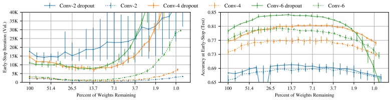

图 6：迭代剪枝并用 dropout 训练时 Conv-2/4/6 的早停迭代与早停处的测试精度。虚线为不使用 dropout 训练的相同网络（即图 5 中的实线）。学习率：Conv-2 为 0.0003，Conv-4 和 Conv-6 为 0.0002。
 

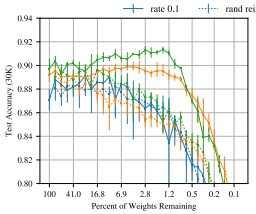

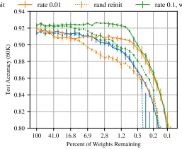

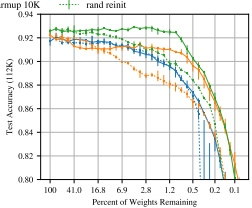

图 7：迭代剪枝时 VGG-19 的测试精度（在 30K、60K、112K 次迭代处）。
 

这些改进表明，我们的迭代剪枝策略与 dropout 以互补的方式相互作用。Srivastava et al. (2014) 观察到 dropout 会在最终网络中诱导出稀疏激活；dropout 诱导的稀疏性可能为网络被剪枝做了准备。如果是这样，针对权重的 dropout 技术（Wan et al., 2013）或学习逐权重 dropout 概率的技术（Molchanov et al., 2017; Louizos et al., 2018）可能让中奖彩票更容易被找到。

## 4 CIFAR10 上的 VGG 与 ResNet（VGG and ResNet for CIFAR10）

在此，我们在让人联想到实际使用的架构与技术的网络上研究彩票假说。具体而言，我们考虑 VGG 风格的深层卷积网络（CIFAR10 上的 VGG-19——Simonyan & Zisserman (2014)）和残差网络（CIFAR10 上的 Resnet-18——He et al. (2016)）。 $^{5}$ 这些网络使用批归一化、权重衰减、递减学习率调度和增强的训练数据进行训练。我们在所有这些架构上仍能找到中奖彩票；然而，我们寻找中奖彩票的方法——迭代剪枝——对所用的特定学习率敏感。在这些实验中，我们不测量早停时间（对这些较大的网络而言，早停时间与学习率调度纠缠在一起），而是描绘训练过程中几个时刻的精度，以说明精度提升的相对速率。

全局剪枝。在 Lenet 和 Conv-2/4/6 上，我们以相同的速率分别剪枝每一层。对于 Resnet-18 和 VGG-19，我们略微修改了这一策略：我们全局地剪枝这些更深的网络，在所有卷积层中统一移除幅度最小的权重。在附录 I.1 中，我们发现全局剪枝能为 Resnet-18 和 VGG-19 识别出更小的中奖彩票。我们对这一行为的猜测性解释如下：对这些更深的网络而言，某些层的参数远多于其他层。例如，VGG-19 的前两个卷积层分别有 1728 和 36864 个参数，而最后一层有 235 万个。当所有层以相同速率剪枝时，这些较小的层会成为瓶颈，阻止我们识别出尽可能小的中奖彩票。全局剪枝使我们能够避免这一陷阱。

VGG-19。我们研究由 Liu et al. (2019) 为 CIFAR10 改编的 VGG-19 变体；我们使用相同的训练方案和超参数：160 个 epoch（112,480 次迭代），使用带

 $^{5}$关于网络、超参数和训练方案的细节见图 2 和附录 I。

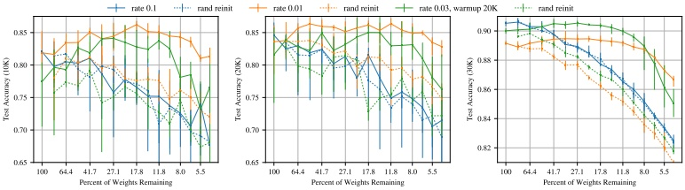

图 8：迭代剪枝时 Resnet-18 的测试精度（在 10K、20K、30K 次迭代处）。
 

momentum（0.9）的 SGD，并在 80 和 120 个 epoch 时将学习率降低 10 倍。该网络有 2000 万个参数。图 7 展示了在两个初始学习率——0.1（Liu et al. (2019) 所用）和 0.01——下对 VGG-19 进行迭代剪枝与随机重新初始化的结果。在较高学习率下，迭代剪枝找不到中奖彩票，性能并不比随机重新初始化的剪枝网络更好。然而，在较低学习率下，通常的规律再次出现：当  $P_m \geq 3.5\%$ 时，子网络保持在原精度 1 个百分点以内。（它们不是中奖彩票，因为它们没有达到原精度。）当随机重新初始化时，子网络随剪枝以与本文其他实验相同的方式损失精度。虽然这些子网络在训练早期比未剪枝网络学得更快（图 7 左），但由于较低的初始学习率，这一精度优势在训练后期被侵蚀。然而，这些子网络仍比重初始化时学得更快。

为了弥合较低学习率下的彩票行为与较高学习率下的精度优势之间的差距，我们探索了在  $k$ 次迭代内学习率从 0 线性 warmup 到初始学习率的效果。在 0.1 学习率下使用 warmup（ $k = 10000$，绿线）训练 VGG-19，未剪枝网络的测试精度提高了约 1 个百分点。warmup 使找到中奖彩票成为可能，当  $P_m \geq 1.5\%$ 时超过这一初始精度。

Resnet-18。Resnet-18（He et al., 2016）是为 CIFAR10 设计的、带残差连接的 20 层卷积网络。它有 271,000 个参数。我们使用带 momentum（0.9）的 SGD 训练该网络 30,000 次迭代，在 20,000 和 25,000 次迭代时将学习率降低 10 倍。图 8 展示了在 0.1（He et al. (2016) 所用）和 0.01 学习率下迭代剪枝与随机重新初始化的结果。这些结果大体上反映了 VGG 的情况：迭代剪枝在较低学习率下能找到中奖彩票，而在较高学习率下不能。较低学习率下最好的中奖彩票的精度（当  $41.7\% \geq P_m \geq 21.9\%$ 时为 89.5%）低于原网络在较高学习率下的精度（90.5%）。在较低学习率下，中奖彩票同样最初学得更快（图 8 左图），但在训练后期落后于较高学习率下的未剪枝网络（右图）。使用 warmup 训练的中奖彩票缩小了与较高学习率下未剪枝网络的精度差距，在 0.03 学习率（warmup， $k = 20000$ ）和  $P_m = 27.1\%$ 下达到 90.5% 的测试精度。对这些超参数，当  $P_m \geq 11.8\%$ 时我们仍能找到中奖彩票。然而，即使使用 warmup，我们也无法找到在原始学习率 0.1 下能识别出中奖彩票的超参数。

## 5 讨论（Discussion）

关于神经网络剪枝的现有工作（如 Han et al. (2015)）表明，神经网络学到的函数通常可以用更少的参数来表示。剪枝通常先训练原网络，再移除连接并进一步微调。实际上，初始训练初始化了剪枝后网络的权重，使其能在微调期间独立学习。我们试图确定同样稀疏的网络是否能从头开始学习。我们发现本文研究的架构可靠地包含此类可训练子网络，而彩票假说提出这一性质具有普遍性。我们对中奖彩票存在性与本质的实证研究引出了一系列后续问题。

中奖彩票初始化的重要性。当随机重新初始化时，中奖彩票学得更慢、测试精度更低，这表明初始化对其成功很重要。对这一行为的一种可能解释是，这些初始权重接近其训练后的最终

值——在最极端的情况下，它们已经是训练好的。然而，附录 F 的实验表明恰恰相反——中奖彩票的权重比其他权重移动得更多。这表明初始化的好处与优化算法、数据集和模型有关。例如，中奖彩票的初始化可能落在特别利于所选优化算法进行优化的损失景观区域。

Liu et al. (2019) 发现剪枝后的网络在随机重新初始化后确实可以训练，这似乎与传统观点及我们的随机重新初始化实验相矛盾。例如，在 VGG-19 上（我们使用相同的设置），他们发现剪枝最多 80% 并随机重新初始化的网络能达到原网络的精度。我们在图 7 中的实验在这一稀疏度水平上确认了这些发现（Liu et al. 在更低稀疏度下未给出数据）。然而，进一步剪枝后，初始化就很重要了：当 VGG-19 被剪枝最多 98.5% 时我们能找到中奖彩票；而重新初始化后，这些彩票的精度要低得多。我们假设——在一定稀疏度水平内——高度过参数化的网络可以被剪枝、重新初始化并成功重训；然而，超过这一点，被极度剪枝、过参数化程度较轻的网络只有凭借幸运的初始化才能保持精度。

中奖彩票结构的重要性。产生中奖彩票的初始化被安排在一种特定的稀疏架构中。由于我们通过大量使用训练数据来发现中奖彩票，我们假设中奖彩票的结构编码了一种针对当前学习任务定制的归纳偏置。Cohen & Shashua (2016) 表明，嵌入深层网络结构中的归纳偏置决定了它能比浅层网络更参数高效地分离哪些类型的数据；虽然 Cohen & Shashua (2016) 关注卷积网络的池化几何，但中奖彩票的结构可能也有类似的作用，使它们即使在被大量剪枝时仍能学习。

中奖彩票泛化能力的改善。我们可靠地找到泛化能力更好的中奖彩票，它们在达到与原网络相同训练精度的同时超过其测试精度。随剪枝的进行，测试精度先升后降，形成一座"Occam 山丘"（Rasmussen & Ghahramani, 2001）：原始过参数化模型的复杂度过高（可能过拟合），而被极度剪枝的模型复杂度又过低。关于压缩与泛化之间关系的传统观点是，紧凑的假设能更好地泛化（Rissanen, 1986）。近期的理论工作表明神经网络也有类似的联系，为可被进一步压缩的网络证明了更紧的泛化界（Zhou et al. (2018) 针对剪枝/量化，Arora et al. (2018) 针对噪声鲁棒性）。彩票假说为这一关系提供了互补的视角——更大的网络可能明确地包含更简单的表示。

对神经网络优化的意义。中奖彩票能以显著更少的参数达到与原未剪枝网络相当的精度。这一观察与近期关于过参数化在神经网络训练中作用的工作相联系。例如，Du et al. (2019) 证明，足够过参数化的两层 relu 网络（第二层规模固定）用 SGD 训练能收敛到全局最优。那么，一个关键问题是：中奖彩票的存在对于 SGD 将神经网络优化到特定测试精度是必要条件还是充分条件。我们猜想（但未经验证）SGD 会寻找并训练一个初始化良好的子网络。按此逻辑，过参数化网络之所以更容易训练，是因为它们拥有更多可能成为中奖彩票的子网络组合。

## 6 局限与未来工作（Limitations and Future Work）

我们只考虑了较小数据集（MNIST、CIFAR10）上的视觉中心分类任务。我们没有研究更大的数据集（即 Imagenet（Russakovsky et al., 2015））：迭代剪枝计算量大，需要对网络连续训练 15 次或更多次以进行多次试验。在未来工作中，我们打算探索更高效的中奖彩票寻找方法，以便在更耗费资源的环境下研究彩票假说。

稀疏剪枝是我们寻找中奖彩票的唯一方法。虽然我们减少了参数量，但得到的架构并未针对现代库或硬件进行优化。在未来工作中，我们打算研究大量当代文献中的其他剪枝方法，例如结构化剪枝（将产生针对当代硬件优化的网络）和非幅度剪枝方法（可能产生更小的中奖彩票或更早找到它们）。

我们找到的中奖彩票具有这样的初始化：在随机初始化网络无法达到相同性能的规模下，它们仍能匹配未剪枝网络的性能。在未来工作中，我们打算研究这些初始化的性质——它们与被剪枝网络架构的归纳偏置共同作用，使这些网络特别擅长学习。

在更深的网络（Resnet-18 和 VGG-19）上，除非我们使用学习率 warmup 训练网络，否则迭代剪枝无法找到中奖彩票。在未来工作中，我们计划探索为什么需要 warmup，以及对我们识别中奖彩票方案的其他改进能否免除这些超参数修改的需要。

## 7 相关工作（Related Work）

在实践中，神经网络往往严重过参数化。蒸馏（Ba & Caruana, 2014; Hinton et al., 2015）和剪枝（LeCun et al., 1990; Han et al., 2015）依赖这样一个事实：参数可以在保持精度的同时被减少。即使有足够的能力记忆训练数据，网络也会自然地学习更简单的函数（Zhang et al., 2016; Neyshabur et al., 2014; Arpit et al., 2017）。当代经验（Bengio et al., 2006; Hinton et al., 2015; Zhang et al., 2016）和图 1 表明，过参数化的网络更容易训练。我们表明，稠密网络包含能够从原始初始化开始独立学习的稀疏子网络。还有其他几个研究方向旨在训练小型或稀疏网络。

训练之前。Squeezenet（Iandola et al., 2016）和 MobileNets（Howard et al., 2017）是专门设计的图像识别网络，比标准架构小一个数量级。Denil et al. (2013) 将权重矩阵表示为低秩因子的乘积。Li et al. (2018) 将优化限制在参数空间中一个小的随机采样子空间内（意味着所有参数仍可更新）；他们在此限制下成功训练了网络。我们表明，优化一个网络甚至无需更新所有参数，我们通过一个包含剪枝的原则性搜索过程找到中奖彩票。我们对这类方法的贡献在于证明：稀疏、可训练的网络存在于更大的网络内部。

训练之后。蒸馏（Ba & Caruana, 2014; Hinton et al., 2015）训练小网络来模仿大网络的行为；在这一范式中，小网络更容易训练。近期的剪枝工作压缩大模型以便在有限资源下运行（例如在移动设备上）。虽然剪枝是我们实验的核心，但我们研究的是：为什么训练需要这些使剪枝成为可能的过参数化网络。LeCun et al. (1990) 和 Hassibi & Stork (1993) 最早探索了基于二阶导数的剪枝。最近，Han et al. (2015) 表明基于逐权重幅度的剪枝能大幅缩小图像识别网络的规模。Guo et al. (2016) 在被剪掉的连接重新变得相关时恢复它们。Han et al. (2017) 和 Jin et al. (2016) 在小权重被剪掉、存活权重被微调之后恢复被剪掉的连接以增加网络容量。其他被提出的剪枝启发式包括基于激活的剪枝（Hu et al., 2016）、基于冗余的剪枝（Mariet & Sra, 2016; Srinivas & Babu, 2015a）、逐层二阶导数剪枝（Dong et al., 2017）以及基于能量/计算效率的剪枝（Yang et al., 2017）（例如剪枝卷积滤波器（Li et al., 2016; Molchanov et al., 2016; Luo et al., 2017）或通道（He et al., 2017））。Cohen et al. (2016) 观察到卷积滤波器对初始化敏感（"滤波器彩票"，The Filter Lottery）；在整个训练过程中，他们随机重新初始化不重要的滤波器。

训练过程中。Bellec et al. (2018) 用稀疏网络训练，并把达到零的权重重置为新的随机连接。Srinivas et al. (2017) 和 Louizos et al. (2018) 学习最小化非零参数数量的门控变量。Narang et al. (2017) 将基于幅度的剪枝整合进训练。Gal & Ghahramani (2016) 表明 dropout 近似于高斯过程中的贝叶斯推断。关于 dropout 的贝叶斯视角在训练过程中学习 dropout 概率（Gal et al., 2017; Kingma et al., 2015; Srinivas & Babu, 2016）。学习逐权重、逐单元（Srinivas & Babu, 2016）或结构化 dropout 概率的技术，随着某些权重的 dropout 概率达到 1，会在训练过程中自然地（Molchanov et al., 2017; Neklyudov et al., 2017）或显式地（Louizos et al., 2017; Srinivas & Babu, 2015b）剪枝并稀疏化网络。相比之下，我们至少训练网络一次以寻找中奖彩票。这些技术也可能找到中奖彩票，或者通过诱导稀疏性，可能对我们的方法产生有益的作用。

