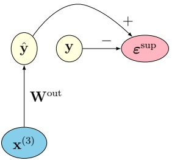

#paper 
写代码！

## 网络架构

### Model：参数说明
- 第 $l$ 层的变量记为 $\mathbf{x}^{(l)}$，是一个 $d_l$ 维的实数向量（每层的维度可以各不相同）。
- 除了 $L$ 层隐变量，还有一个**输入层** $\mathbf{x}^{(0)}$，维度为 $d_0$。

*下图的参数说明*：
1. $x^{(0)}$：输入
2. $x^{(1)} \sim x^{(3)}$：隐变量
3. $a$：预激活值（只乘以权重）
4. $\hat{x}$：预测值（经过激活函数）
5. $\varepsilon$：误差
6. 模型最终的预测值：$\hat y$
7. 标签：$y$
<div style="text-align: center;"></div>
<div style="text-align: center;color: limegreen; font-style: italic;">输出层</div>

<div style="text-align: center;"></div>
<div style="text-align: center;color: limegreen; font-style: italic;">主干网络</div>

### 具体算法

1. 每层隐变量随机初始化
2. 根据隐变量计算下层的预测值：

	• Preactivations（预激活）
$$ \mathbf{a}^{(l)}=\mathbf{W}^{(l)}\mathbf{x}^{(l+1)}\in\mathbb{R}^{d_{l}} $$
	• Predictions（$f^{(l)}$ 为非线性激活函数）
$$ \hat{\mathbf{x}}^{(l)}=f^{(l)}(\mathbf{a}^{(l)})\in\mathbb{R}^{d_{l}} $$
3. 计算误差

	• Prediction errors （隐变量 $-$ 上层的预测值）
$$ \boldsymbol{\varepsilon}^{(l)}=\mathbf{x}^{(l)}-\hat{\mathbf{x}}^{(l)}\in\mathbb{R}^{d_{l}} $$ 
最终需要最小化的损失函数就是每层误差的平方和：
$$ \mathcal{L}=\frac{1}{2}\sum_{l=0}^{L-1}\left\|\varepsilon^{(l)}\right\|^{2}. $$ 
4. 根据误差优化参数，寻找合适的隐变量和权重，具体优化方法见后文

> pcn的预测不是 从输入一步步传播到输出的
> 而是直接从最后一个隐变量输出：$\hat y = W^{out} * x^{(3)}$
> 其中最后一个隐变量 $x^{(3)}$ 在预测时 通过计算得出，而不是事先设定的


### 优化方法：交替最小化步骤

#### 1. 推理过程（inference process）
- **固定权重和输入**：暂时把权重 $\mathbf{W}$ 和输入 $\mathbf{x}^{(0)}$ 当作常量，不去改变它们。
- **推理过程（inference process）**：寻找一组最优的隐变量 $\mathbf{x}^* = (\mathbf{x}^{*(1)}, \ldots, \mathbf{x}^{*(L)})$，使得总预测误差最小。
$$ \mathbf{x}^{*}=\mathop{\operatorname{a r g}\operatorname*{m i n}}_{\mathbf{x}}\mathcal{L}(\mathbf{x};\mathbf{W},\mathbf{x}^{(0)})\;. $$
  - $\arg\min_{\mathbf{x}}$：找到使后面表达式最小的 $\mathbf{x}$ 值
  - $\mathcal{L}(\mathbf{x}; \mathbf{W}, \mathbf{x}^{(0)})$：以 $\mathbf{x}$ 为自变量，$\mathbf{W}$ 和 $\mathbf{x}^{(0)}$ 为参数的能量函数

#### 2. 学习过程（learning process）
固定隐变量，优化权重
- 梯度下降法求权重，使能量函数（损失）变得更小

通过这种方式，**推理**在一个固定的能量景观中执行下降，而**学习**则重塑该景观以更好地适应未来的推理。这种角色分工赋予了预测编码网络其标志性的双时间尺度动力学：快速推理，缓慢学习。

实践中，对于新的输入 $\mathbf{x}^{(0)}$ 和重新初始化的隐变量配置 $\mathbf{x}$，上述过程会重复执行。

**收敛性。** 已有若干工作从理论和实验上证明，预测编码网络中的交替优化过程——即先对隐变量执行推理步骤，再对生成权重进行学习更新——在充分假设条件下可收敛到损失的局部最小值 [31, 27, 7, 16, 2, 24]。并且文末的CIFAR-10应用将展示**快速收敛和良好泛化**的实例

**生成式层级结构。** 网络由堆叠的隐变量层构建而成。其思想是每一层以不同抽象层次表示数据，从原始感官输入逐步上升到更高阶的特征。预测自上而下流动（高层预测低层活动），误差自下而上流动。类似的过程被认为存在于大脑的多级感知层级中。PCN 不只是学习从输入到标签的判别映射，而是显式编码了一个关于低层活动如何由高层原因产生的生成模型，因此网络可以根据其隐变量信念，尝试重建感知数据应有的样子。

**关于混合预测编码的说明。** 在本文所介绍的算法和实现中，隐变量的初始值是随机的——无论是字面意义上还是比喻意义上。最近，一种有趣的混合预测编码模型被提出，其中隐变量 $\mathbf{x}^{(l)}$ 被初始化为另一个网络预测的值 $\boldsymbol{\xi}^{(l)}$ [29]。该第二个网络的预测沿自下而上方向流动——与 PCN 层级方向相反——通过”摊销”函数 $\mathbf{g}^{(l)} : \mathbb{R}^{d_{l-1}} \to \mathbb{R}^{d_l}$ 以前馈方式实现：$\boldsymbol{\xi}^{(l)} = \mathbf{g}^{(l)}(\boldsymbol{\xi}^{(l-1)})$，$1 \leq l \leq L$，从输入 $\boldsymbol{\xi}^{(0)} = \mathbf{x}^{(0)}$ 开始。这种构造反映了网络在接收到感官输入后，在标准 PCN 的精炼推理过程开始之前，对其后验信念的调整。本文后续部分不涉及该混合模型。


## 代码实现（Supervised Learning on CIFAR-10）
代码文件夹（本地）：
[pcn_cifar10_notebook](file:///D:\code\pcn-intro/)

### Define latent layer
```python
class PCNLayer(nn.Module):
    def __init__(self,
                 in_dim,   # d_{l+1}  - dimension of layer above
                 out_dim,  # d_l      - dimension of current layer
                 activation_fn=torch.relu, # nonlinearity f^(l)
                 activation_deriv=lambda a: (a > 0).float() # derivative f^(l)'
                 ):
        super().__init__()
        self.W = nn.Parameter(torch.empty(out_dim, in_dim)) # W^(l)
        nn.init.xavier_uniform_(self.W)
        self.activation_fn     = activation_fn
        self.activation_deriv  = activation_deriv

    def forward(self, x_above):
        with autocast(device_type='cuda'):
            a     = x_above @ self.W.T      # A^(l) = X^(l+1) @ {W^(l)}^T
            x_hat = self.activation_fn(a)   # \hat X^(l) = f^(l)(A^(l))
            return x_hat, a
```

### Define network structure
```python
class PredictiveCodingNetwork(nn.Module):
    def __init__(self,
                 dims,        # [d_0,...,d_L]  - list of layer dimensions
                 output_dim   # d_out          - readout layer dimension
                 ):
        super().__init__()
        self.dims = dims
        self.L = len(dims) - 1            # L  - number of latent layers
        self.layers = nn.ModuleList([     # Build latent layers
            PCNLayer(in_dim=dims[l+1],    # Layer l reads from layer l+1
                     out_dim=dims[l])
            for l in range(self.L)        # l = 0,...,L-1
        ])
        # Build readout layer: maps top latent X^(L) to
        # predicted output \hat Y
        # Note: nn.Linear applies (batch, in_features) @ weight.T under the hood,
        # which corresponds exactly to X^(L) @ (W^out)^T
        self.readout = nn.Linear(dims[-1], output_dim, bias=False)


    def init_latents(self, batch_size, device):
        # returns [X^(1),...,X^(L)] as random normals
        return [
           torch.randn(batch_size, d, device=device, requires_grad=False)
           for d in self.dims[1:]
        ]

    def compute_errors(self, inputs_latents):
        # Compute predictions from input and latent variables
        # Argument: inputs_latents - list of tensors [X^(0), X^(1),...,X^(L)] shaped [(B,d_0),...,(B,d_L)]
        # Returns: two lists of tensors shaped [(B,d_0),...,(B,d_{L-1})]
        errors, gain_modulated_errors = [], []
        for l, layer in enumerate(self.layers):       # l = 0,...,L-1
            # Call to layer returns:
            #   a = X^(l+1) @ W^(l).T  (preactivations A^(l))
            #   x_hat = f^(l)(a)       (predictions \hat X^(l))
            x_hat, a  = layer(inputs_latents[l + 1])
            err       = inputs_latents[l] - x_hat # 隐藏变量 - 上层传下来的预测值
            gm_err    = err * layer.activation_deriv(a)
            errors.append(err)                               # E^(l) - prediction errors
            gain_modulated_errors.append(gm_err)             # H^(l) - gain-modulated errors
        return errors, gain_modulated_errors
```

### 计算误差
```python
# 从每个隐藏层计算
errors, gain_modulated_errors = model.compute_errors(inputs_latents)。
# 输出层单独计算（因为不过激活函数）
y_hat           = model.readout(inputs_latents[-1]) # X^(L) @ W^out.T
eps_sup         = y_hat - y_batch
eps_L           = eps_sup @ weights[-1]
errors_extended = errors + [eps_L]
```

### 更新隐变量(inference)：
```python
for l in range(1, model.L + 1):  # l=1,...,L
	# 计算梯度
	grad_Xl = errors_extended[l] - gain_modulated_errors[l-1] @ weights[l-1]
	# 更新参数
	inputs_latents[l] -= eta_infer * grad_Xl
```

### 更新权重(learning)：
```python
for l in range(model.L): # l=0,...,L-1
	# 计算梯度
	grad_Wl = -(gain_modulated_errors[l].T @ inputs_latents[l+1]) / B
	# 更新参数
	weights[l] -= eta_learn * grad_Wl
```


