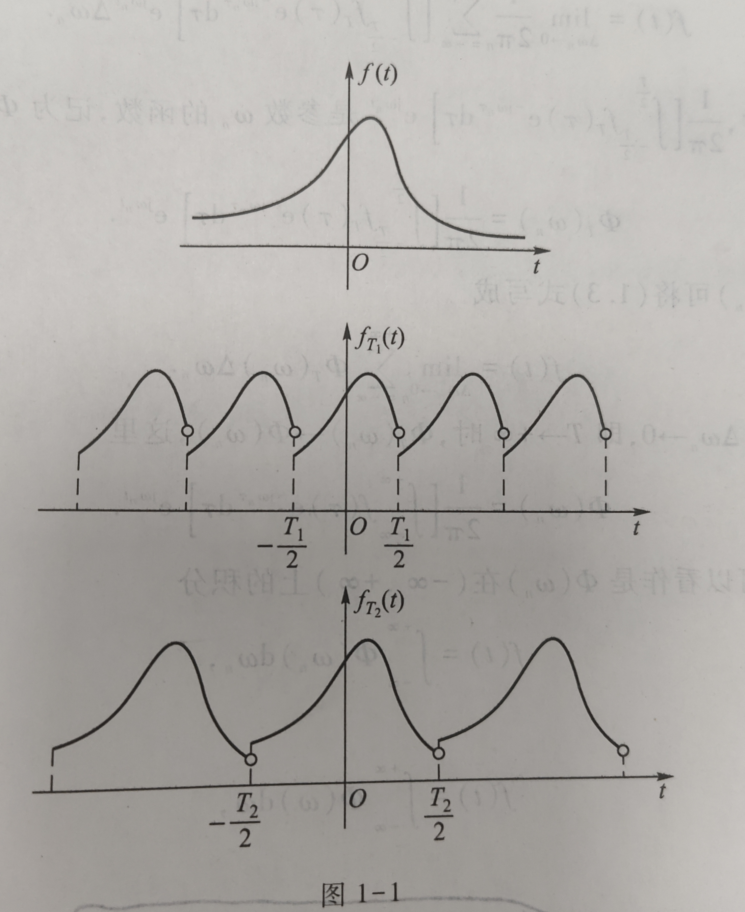

>简单来说，傅里叶级数是离散值，傅里叶变换是连续值

## 基于公式的直接联系
### 傅里叶级数
设 $f(t)$ 为周期函数，其周期为 $T$ ，基频率 $\omega_0 = \frac{2\pi}{T}$，考虑傅里叶级数的**指数形式**：
$$
f(t) = \sum_{n=-\infty}^{\infty} c_n e^{jn\omega_0 t}
$$
- $(n = 0, \pm1, \pm2, \dots)$

**其系数计算公式：**
$$
c_n = \frac{1}{T} \int_{t_0}^{t_0+T} f(t) e^{-jn\omega_0 t} \, dt 
$$

### 傅里叶变换
而我们写出傅里叶变换的公式：
$$F(\omega) = \int_{-\infty}^{\infty} f(t) e^{-i \omega t} dt$$
若取 $f^{'}(t)$ 为 $f(t)$ 的其中一个周期（其余部分全置0），那么它的傅里叶变换为：
$$F^{'}(\omega) = \int_{t_0}^{t_0+T} f^{'}(t) e^{-i \omega t} dt$$
只需要乘以 $\frac{1}{T}$，在取 $\omega$ 为 $n\omega_0$ ，那便与上面提到的系数计算公式一样。

## 周期函数的傅里叶变换 是一系列冲激函数
将级数 $f(t) = \sum_{n=-\infty}^{\infty} c_n e^{jn\omega_0 t}$ 做傅里叶变换，得到的是一系列冲激函数：
$$
F(j\omega) = \sum_{n=-\infty}^{\infty} c_n \,\mathcal{F}\{e^{jn\omega_0 t}\} = 2\pi \sum_{n=-\infty}^{\infty} c_n \,\delta(\omega - n\omega_0)
$$
也就是说，当一个函数周期化时，其每一个频率都被无限放大到冲激函数

> **对偶关系**：时域周期化 $\Longleftrightarrow$ 频域离散化（冲激串）；时域离散化（采样）$\Longleftrightarrow$ 频域周期化。这正是傅里叶级数与傅里叶变换能够互相转化的根源。

#mathf
## 从傅里叶级数 推导 傅里叶变换（非严格）
?
！修改闪卡
>把周期看作无穷大，傅里叶级数便可以转成积分形式，即是从周期函数转到非周期函数

对于任意一个非周期函数 $f(t)$ ，都可以截取 $[-\frac{T}{2},\frac{T}{2})$ 区间，并按周期  $T$ 延拓到整个数轴上。记延拓后的周期函数为 $f_T(t)$ ，该函数可以展开为傅里叶级数：

$$
f_T(t) = \sum_{n=-\infty}^{\infty} \frac{1}{T} \left[\int_{-\frac{T}{2}}^{\frac{T}{2}} f_T(t) e^{-jn\omega_0 t}\, dt \; \right] e^{jn\omega_0 t}
$$

- 这里只是把标准公式中的 $c_n$ 展开
- $\omega_0 = \frac{2\pi}{T}$

显然，周期 $T$ 取得越大，$f_T(t)$ 就越接近 $f(t)$ 。
也就是说，当 $T \to \infty$ 时：
- $f(t) = f_T(t)$
- $\omega_0 \to 0$ 。那么 $n\omega_0$ 可看作连续值 $\omega$，而 $\omega_0$ 可看作 $d\omega$
- $\frac{1}{T} = \frac{\omega_0}{2\pi} = \frac{1}{2\pi} d\omega$

那么我们就可以把求和写成积分：
$$
f(t) = \frac{1}{2\pi} \int_{-\infty}^{\infty}  \left[\int_{-\infty}^{\infty} f(t) e^{-j\omega t}\, dt \; \right] e^{j\omega t } \, d \omega
$$
这就是傅里叶积分。

1. 把中间的系数记作 $F(j\omega)$ ，那么就是傅里叶变换的公式：
$$F(j\omega) = \int_{-\infty}^{\infty} f(t) e^{-j\omega t}\, dt$$
	- 这就是 $c_n$ 的连续值。

2. 外层公式就是傅里叶逆变换：
$$
f(t) = \frac{1}{2\pi} \int_{-\infty}^{\infty}  F(j\omega) e^{j\omega t } \, d \omega
$$
<!--SR:!2026-11-22,12,270-->

---

### 过程的详细推导
原傅里叶级数：
$$
f_T(t) = \sum_{n=-\infty}^{\infty} \frac{1}{T} \left[\int_{-\frac{T}{2}}^{\frac{T}{2}} f_T(t) e^{-jn\omega_0 t}\, dt \; \right] e^{jn\omega_0 t}
$$

当 $T \to \infty$ 时，$f_T(t) = f(t)$：
$$
f(t) = \lim_{T \to \infty}\sum_{n=-\infty}^{\infty} \frac{1}{T} \left[\int_{-\frac{T}{2}}^{\frac{T}{2}} f_T(t) e^{-jn\omega_0 t}\, dt \; \right] e^{jn\omega_0 t}
$$

当 $T \to \infty$ 时，基频率 $\omega_0 = \frac{2\pi}{T} \to 0$ 。上式可变化为：

$$
f(t) = \lim_{\omega_0 \to 0}\sum_{n=-\infty}^{\infty} \frac{1}{2\pi} \left[\int_{-\infty}^{\infty} f(t) e^{-jn\omega_0 t}\, dt \; \right] e^{jn\omega_0 t } \,  \omega_0
$$

把 $n\omega_0$ 看成 $\omega$，把 $\omega_0$ 看成 $d\omega$。上式就相当于关于 $\omega$ 积分：

$$
f(t) = \frac{1}{2\pi} \int_{-\infty}^{\infty}  \left[\int_{-\infty}^{\infty} f(t) e^{-j\omega t}\, dt \; \right] e^{j\omega t } \, d \omega
$$
