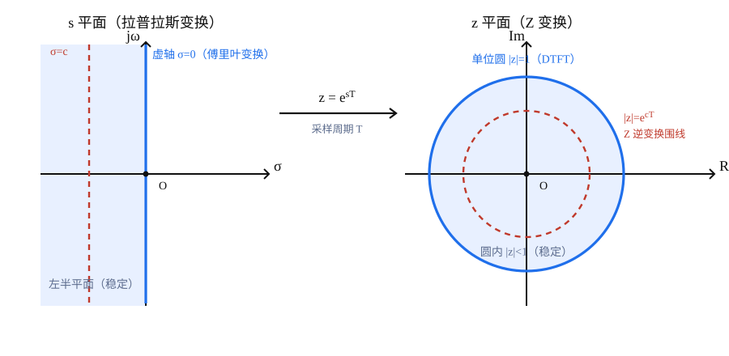

**傅里叶变换（FT）**、**拉普拉斯变换（LT）** 与 **Z 变换（ZT）** 是分析**线性时不变（LTI）系统**的三件套工具。LT 与 ZT 分别处理**连续**与**离散**信号，而 FT 是 LT 在**虚轴上的特例**；Z 变换则是采样信号的拉氏变换经变量代换 $z=e^{sT}$ 得到的。三者通过复平面之间的映射（**s 平面**、**z 平面**）紧密相连。

## 一、三者的定位与统一视角

| 变换 | 处理信号 | 复变量 | 核函数 | 存在条件 |
|:---|:---|:---|:---|:---|
| **傅里叶变换 FT** | 连续、非周期 | $\omega$（等价 $j\omega$） | $e^{-j\omega t}$ | 绝对可积，或借助广义函数 |
| **拉普拉斯变换 LT** | 连续 | $s=\sigma+j\omega$ | $e^{-st}$ | 收敛域（ROC）非空 |
| **Z 变换 ZT** | 离散序列 $x[n]$ | $z$ | $z^{-n}$ | 收敛域（ROC）非空 |

三者的共同思想：用**复指数基底** $e^{st}$（连续）与 $z^{n}$（离散）把 LTI 系统的**微分 / 差分方程**、**卷积**化为**代数运算**。变量之间由两条纽带连接：

$$
\underbrace{e^{-j\omega t}}_{\text{FT 核}} \;\longleftarrow\; \underbrace{e^{-st}}_{\text{LT 核}},\ \ s=\sigma+j\omega
\qquad\qquad
\underbrace{z=e^{sT}}_{\text{采样}},\ \ \underbrace{z^{-n}=(e^{sT})^{-n}}_{\text{ZT 核}}
$$

即：**FT 是 LT 在 $\sigma=0$ 的切片**；**ZT 是 LT 经采样后的变量代换**。

---

## 二、傅里叶变换 ↔ 拉普拉斯变换：虚轴上的切片

### 1. 正变换

令 $s=\sigma+j\omega$，当 $\sigma=0$（即 $s=j\omega$）时，

$$F(j\omega)=\left.F(s)\right|_{s=j\omega}=\int_{-\infty}^{\infty} f(t)\,e^{-j\omega t}\,dt$$

> **前提**：LT 的**收敛域包含虚轴** $\sigma=0$。若不含，则 FT 不存在，或需借助广义函数补项（如 $u(t)$ 的 FT 为 $\pi\delta(\omega)+\dfrac{1}{j\omega}$）。

### 2. 逆变换

LT 的逆变换是沿 **$\sigma=c$ 竖直直线**（Bromwich 围线）的复积分；令 $c=0$，积分路径落到虚轴上，即退化为 FT 的逆变换：

$$
f(t)=\frac{1}{2\pi j}\int_{c-j\infty}^{c+j\infty} F(s)\,e^{st}\,ds
\;\;\xrightarrow{\;c=0\;}\;\;
f(t)=\frac{1}{2\pi}\int_{-\infty}^{\infty} F(j\omega)\,e^{j\omega t}\,d\omega
$$

> 因此，**FT 的积分路径就是 s 平面上的虚轴**，LT 的积分路径是任意一条位于收敛域内、平行于虚轴的直线。二者是同一条“竖直围线”在 $\sigma=0$ 时的特例。

$$
\boxed{\text{傅里叶变换} = \text{拉普拉斯变换在虚轴 } \sigma=0 \text{ 上的切片}}
$$

---

## 三、拉普拉斯变换 ↔ Z 变换：$z=e^{sT}$ 映射

### 1. 从采样信号导出

理想采样信号 $x_s(t)=\sum\limits_{n=-\infty}^{\infty} x(nT)\,\delta(t-nT)$ 的拉氏变换为

$$X_s(s)=\sum_{n=-\infty}^{\infty} x(nT)\,e^{-snT}$$

令 $z=e^{sT}$（$T$ 为采样周期），即得 Z 变换

$$X(z)=\sum_{n=-\infty}^{\infty} x(nT)\,z^{-n}=\mathcal{Z}\{x[n]\}\big|_{x[n]=x(nT)}$$

> 所以 **ZT = 采样信号 LT 的变量代换** $z=e^{sT}$。这也说明：讨论 Z 变换必须与采样周期 $T$ 挂钩，离散频率被“归一化”为 $\omega=\Omega T$。

### 2. s 平面 → z 平面的映射规律

由 $z=e^{sT}=e^{\sigma T}e^{j\omega T}$，得

$$|z|=e^{\sigma T},\qquad \angle z=\omega T$$

| s 平面 | z 平面 | 含义 |
|:---|:---|:---|
| 虚轴 $\sigma=0$ | 单位圆 $\lvert z\rvert=1$ | 傅里叶 / DTFT 频率轴 |
| 左半平面 $\sigma<0$ | 单位圆内 $\lvert z\rvert<1$ | **稳定**区 |
| 右半平面 $\sigma>0$ | 单位圆外 $\lvert z\rvert>1$ | 不稳定区 |
| 竖直线 $\sigma=c$ | 圆 $\lvert z\rvert=e^{cT}$ | 逆变换围线 |
| $\sigma\to-\infty$ | $z\to 0$（原点） | |
| $\omega$ 沿虚轴走 $\dfrac{2\pi}{T}$ | 绕单位圆一圈 | 频率周期化 |

### 3. 关键：映射不是一一对应的

$e^{sT}$ 关于 $\omega$ 以

$$\omega_s=\frac{2\pi}{T}$$

为周期，故 **s 平面沿虚轴每隔 $\omega_s$ 的水平带都映射到同一个 z 平面**。若取**基本映射带**

$$-\frac{\pi}{T}<\omega\le\frac{\pi}{T}\quad\left(-\frac{\omega_s}{2}<\omega\le\frac{\omega_s}{2}\right)$$

则该带内的点与 z 平面**一一对应**，带外部分只是**重复叠加**。

> 这正是**离散信号频谱周期性**与**频率混叠（Aliasing）**的根源：s 平面无穷多条水平带“卷绕”到同一个 z 平面，高频与低频可能落到同一点（见 [[11. 取样]]）。

---

#review  
## 四、平面映射关系图
?
>s平面左半部分在z平面的单位圆内，右半平面在单位圆外，虚轴刚好为单位圆
>对于傅里叶变换，在s平面中对应虚轴，在z平面中对应单位圆

> 左：s 平面。蓝线为虚轴 $\sigma=0$（对应 FT），红线 $\sigma=c$ 为 LT 逆变换的竖直围线（取在收敛域内、极点右侧）。右：z 平面。蓝圆为单位圆 $\lvert z\rvert=1$（对应 DTFT），红圆 $\lvert z\rvert=e^{cT}$ 为 ZT 逆变换围线——它正是 s 平面竖直线的像。

**因果性与稳定性的对应**：

| 连续系统（s 平面） | 离散系统（z 平面） |
|:---|:---|
| 极点位于**左半平面** $\sigma<0$ | 极点位于**单位圆内** $\lvert z\rvert<1$ |
| 收敛域含**虚轴** → 稳定 | 收敛域含**单位圆** → 稳定 |
| 虚轴上的频率响应 $F(j\omega)$ | 单位圆上的频率响应 $H(e^{j\omega})$ |

---

## 五、傅里叶变换、DTFT、DFT 与 Z 变换

- 当 $z$ 取**单位圆上的值** $z=e^{j\omega}$（即 $\sigma=0$，$\omega=\Omega T$）时，Z 变换退化为**离散时间傅里叶变换（DTFT）**：
  $$X(e^{j\omega})=X(z)\big|_{z=e^{j\omega}},\qquad \text{前提：ROC 含单位圆}$$
- DTFT 关于 $\omega$ 以 $2\pi$ 为周期，对应 s 平面虚轴上的 $\omega_s=\dfrac{2\pi}{T}$ 周期。
- 在单位圆上对 $\omega$ 等间隔取样，即得**离散傅里叶变换（DFT）**，是可计算（FFT）的频域工具。
- 从采样角度看：采样信号的 FT 是原信号 FT 的**周期延拓**：
  $$X_s(j\Omega)=\frac{1}{T}\sum_{k=-\infty}^{\infty} X_a\big(j(\Omega-k\Omega_s)\big),\qquad \Omega_s=\frac{2\pi}{T}$$

$$
\boxed{\text{DFT}\subset\text{DTFT}=\text{Z 变换在单位圆上的“切片”}=\text{采样信号 FT 的周期延拓}}
$$

---

## 六、三个逆变换的围线对照

| 变换 | 逆变换公式 | 积分路径（复平面） |
|:---|:---|:---|
| **FT** | $f(t)=\dfrac{1}{2\pi}\displaystyle\int_{-\infty}^{\infty}F(j\omega)e^{j\omega t}\,d\omega$ | s 平面**虚轴** |
| **LT** | $f(t)=\dfrac{1}{2\pi j}\displaystyle\int_{c-j\infty}^{c+j\infty}F(s)e^{st}\,ds$ | s 平面 $\sigma=c$ **竖直线** |
| **ZT** | $x[n]=\dfrac{1}{2\pi j}\displaystyle\oint_C X(z)z^{\,n-1}\,dz$ | z 平面半径 $r=e^{cT}$ 的**圆** |

> 三者本质相同：**在收敛域内沿一条“竖直 / 圆形”围线做复积分**。而 $z=e^{sT}$ 恰好把 s 平面的**竖直线** $\sigma=c$ 映成 z 平面的**圆** $\lvert z\rvert=e^{cT}$——三个逆变换在几何上完全对应。当 $c=0$ 时，LT 逆变换退化为 FT 逆变换（[[留数法]]）。

---

## 七、关系总览

| | 傅里叶变换 FT | 拉普拉斯变换 LT | Z 变换 ZT |
|:---|:---|:---|:---|
| 信号 | 连续 | 连续 | 离散 |
| 复变量 | $j\omega$ | $s=\sigma+j\omega$ | $z$ |
| 频率轴 / 收敛域 | 虚轴 | s 平面（含虚轴） | 单位圆 |
| 稳定性 | 极点位于虚轴（临界） | 极点位于**左半平面** | 极点位于**单位圆内** |
| 逆变换围线 | 虚轴 | $\sigma=c$ 竖直线 | $\lvert z\rvert=e^{cT}$ 圆 |
| 与谁相连 | LT 的特例 | 最一般形式 | LT 的采样代换 |

**一句话记忆**：

$$
\text{FT}\;\subset\;\text{LT},\qquad \text{DTFT}\;\subset\;\text{ZT},\qquad z=e^{sT}\ \text{把 s 平面卷绕到 z 平面}
$$

---

## 相关

- [[../复变函数与积分变换/3. 拉普拉斯变换概念]] —— LT 定义及其与 FT 的关系
- [[../复变函数与积分变换/4. 拉普拉斯变换的性质]] —— LT 性质体系
- [[Z变换]] —— Z 变换定义、ROC、性质与逆变换
- [[../复变函数与积分变换/1.傅里叶级数与傅里叶变换]] —— FT 定义与直观理解
- [[11. 取样]] —— 采样定理、频谱周期化与混叠
- [[留数法]] —— 围线积分（逆 Z 变换留数法）
