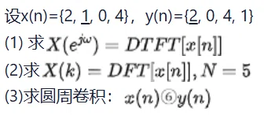

**已知**（$n$ 从 0 开始）：
$$x(n)=\{2,\ 1,\ 0,\ 4\},\qquad y(n)=\{2,\ 0,\ 4,\ 1\}$$

---

## (1) 求 DTFT $X(e^{j\omega})$

$$X(e^{j\omega})=\sum_{n=0}^{3}x(n)e^{-j\omega n}=2+e^{-j\omega}+0\cdot e^{-j2\omega}+4e^{-j3\omega}$$

$$\boxed{X(e^{j\omega})=2+e^{-j\omega}+4e^{-j3\omega}}$$

提出 $e^{-j3\omega/2}$ 整理成幅度-相位形式：

$$X(e^{j\omega})=e^{-j3\omega/2}\Big[\big(6\cos\tfrac{3\omega}{2}+\cos\tfrac{\omega}{2}\big)+j\big(\sin\tfrac{\omega}{2}-2\sin\tfrac{3\omega}{2}\big)\Big]$$

幅度：$\;|X(e^{j\omega})|=\sqrt{21+4\cos\omega+8\cos2\omega+16\cos3\omega}$

> 验算：$\omega=0$ 时 $|X|=7$，与 $X(0)=\sum x(n)=7$ 一致。

---

## (2) 求 $N=5$ 的 DFT $X(k)$

$x(n)$ 只有 4 点，需补 1 个零：$x=\{2,1,0,4,0\}$，$W_5=e^{-j2\pi/5}$。

$$X(k)=\sum_{n=0}^{4}x(n)W_5^{nk}=2+W_5^{k}+4W_5^{3k},\qquad k=0,1,\dots,4$$

即 $X(k)=2+e^{-j\frac{2\pi k}{5}}+4e^{-j\frac{6\pi k}{5}}$。数值：

| $k$ | $X(k)$ |
|:---:|:---|
| 0 | $7$ |
| 1 | $-0.9271+j1.4001$ |
| 2 | $2.4271-j4.3920$ |
| 3 | $2.4271+j4.3920$ |
| 4 | $-0.9271-j1.4001$ |

> 实序列满足共轭对称 $X(k)=X^{*}(N-k)$，故 $X(4)=X^*(1)$、$X(3)=X^*(2)$，只需算 $k=0,1,2$。

---

## (3) 求圆周卷积 $x(n)\circledast y(n)$（$N=4$）

$$y_c(n)=\sum_{m=0}^{3}x(m)\,y\big((n-m)\bmod 4\big)$$

逐点计算：

- $n=0$：$2\cdot2+1\cdot1+0\cdot4+4\cdot0=5$
- $n=1$：$2\cdot0+1\cdot2+0\cdot1+4\cdot4=18$
- $n=2$：$2\cdot4+1\cdot0+0\cdot2+4\cdot1=12$
- $n=3$：$2\cdot1+1\cdot4+0\cdot0+4\cdot2=14$

$$\boxed{x(n)\circledast y(n)=\{5,\ 18,\ 12,\ 14\}}$$

> **DFT 验证**（$N=4$，$\circledast \leftrightarrow$ 频域相乘）：
> $X_4=\{7,\ 2+3j,\ -3,\ 2-3j\}$，$Y_4=\{7,\ -2+j,\ 5,\ -2-j\}$，
> 乘积 $P=\{49,\ -7-4j,\ -15,\ -7+4j\}$，IDFT 得 $\{5,18,12,14\}$，与上一致。

---

## 圆周卷积（Circular Convolution）

> 也叫**循环卷积**。它只在**有限长序列**上定义，是 DFT 的“天然搭档”：**时域圆周卷积 ↔ 频域逐点相乘**。

### 一、定义

设两序列长度均为 $N$，则 $N$ 点圆周卷积 定义为

$$x(n)\circledast y(n)=\sum_{m=0}^{N-1}x(m)\,y\big((n-m)\bmod N\big),\qquad n=0,1,\dots,N-1$$

关键在 **$\bmod N$**：把序列首尾相接**缠绕（卷绕）在一个长度为 $N$ 的圆环上**，索引超出 $[0,\,N-1]$ 就从另一端绕回来，即 $y(-1)=y(N-1)$、$y(N)=y(0)$。

> 与**线性卷积** $x(n)*y(n)=\sum_m x(m)y(n-m)$ 的唯一区别：线性卷积的索引是**直线**（取值范围 $-N+1\sim N-1$），圆周卷积的索引是**圆圈**（取值永远落在 $0\sim N-1$）。

### 二、与线性卷积的关系：周期延拓 + 折叠

把 $x(n)$、$y(n)$ 以 $N$ 为周期**延拓**成周期序列 $\tilde x(n),\tilde y(n)$，则

$$\tilde x(n)\circledast \tilde y(n)=\sum_{m=0}^{N-1}\tilde x(m)\,\tilde y(n-m)$$

即**圆周卷积 = 两个周期序列在一个周期内的卷积**。若先做线性卷积 $y_{\text{lin}}(n)=x(n)*y(n)$，再把它**以 $N$ 为周期折叠叠加（wrap-around）**，就得到圆周卷积：

$$y_c(n)=\sum_{r=-\infty}^{\infty} y_{\text{lin}}(n+rN)$$

- 线性卷积长度 $L=N_1+N_2-1$；
- 若 $N\ge L$，折叠时各段不重叠 → **圆周卷积 = 线性卷积**；
- 若 $N<L$，后一段会“绕回来”叠加到前面 → 发生**时域混叠（wrap-around error）**。

$$
\boxed{\;N\ge N_1+N_2-1\ \Longrightarrow\ \text{圆周卷积}=\text{线性卷积}\;}
$$

> 这正是用 DFT 做快速线性卷积时，必须把序列**补零到 $N\ge N_1+N_2-1$** 的原因。

### 三、三种计算方法

1. **定义法（列表法）**：直接套定义，逐点按 $\bmod N$ 取索引——本题 (3) 即此法。
2. **循环矩阵法**：写成矩阵形式，第二行是上一行的**循环右移**：

$$
\begin{bmatrix}y_c(0)\\y_c(1)\\\vdots\\y_c(N-1)\end{bmatrix}
=\underbrace{\begin{bmatrix}
y(0)&y(N-1)&\cdots&y(1)\\
y(1)&y(0)&\cdots&y(2)\\
\vdots&\vdots&\ddots&\vdots\\
y(N-1)&y(N-2)&\cdots&y(0)
\end{bmatrix}}_{\text{循环矩阵（Circulant）}}
\begin{bmatrix}x(0)\\x(1)\\\vdots\\x(N-1)\end{bmatrix}
$$

3. **DFT 法**：先各自做 DFT，频域**逐点相乘**，再 IDFT 回去：

$$y_c(n)=\text{IDFT}\big[\,X(k)\,Y(k)\,\big]$$

### 四、性质

| 性质 | 表达式 |
|:---|:---|
| 交换律 | $x\circledast y=y\circledast x$ |
| 结合律 | $(x\circledast y)\circledast h=x\circledast(y\circledast h)$ |
| 分配律 | $x\circledast(y+h)=x\circledast y+x\circledast h$ |
| **圆周卷积定理** | $x(n)\circledast y(n)\ \longleftrightarrow\ X(k)Y(k)$（DFT） |

> **对比线性卷积定理**（DTFT）：$x(n)*y(n)\longleftrightarrow X(e^{j\omega})Y(e^{j\omega})$。
> 二者形式完全平行，区别只是“**DFT ↔ 圆周卷积**”“**DTFT ↔ 线性卷积**”。对偶地，时域相乘则对应频域圆周卷积。

### 五、本例（$N=4$）回顾

$x=\{2,1,0,4\}$、$y=\{2,0,4,1\}$，长度 $N_1=N_2=4$，线性卷积长度 $L=N_1+N_2-1=7$。因 $N=4<7$，圆周卷积**不等于**线性卷积，发生了 wrap-around 折叠。

先求线性卷积 $y_{\text{lin}}=x*y$（长度 7）：

$$y_{\text{lin}}=\{4,\ 2,\ 8,\ 14,\ 1,\ 16,\ 4\}$$

再以 $N=4$ 为周期折叠叠加 $y_c(n)=\sum_r y_{\text{lin}}(n+4r)$：

- $y_c(0)=y_{\text{lin}}(0)+y_{\text{lin}}(4)=4+1=5$
- $y_c(1)=y_{\text{lin}}(1)+y_{\text{lin}}(5)=2+16=18$
- $y_c(2)=y_{\text{lin}}(2)+y_{\text{lin}}(6)=8+4=12$
- $y_c(3)=y_{\text{lin}}(3)=14$

$$\Longrightarrow\quad x(n)\circledast y(n)=\{5,\ 18,\ 12,\ 14\}$$

与 (3) 的定义法、以及 DFT 频域相乘法结果**完全一致**。

> 若把 $N$ 取到 $\ge 7$（补零到 7 点或更多），圆周卷积就退化为线性卷积 $\{4,2,8,14,1,16,4\}$——可见**圆周卷积是线性卷积在“长度不足”时的混叠版本**。
