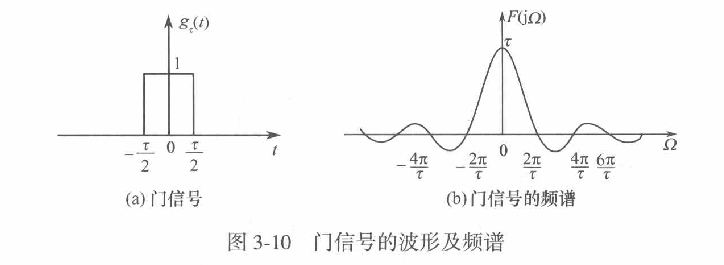
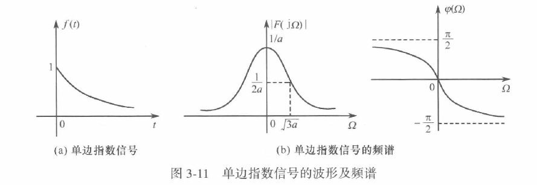
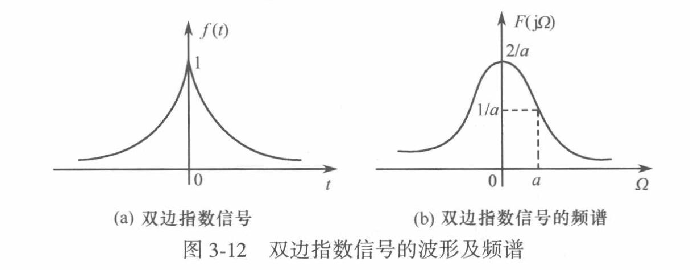
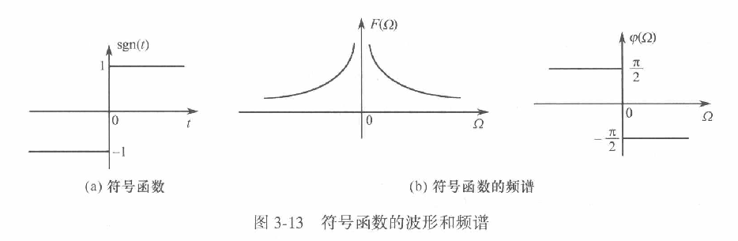
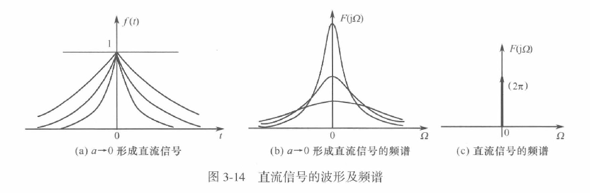
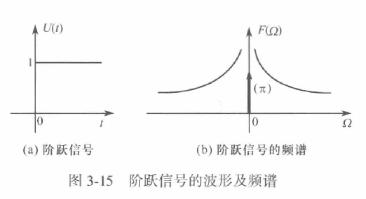

## 速查表

| 信号         | 时域 $f(t)$                                      | 频谱 $F(\mathrm{j}\Omega)$                            |
| :--------- | :--------------------------------------------- | :-------------------------------------------------- |
| 矩形脉冲（门信号）  | $g_{\tau}(t)$（幅度为 1、脉宽为 $\tau$）                | $\tau\mathrm{Sa}\left(\dfrac{\Omega\tau}{2}\right)$ |
| 单边指数信号     | $\mathrm{e}^{-at}U(t)$，$a>0$                   | $\dfrac{1}{a+\mathrm{j}\Omega}$                     |
| 双边指数信号     | $\mathrm{e}^{-a\left\vert t\right\vert}$，$a>0$ | $\dfrac{2a}{\Omega^{2}+a^{2}}$                      |
| 符号函数       | $\operatorname{sgn}(t)$                        | $\dfrac{2}{\mathrm{j}\Omega}$                       |
| 冲激信号       | $\delta(t)$                                    | $1$                                                 |
| 冲激偶 / 高阶冲激 | $\delta'(t)$；$\delta^{(n)}(t)$                 | $\mathrm{j}\Omega$；$(\mathrm{j}\Omega)^{n}$         |
| 单位直流信号     | $1$                                            | $2\pi\delta(\Omega)$                                |
| 阶跃信号       | $U(t)$                                         | $\pi\delta(\Omega)+\dfrac{1}{\mathrm{j}\Omega}$     |

> 表中 $a>0$；幅度谱与相位谱仅对单边指数、双边指数、符号函数列出。

## 典型非周期信号的傅里叶变换

#mathf
### 矩形脉冲信号（门信号） $g_{r}(t)$
?
由例3-6可知，幅度E=1的矩形脉冲信号 $g_{\tau}(t)$的傅里叶变换为
$$  g_{\tau}(t)\longleftrightarrow\tau\mathrm{S a}\left(\frac{\Omega\tau}{2}\right)   \tag*{（3-22）}$$

<!--SR:!2026-11-26,3,250-->

---

#mathf
### 单边指数信号  $e^{-at}U(t)(a>0)$
?
$$ F(\mathrm{j}\Omega)=\int_{-\infty}^{\infty}f(t)\mathrm{e}^{-\mathrm{j}\Omega t}\mathrm{d}t=\int_{-\infty}^{\infty}\mathrm{e}^{-at}U(t)\cdot\mathrm{e}^{-\mathrm{j}\Omega t}\mathrm{d}t=\int_{0}^{\infty}\mathrm{e}^{-\left(a+\mathrm{j}\Omega\right)t}\mathrm{d}t=\frac{1}{a+\mathrm{j}\Omega} $$
即
$$  \left.\begin{array}{l}\mathrm{e}^{-a t}U(t)\longleftrightarrow\frac{1}{a+\mathrm{j}\Omega}\\ \mid F(\mathrm{j}\Omega)\mid=\frac{1}{\sqrt{a^{2}+\Omega^{2}}}\\ \varphi(\Omega)=-\arctan\frac{\Omega}{a}\end{array}\right\}   \tag*{(3-23)}$$

*（ $|F(j\Omega)|$ 是偶函数，图中画歪了）*
<!--SR:!2026-11-26,3,250-->

---

#mathf
### 双边指数信号 $\mathrm{e}^{-a|t|}$（$a>0$）
?
$$ \begin{aligned}F(\mathrm{j}\Omega)&=\int_{-\infty}^{\infty}f(t)\mathrm{e}^{-\mathrm{j}\Omega t}\mathrm{d}t=\int_{-\infty}^{\infty}\mathrm{e}^{-a|t|}\cdot\mathrm{e}^{-\mathrm{j}\Omega t}\mathrm{d}t\\&=\int_{-\infty}^{0}\mathrm{e}^{a t}\cdot\mathrm{e}^{-\mathrm{j}\Omega t}\mathrm{d}t+\int_{0}^{\infty}\mathrm{e}^{-a t}\cdot\mathrm{e}^{-\mathrm{j}\Omega t}\mathrm{d}t\\&=\frac{1}{a-\mathrm{j}\Omega}+\frac{1}{a+\mathrm{j}\Omega}=\frac{2a}{a^{2}+\Omega^{2}}\end{aligned} $$
即
$$ \begin{aligned}&\quad\mathrm{e}^{-a|t|}\longleftrightarrow\frac{2a}{\Omega^{2}+a^{2}}\\&\quad F(\Omega)=\frac{2a}{\Omega^{2}+a^{2}}\\&\quad\varphi(\Omega)=0\end{aligned} $$

*（ $F(j\Omega)$ 是偶函数）*
<!--SR:!2026-11-27,4,270-->

---

#mathf
### 符号函数 $\operatorname{sgn}(t)$
?
$$ \operatorname{sgn}(t)=\left\{\begin{aligned}&1,&t>0\\&-1,&t<0\end{aligned}\right. $$
符号函数 可由 单边指数信号逼近：
$$ \begin{aligned}\operatorname{sgn}(t)&=\lim_{a\to0}\left[\mathrm{e}^{-a t}U(t)-\mathrm{e}^{a t}U(-t)\right]\\F(\mathrm{j}\Omega)&=\lim_{a\to0}\left[\int_{0}^{\infty}\mathrm{e}^{-(a+\mathrm{j}\Omega)t}\mathrm{d}t-\int_{-\infty}^{0}\mathrm{e}^{(a-\mathrm{j}\Omega)t}\mathrm{d}t\right]\\&=\lim_{a\to0}\left(\frac{1}{a+\mathrm{j}\Omega}-\frac{1}{a-\mathrm{j}\Omega}\right)=\frac{2}{\mathrm{j}\Omega}\end{aligned} $$
即
$$ \left.\begin{array}{l}\operatorname{sgn}(t)\longleftrightarrow\frac{2}{\mathrm{j}\Omega}\\|F(\mathrm{j}\Omega)|=\frac{2}{|\Omega|}\\\varphi(\Omega)=-\frac{\pi}{2}\operatorname{sgn}(\Omega)\end{array}\right\} \tag*{(3-25)} $$

<!--SR:!2026-11-26,3,250-->

---

#mathf
### 冲激信号和冲激偶
?
#### 冲激信号
$$F(\mathrm{j}\Omega)=\int_{-\infty}^{\infty}\delta(t)\,\mathrm{e}^{-\mathrm{j}\Omega t}\,\mathrm{d}t = 1$$
所以
$$ \delta(t)\longleftrightarrow1 $$
#### 冲激偶
取 $\delta(t)$ 的逆变换：
$$ \delta(t)=\frac{1}{2\pi}\int_{-\infty}^{\infty}1\cdot\mathrm{e}^{\mathrm{j}\Omega t}\mathrm{d}\Omega $$
两边对 $t$ 求导，得
$$ \delta^{\prime}(t)=\frac{\mathrm{d}}{\mathrm{d}t}\delta(t)=\frac{1}{2\pi}\int_{-\infty}^{\infty}\mathrm{j}\Omega\cdot\mathrm{e}^{\mathrm{j}\Omega t}\mathrm{d}\Omega $$
即 $\delta^{\prime}(t)$ 的傅里叶变换：
$$ \delta^{\prime}(t)\longleftrightarrow\mathrm{j}\Omega $$
同理可得
$$ \delta^{(n)}(t)\longleftrightarrow(\mathrm{j}\Omega)^{n} $$
<!--SR:!2026-11-27,4,270-->

---

### 单位直流信号

直流信号可看成双边指数信号当 $a\to0$ 时的极限：
$$ \begin{aligned}1=\lim_{a\to0}f(t)&=\lim_{a\to0}\mathrm{e}^{-a|t|}\\F(\mathrm{j}\Omega)=\lim_{a\to0}\frac{2a}{a^{2}+\Omega^{2}}&=\left\{\begin{aligned}&0,&\Omega\neq0\\&\infty,&\Omega=0\end{aligned}\right.\end{aligned} $$
$F(\mathrm{j}\Omega)$ 显然是一个冲激函数，其强度为
$$ \int_{-\infty}^{\infty}\frac{2a}{a^{2}+\Omega^{2}}\mathrm{d}\Omega=2\int_{-\infty}^{\infty}\frac{1}{1+\left(\frac{\Omega}{a}\right)^{2}}\mathrm{d}\left(\frac{\Omega}{a}\right) $$
因为
$$ \int_{-\infty}^{\infty}\frac{1}{1+x^{2}}\mathrm{d}x=\arctan x\,\bigg|_{-\infty}^{\infty}=\pi $$
所以
$$ \int_{-\infty}^{\infty}\frac{2a}{a^{2}+\Omega^{2}}\mathrm{d}\Omega=2\pi $$
即
$$ 1\longleftrightarrow2\pi\delta(\Omega) $$

#mathf
### 阶跃信号 $U(t)$
?
把阶跃信号做偶分量、奇分量分解，有
$$ U(t)=\frac{1}{2}\times1+\frac{1}{2}\operatorname{sgn}(t) $$
由 $1\longleftrightarrow2\pi\delta(\Omega)$、$\operatorname{sgn}(t)\longleftrightarrow\frac{2}{\mathrm{j}\Omega}$，得
$$ F(\mathrm{j}\Omega)=\frac{1}{2}\cdot2\pi\delta(\Omega)+\frac{1}{2}\cdot\frac{2}{\mathrm{j}\Omega}=\pi\delta(\Omega)+\frac{1}{\mathrm{j}\Omega} $$
即
$$ U(t)\longleftrightarrow\pi\delta(\Omega)+\frac{1}{\mathrm{j}\Omega} $$

<!--SR:!2026-11-26,3,250-->

---
