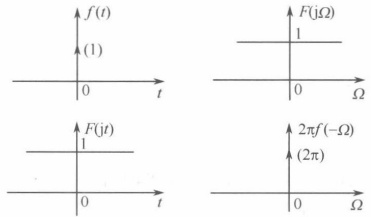

#mathf
## 线性特性（Linearity）
?
若
$$ f_1(t)\longleftrightarrow F_1(\mathrm{j}\Omega),\qquad f_2(t)\longleftrightarrow F_2(\mathrm{j}\Omega) $$
则
$$ a_1f_1(t)+a_2f_2(t)\longleftrightarrow a_1F_1(\mathrm{j}\Omega)+a_2F_2(\mathrm{j}\Omega) $$
其中 $a_1$、$a_2$ 为任意常数。

**证明：** 由傅里叶变换的定义
$$ \begin{aligned} \mathcal{F}[a_1f_1(t)+a_2f_2(t)]&=\int_{-\infty}^{\infty}\left[a_1f_1(t)+a_2f_2(t)\right]\mathrm{e}^{-\mathrm{j}\Omega t}\mathrm{d}t\\ &=a_1\int_{-\infty}^{\infty}f_1(t)\mathrm{e}^{-\mathrm{j}\Omega t}\mathrm{d}t+a_2\int_{-\infty}^{\infty}f_2(t)\mathrm{e}^{-\mathrm{j}\Omega t}\mathrm{d}t\\ &=a_1F_1(\mathrm{j}\Omega)+a_2F_2(\mathrm{j}\Omega) \end{aligned} $$
所以
$$ a_1f_1(t)+a_2f_2(t)\longleftrightarrow a_1F_1(\mathrm{j}\Omega)+a_2F_2(\mathrm{j}\Omega) $$
可见傅里叶变换满足**齐次性**和**可加性**。
<!--SR:!2026-11-28,4,270-->

---

#mathf
## 对称特性（对偶性）
?
若 $f(t)\longleftrightarrow F(\mathrm{j}\Omega)$，则
$$ F(\mathrm{j}t)\longleftrightarrow 2\pi f(-\Omega) $$
- 这里的 $j$ 只是标记，$F(\mathrm{j}t)$ 完全可以是实信号

**证明：** 由傅里叶逆变换定义
$$ f(t)=\frac{1}{2\pi}\int_{-\infty}^{\infty}F(\mathrm{j}\Omega)\mathrm{e}^{\mathrm{j}\Omega t}\mathrm{d}\Omega \tag*{(3-30)} $$
有
$$ f(-t)=\frac{1}{2\pi}\int_{-\infty}^{\infty}F(\mathrm{j}\Omega)\mathrm{e}^{-\mathrm{j}\Omega t}\mathrm{d}\Omega $$
将上式中 $t$ 与 $\Omega$ 互换，结果不变：
$$ f(-\Omega)=\frac{1}{2\pi}\int_{-\infty}^{\infty}F(\mathrm{j}t)\mathrm{e}^{-\mathrm{j}\Omega t}\mathrm{d}t $$
所以
$$ 2\pi f(-\Omega)=\int_{-\infty}^{\infty}F(\mathrm{j}t)\mathrm{e}^{-\mathrm{j}\Omega t}\mathrm{d}t $$
由傅里叶变换的定义知
$$ F(\mathrm{j}t)\longleftrightarrow 2\pi f(-\Omega) $$

该性质说明：若**偶函数** $f(t)$ 的频谱为 $F(\mathrm{j}\Omega)$（只有实域数据），则形式与 $F(\mathrm{j}\Omega)$ 完全相同的时域信号 $F(\mathrm{j}t)$，其频谱与 $f(t)$ 形式相同，只相差系数 $2\pi$。
冲激信号的傅里叶变换与对称性如图所示：

*（图 3-17 冲激信号的傅氏变换和对称性）*
<!--SR:!2026-11-27,2,230-->

---

#mathf
## 时移特性
?
若 $f(t)\longleftrightarrow F(\mathrm{j}\Omega)$，则
$$ f(t-t_0)\longleftrightarrow F(\mathrm{j}\Omega)\mathrm{e}^{-\mathrm{j}\Omega t_0} \tag*{(3-32)} $$

**证明：** 因为
$$ \mathcal{F}[f(t-t_0)]=\int_{-\infty}^{\infty}f(t-t_0)\mathrm{e}^{-\mathrm{j}\Omega t}\mathrm{d}t $$
令 $x=t-t_0$，则
$$ \begin{aligned} \mathcal{F}[f(t-t_0)]&=\int_{-\infty}^{\infty}f(x)\mathrm{e}^{-\mathrm{j}\Omega(x+t_0)}\mathrm{d}x\\ &=\mathrm{e}^{-\mathrm{j}\Omega t_0}\int_{-\infty}^{\infty}f(x)\mathrm{e}^{-\mathrm{j}\Omega x}\mathrm{d}x\\ &=\mathrm{e}^{-\mathrm{j}\Omega t_0}F(\mathrm{j}\Omega) \end{aligned} $$
所以
$$ f(t-t_0)\longleftrightarrow F(\mathrm{j}\Omega)\mathrm{e}^{-\mathrm{j}\Omega t_0} $$

若 $F(\mathrm{j}\Omega)=\left|F(\mathrm{j}\Omega)\right|\mathrm{e}^{\mathrm{j}\varphi(\Omega)}$，则
$$ f(t-t_0)\longleftrightarrow\left|F(\mathrm{j}\Omega)\right|\mathrm{e}^{\mathrm{j}[\varphi(\Omega)-\Omega t_0]} $$
即若时域信号 $f(t)$ 沿时间轴右移 $t_0$，频谱的**幅度谱不变**，**相位谱产生附加相移** $-\Omega t_0$。同理可得
$$ f(t+t_0)\longleftrightarrow F(\mathrm{j}\Omega)\mathrm{e}^{\mathrm{j}\Omega t_0} \tag*{(3-33)} $$
<!--SR:!2026-11-27,3,250-->

---

#mathf
## 频移特性
?
若 $f(t)\longleftrightarrow F(\mathrm{j}\Omega)$，则
$$ f(t)\mathrm{e}^{\mathrm{j}\Omega_0 t}\longleftrightarrow F[\mathrm{j}(\Omega-\Omega_0)] $$

**证明：** 因为
$$ \begin{aligned} \mathcal{F}[f(t)\mathrm{e}^{\mathrm{j}\Omega_0 t}]&=\int_{-\infty}^{\infty}f(t)\mathrm{e}^{\mathrm{j}\Omega_0 t}\mathrm{e}^{-\mathrm{j}\Omega t}\mathrm{d}t\\ &=\int_{-\infty}^{\infty}f(t)\mathrm{e}^{-\mathrm{j}(\Omega-\Omega_0)t}\mathrm{d}t\\ &=F[\mathrm{j}(\Omega-\Omega_0)] \end{aligned} $$
同理
$$ f(t)\mathrm{e}^{-\mathrm{j}\Omega_0 t}\longleftrightarrow F[\mathrm{j}(\Omega+\Omega_0)] $$
其中 $\Omega_0$ 为实常数。

该特性说明：若时间信号 $f(t)$ 乘以因子 $\mathrm{e}^{\mathrm{j}\Omega_0 t}$，则频谱函数的形状不变，仅沿频率轴向右搬移 $\Omega_0$；反之，若频谱函数 $F(\mathrm{j}\Omega)$ 沿 $\Omega$ 轴右移 $\Omega_0$，则时域信号应乘以因子 $\mathrm{e}^{\mathrm{j}\Omega_0 t}$。因此频移特性也称为**频谱搬移特性**。
<!--SR:!2026-11-27,3,250-->

---

#mathf
### 频移特性的常用推论
?
由频移特性得
$$ \mathrm{e}^{-\mathrm{j}\Omega_0 t}\longleftrightarrow 2\pi\delta(\Omega+\Omega_0) \tag*{(3-36)} $$
$$ \mathrm{e}^{\mathrm{j}\Omega_0 t}\longleftrightarrow 2\pi\delta(\Omega-\Omega_0) \tag*{(3-37)} $$
结合欧拉公式和线性特性得
$$ \left.\begin{aligned} \cos\Omega_0 t&\longleftrightarrow\pi\left[\delta(\Omega+\Omega_0)+\delta(\Omega-\Omega_0)\right]\\ \sin\Omega_0 t&\longleftrightarrow\mathrm{j}\pi\left[\delta(\Omega+\Omega_0)-\delta(\Omega-\Omega_0)\right] \end{aligned}\right\} \tag*{(3-38)} $$
>$cos$ 和 $sin$ 的傅里叶级数？

利用频移特性可以求周期信号的傅里叶变换。设 $f(t)$ 是周期为 $T$ 的信号，其傅里叶级数为
$$ f(t)=\sum_{n=-\infty}^{\infty}F_n\mathrm{e}^{\mathrm{j}n\Omega_0 t},\qquad \Omega_0=\frac{2\pi}{T} $$
由于
$$ \mathrm{e}^{\mathrm{j}n\Omega_0 t}\longleftrightarrow 2\pi\delta(\Omega-n\Omega_0) $$
由线性特性得
$$ f(t)\longleftrightarrow\sum_{n=-\infty}^{\infty}2\pi F_n\delta(\Omega-n\Omega_0) $$
<!--SR:!2026-11-28,4,270-->

---

## 时频展缩特性

若 $f(t)\longleftrightarrow F(\mathrm{j}\Omega)$，则
$$ f(at)\longleftrightarrow\frac{1}{|a|}F\left(\mathrm{j}\frac{\Omega}{a}\right) \tag*{(3-39)} $$
其中 $a$ 为非零实常数。

**证明：** 因为
$$ \mathcal{F}[f(at)]=\int_{-\infty}^{\infty}f(at)\mathrm{e}^{-\mathrm{j}\Omega t}\mathrm{d}t $$
令 $x=at$。当 $a>0$ 时，
$$ \mathcal{F}[f(at)]=\frac{1}{a}\int_{-\infty}^{\infty}f(x)\mathrm{e}^{-\mathrm{j}\Omega\frac{x}{a}}\mathrm{d}x=\frac{1}{a}F\left(\mathrm{j}\frac{\Omega}{a}\right) $$
当 $a<0$ 时，积分限翻转，
$$ \mathcal{F}[f(at)]=\frac{1}{a}\int_{+\infty}^{-\infty}f(x)\mathrm{e}^{-\mathrm{j}\Omega\frac{x}{a}}\mathrm{d}x=-\frac{1}{a}\int_{-\infty}^{\infty}f(x)\mathrm{e}^{-\mathrm{j}\Omega\frac{x}{a}}\mathrm{d}x=-\frac{1}{a}F\left(\mathrm{j}\frac{\Omega}{a}\right) $$
综合上述两种情况得
$$ \mathcal{F}[f(at)]=\frac{1}{|a|}F\left(\mathrm{j}\frac{\Omega}{a}\right) $$

该特性表明：信号在时域中以 $1/a$ 的比例压缩，相应于在频域中频谱展宽 $a$ 倍、幅度压缩为原来的 $1/a$，即**信号脉宽与频宽成反比**。若要求信号持续时间缩短，则必须付出展宽频带的代价。

如果对时间信号 $f(t)$ 既有平移又有展缩，即变为 $f(at+b)$ 时，则
$$ f(at+b)\longleftrightarrow\frac{1}{|a|}\mathrm{e}^{\mathrm{j}\Omega\frac{b}{a}}F\left(\mathrm{j}\frac{\Omega}{a}\right) \tag*{(3-40)} $$
显然，时移特性和时频展缩特性都是上式的特殊情况。若 $a=-1,\ b=0$，则
$$ f(-t)\longleftrightarrow F(-\mathrm{j}\Omega)=F^*(\mathrm{j}\Omega) \tag*{(3-41)} $$
上式只在 $f(t)$ 为实信号时成立。

---

## 时域微分特性

若 $f(t)\longleftrightarrow F(\mathrm{j}\Omega)$，则
$$ f'(t)\longleftrightarrow\mathrm{j}\Omega F(\mathrm{j}\Omega) $$

**证明：** 由傅里叶逆变换
$$ f(t)=\frac{1}{2\pi}\int_{-\infty}^{\infty}F(\mathrm{j}\Omega)\mathrm{e}^{\mathrm{j}\Omega t}\mathrm{d}\Omega $$
两边对 $t$ 求导，得
$$ \frac{\mathrm{d}f(t)}{\mathrm{d}t}=\frac{1}{2\pi}\int_{-\infty}^{\infty}\left[\mathrm{j}\Omega F(\mathrm{j}\Omega)\right]\mathrm{e}^{\mathrm{j}\Omega t}\mathrm{d}\Omega $$
所以
$$ \mathcal{F}\left[\frac{\mathrm{d}f(t)}{\mathrm{d}t}\right]=\mathrm{j}\Omega F(\mathrm{j}\Omega) $$

对于时域 $n$ 阶微分，可推广得到
$$ f^{(n)}(t)\longleftrightarrow(\mathrm{j}\Omega)^n F(\mathrm{j}\Omega) \tag*{(3-43)} $$
该特性说明：在时域中对信号 $f(t)$ 取 $n$ 阶导数，相应于频域中频谱函数 $F(\mathrm{j}\Omega)$ 乘以 $(\mathrm{j}\Omega)^n$。

---

## 频域微分特性

若 $f(t)\longleftrightarrow F(\mathrm{j}\Omega)$，则
$$ (-\mathrm{j}t)f(t)\longleftrightarrow\frac{\mathrm{d}}{\mathrm{d}\Omega}F(\mathrm{j}\Omega) $$

**证明：** 因为
$$ F(\mathrm{j}\Omega)=\int_{-\infty}^{\infty}f(t)\mathrm{e}^{-\mathrm{j}\Omega t}\mathrm{d}t $$
上式两边对 $\Omega$ 求导，得
$$ \frac{\mathrm{d}F(\mathrm{j}\Omega)}{\mathrm{d}\Omega}=\int_{-\infty}^{\infty}(-\mathrm{j}t)f(t)\mathrm{e}^{-\mathrm{j}\Omega t}\mathrm{d}t $$
根据傅里叶变换的定义可得
$$ (-\mathrm{j}t)f(t)\longleftrightarrow\frac{\mathrm{d}}{\mathrm{d}\Omega}F(\mathrm{j}\Omega) $$
类似推广可得
$$ (-\mathrm{j}t)^n f(t)\longleftrightarrow\frac{\mathrm{d}^n}{\mathrm{d}\Omega^n}F(\mathrm{j}\Omega) $$

---

## 时域积分特性

若 $f(t)\longleftrightarrow F(\mathrm{j}\Omega)$，则
$$ \int_{-\infty}^{t}f(\tau)\mathrm{d}\tau\longleftrightarrow\frac{F(\mathrm{j}\Omega)}{\mathrm{j}\Omega}+\pi F(0)\delta(\Omega) $$
特别地，若 $\frac{F(\mathrm{j}\Omega)}{\Omega}$ 在 $\Omega=0$ 处有界（或满足 $F(0)=0$，即信号的直流分量为零），则
$$ \int_{-\infty}^{t}f(\tau)\mathrm{d}\tau\longleftrightarrow\frac{F(\mathrm{j}\Omega)}{\mathrm{j}\Omega} $$

**证明：** 令
$$ y(t)=\int_{-\infty}^{t}f(\tau)\mathrm{d}\tau,\qquad y(t)\longleftrightarrow Y(\mathrm{j}\Omega) $$
将 $y(t)$ 取导数，得到
$$ \frac{\mathrm{d}y(t)}{\mathrm{d}t}=f(t) $$
由时域微分特性可知
$$ \mathrm{j}\Omega Y(\mathrm{j}\Omega)=F(\mathrm{j}\Omega) $$
若 $\frac{F(\mathrm{j}\Omega)}{\Omega}$ 在 $\Omega=0$ 处有界，或者满足 $F(0)=0$，此时 $Y(\mathrm{j}\Omega)$ 中不包含冲激信号 $\delta(\Omega)$，于是
$$ Y(\mathrm{j}\Omega)=\frac{F(\mathrm{j}\Omega)}{\mathrm{j}\Omega} $$
即
$$ \mathcal{F}\left[\int_{-\infty}^{t}f(\tau)\mathrm{d}\tau\right]=\frac{F(\mathrm{j}\Omega)}{\mathrm{j}\Omega} $$

如果不满足上述条件，$Y(\mathrm{j}\Omega)$ 中必定包含冲激信号 $\delta(\Omega)$，上式不再成立。由于 $\int_{-\infty}^{t}f(\tau)\mathrm{d}\tau=f(t)*U(t)$，利用时域卷积定理可以证明一般形式为
$$ \int_{-\infty}^{t}f(\tau)\mathrm{d}\tau\longleftrightarrow\frac{F(\mathrm{j}\Omega)}{\mathrm{j}\Omega}+\pi F(0)\delta(\Omega) $$

---

## 卷积特性（卷积定理）

卷积定理在信号与系统分析中占有重要地位，是应用最广的定理之一。

### 时域卷积定理

若 $f_1(t)\longleftrightarrow F_1(\mathrm{j}\Omega)$，$f_2(t)\longleftrightarrow F_2(\mathrm{j}\Omega)$，则
$$ f_1(t)*f_2(t)\longleftrightarrow F_1(\mathrm{j}\Omega)\cdot F_2(\mathrm{j}\Omega) \tag*{(3-50)} $$

**证明：** 由卷积的定义
$$ f_1(t)*f_2(t)=\int_{-\infty}^{\infty}f_1(\tau)f_2(t-\tau)\mathrm{d}\tau $$
因此
$$ \begin{aligned} \mathcal{F}[f_1(t)*f_2(t)]&=\int_{-\infty}^{\infty}\left[\int_{-\infty}^{\infty}f_1(\tau)f_2(t-\tau)\mathrm{d}\tau\right]\mathrm{e}^{-\mathrm{j}\Omega t}\mathrm{d}t\\ &=\int_{-\infty}^{\infty}f_1(\tau)\left[\int_{-\infty}^{\infty}f_2(t-\tau)\mathrm{e}^{-\mathrm{j}\Omega t}\mathrm{d}t\right]\mathrm{d}\tau\\ &=\int_{-\infty}^{\infty}f_1(\tau)F_2(\mathrm{j}\Omega)\mathrm{e}^{-\mathrm{j}\Omega\tau}\mathrm{d}\tau\\ &=F_1(\mathrm{j}\Omega)F_2(\mathrm{j}\Omega) \end{aligned} $$
时域卷积定理说明：两个时间信号卷积的频谱等于各个信号频谱的乘积，即**时域卷积等效于频域相乘**，从而把时域的卷积运算简化为频域的代数运算。

---

### 频域卷积定理

若 $f_1(t)\longleftrightarrow F_1(\mathrm{j}\Omega)$，$f_2(t)\longleftrightarrow F_2(\mathrm{j}\Omega)$，则
$$ f_1(t)\cdot f_2(t)\longleftrightarrow\frac{1}{2\pi}\left[F_1(\mathrm{j}\Omega)*F_2(\mathrm{j}\Omega)\right] \tag*{(3-51)} $$

**证明：**
$$ \begin{aligned} \mathcal{F}[f_1(t)\cdot f_2(t)]&=\int_{-\infty}^{\infty}f_1(t)f_2(t)\mathrm{e}^{-\mathrm{j}\Omega t}\mathrm{d}t\\ &=\int_{-\infty}^{\infty}\left[\frac{1}{2\pi}\int_{-\infty}^{\infty}F_1(\mathrm{j}\lambda)\mathrm{e}^{\mathrm{j}\lambda t}\mathrm{d}\lambda\right]f_2(t)\mathrm{e}^{-\mathrm{j}\Omega t}\mathrm{d}t\\ &=\frac{1}{2\pi}\int_{-\infty}^{\infty}F_1(\mathrm{j}\lambda)\left[\int_{-\infty}^{\infty}f_2(t)\mathrm{e}^{-\mathrm{j}(\Omega-\lambda)t}\mathrm{d}t\right]\mathrm{d}\lambda\\ &=\frac{1}{2\pi}\int_{-\infty}^{\infty}F_1(\mathrm{j}\lambda)F_2[\mathrm{j}(\Omega-\lambda)]\mathrm{d}\lambda\\ &=\frac{1}{2\pi}\left[F_1(\mathrm{j}\Omega)*F_2(\mathrm{j}\Omega)\right] \end{aligned} $$
频域卷积定理说明：两时间信号频谱的卷积等效于两信号的时域相乘。时域与频域的卷积定理是对称的，这是由傅里叶变换的对称性所决定的。

---

## 能量定理（帕斯瓦尔定理）

若 $f(t)\longleftrightarrow F(\mathrm{j}\Omega)$，则
$$ \int_{-\infty}^{\infty}\left|f(t)\right|^2\mathrm{d}t=\frac{1}{2\pi}\int_{-\infty}^{\infty}\left|F(\mathrm{j}\Omega)\right|^2\mathrm{d}\Omega \tag*{(3-52)} $$
该特性表明：能量有限的非周期信号，其能量既可按单位时间内的能量 $\left|f(t)\right|^2$ 在整个时间内积分算出，也可按单位频带内的能量 $\frac{\left|F(\mathrm{j}\Omega)\right|^2}{2\pi}$ 在整个频带范围内积分算出。

**证明：** 对能量信号 $0<E<\infty$，有
$$ \begin{aligned} E&=\int_{-\infty}^{\infty}\left|f(t)\right|^2\mathrm{d}t=\int_{-\infty}^{\infty}f(t)\left[\frac{1}{2\pi}\int_{-\infty}^{\infty}F(\mathrm{j}\Omega)\mathrm{e}^{\mathrm{j}\Omega t}\mathrm{d}\Omega\right]^{*}\mathrm{d}t\\ &=\frac{1}{2\pi}\int_{-\infty}^{\infty}F^{*}(\mathrm{j}\Omega)\left[\int_{-\infty}^{\infty}f(t)\mathrm{e}^{-\mathrm{j}\Omega t}\mathrm{d}t\right]\mathrm{d}\Omega\\ &=\frac{1}{2\pi}\int_{-\infty}^{\infty}F^{*}(\mathrm{j}\Omega)F(\mathrm{j}\Omega)\mathrm{d}\Omega\\ &=\frac{1}{2\pi}\int_{-\infty}^{\infty}\left|F(\mathrm{j}\Omega)\right|^2\mathrm{d}\Omega \end{aligned} $$
式中，$*$ 表示取复数的共轭。

---

## 性质汇总

表 3-1 傅里叶变换的性质：

| 名称 | 时域 $f(t)\longleftrightarrow F(\mathrm{j}\Omega)$ | 频域 |
| :--- | :--- | :--- |
| 定义 | $f(t)=\dfrac{1}{2\pi}\displaystyle\int_{-\infty}^{\infty}F(\mathrm{j}\Omega)\mathrm{e}^{\mathrm{j}\Omega t}\mathrm{d}\Omega$ | $F(\mathrm{j}\Omega)=\displaystyle\int_{-\infty}^{\infty}f(t)\mathrm{e}^{-\mathrm{j}\Omega t}\mathrm{d}t$ |
| 线性特性 | $a_1f_1(t)+a_2f_2(t)$ | $a_1F_1(\mathrm{j}\Omega)+a_2F_2(\mathrm{j}\Omega)$ |
| 反折特性 | $f(-t)$ | $F(-\mathrm{j}\Omega)$ |
| 对称特性 | $F(\mathrm{j}t)$ | $2\pi f(-\Omega)$ |
| 时频展缩特性 | $f(at),\quad a\neq0$ | $\dfrac{1}{\left\vert a\right\vert}F\left(\mathrm{j}\dfrac{\Omega}{a}\right)$ |
| 时移特性 | $f(t\pm t_0)$ | $\mathrm{e}^{\pm\mathrm{j}\Omega t_0}F(\mathrm{j}\Omega)$ |
|  | $f(at-b),\quad a\neq0$ | $\dfrac{1}{\left\vert a\right\vert}\mathrm{e}^{-\mathrm{j}\frac{b}{a}\Omega}F\left(\mathrm{j}\dfrac{\Omega}{a}\right)$ |
| 频移特性 | $f(t)\mathrm{e}^{\pm\mathrm{j}\Omega_0 t}$ | $F\left[\mathrm{j}(\Omega\mp\Omega_0)\right]$ |
| 时域卷积定理 | $f_1(t)*f_2(t)$ | $F_1(\mathrm{j}\Omega)F_2(\mathrm{j}\Omega)$ |
| 频域卷积定理 | $f_1(t)\cdot f_2(t)$ | $\dfrac{1}{2\pi}F_1(\mathrm{j}\Omega)*F_2(\mathrm{j}\Omega)$ |
| 时域微分特性 | $f^{(n)}(t)$ | $(\mathrm{j}\Omega)^nF(\mathrm{j}\Omega)$ |
| 时域积分特性 | $f^{(-1)}(t)$ | $\pi F(0)\delta(\Omega)+\dfrac{1}{\mathrm{j}\Omega}F(\mathrm{j}\Omega)$ |
| 频域微分特性 | $(-\mathrm{j}t)^n f(t)$ | $\dfrac{\mathrm{d}^n}{\mathrm{d}\Omega^n}F(\mathrm{j}\Omega)$ |
| 频域积分特性 | $\pi f(0)\delta(t)+\dfrac{1}{-\mathrm{j}t}f(t)$ | $F^{(-1)}(\mathrm{j}\Omega)$ |

奇偶特性（$R(\Omega)$、$X(\Omega)$ 分别为 $F(\mathrm{j}\Omega)$ 的实部、虚部）：

| $f(t)$ | $F(\mathrm{j}\Omega)$ 的对称性 |
| :--- | :--- |
| 实函数 | $\left\vert F(\mathrm{j}\Omega)\right\vert$ 为偶函数，$\varphi(\Omega)$ 为奇函数；$R(\Omega)$ 为偶函数，$X(\Omega)$ 为奇函数 |
| 实偶函数 | $F(\mathrm{j}\Omega)=R(\Omega)$，为实偶函数 |
| 实奇函数 | $F(\mathrm{j}\Omega)=\mathrm{j}X(\Omega)$，为虚奇函数 |
| 虚函数 | $R(\Omega)$ 为奇函数，$X(\Omega)$ 为偶函数；$F(-\mathrm{j}\Omega)=-F^{*}(\mathrm{j}\Omega)$ |
