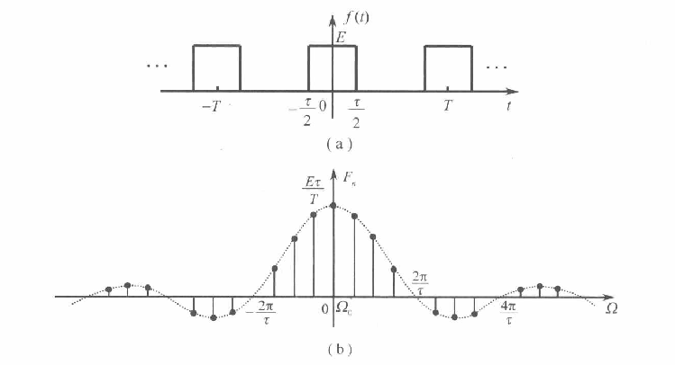

#mathf
#### 3.1.3 周期信号频谱的特点
?
周期矩形脉冲信号的波形及其频谱 如下图所示。

图 3-8 周期矩形脉冲信号及其频谱
 

归纳出有关周期信号频谱结构的一般特点如下：

（2）理论上周期信号的谐波分量是无限多的。在整个频率范围内高次谐波幅度虽然时有起伏，但总的趋势是按照一定规律递减的。这表明，**信号能量主要集中在低频范围内**。

（3）信号的频带宽度。基于上述理由，我们把从零频开始的能量主要集中在频率范围称为信号的**有效频带宽度**，简称**带宽**。如周期矩形脉冲信号的带宽为
$$  B=2\pi/\tau(rad/s)\quad 或 \quad\Delta f=1/\tau(Hz)   \tag*{（3-13）}$$

（4）从上式可知，**时域中脉冲持续时间越短，在频域中信号占有的频带越宽。**

（5）谱线密度与周期 T 的关系。因为谱线间隔  $\Omega_{0}=2\pi/T$，所以周期越大，谱线间隔越小，谱线越密集。当 T 趋近于无穷大，即  $T\to\infty$ 时，周期信号就变成非周期信号，离散谱将趋近于连续谱。（傅里叶变换）
<!--SR:!2026-11-25,3,250-->

---
