> 本文保存自 [[傅里叶变换的性质]] 中删去的例题（例 3-7 ～ 例 3-21），保留原题、解与插图。

## 例 3-7

**题目：** 求图 3-16(a) 所示信号的频谱 $F(\mathrm{j}\Omega)$。

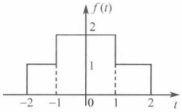
*（a）*

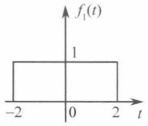
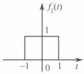
*（b）*

*图 3-16 例 3-7 的图*

**解：** 因为
$$ f(t)=f_1(t)+f_2(t) $$
由门信号的傅里叶变换
$$ g_\tau(t)\longleftrightarrow\tau\mathrm{Sa}\left(\frac{\Omega\tau}{2}\right) $$
故
$$ f_1(t)\longleftrightarrow4\mathrm{Sa}(2\Omega),\qquad f_2(t)\longleftrightarrow2\mathrm{Sa}(\Omega) $$
所以
$$ F(\mathrm{j}\Omega)=4\mathrm{Sa}(2\Omega)+2\mathrm{Sa}(\Omega) $$

---

## 例 3-8

**题目：** 求信号 $\mathrm{Sa}(\Omega_0 t)$ 的频谱函数。

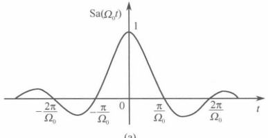
*（a）*

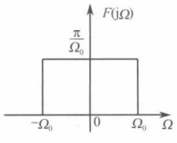
*（b）*

*图 3-18 例 3-8 的图*

**解：** 由前面典型信号的傅里叶变换知
$$ g_\tau(t)\longleftrightarrow\tau\mathrm{Sa}\left(\frac{\Omega\tau}{2}\right) $$
由对称特性得
$$ \tau\mathrm{Sa}\left(\frac{\tau}{2}t\right)\longleftrightarrow2\pi g_\tau(\Omega) $$
令 $\frac{\tau}{2}=\Omega_0$，即 $\tau=2\Omega_0$，则
$$ \mathrm{Sa}(\Omega_0 t)\longleftrightarrow\frac{\pi}{\Omega_0}g_{2\Omega_0}(\Omega) $$
相应的频谱图如图 3-18(b) 所示。

---

## 例 3-9

**题目：** 求 $g_\tau\left(t+\frac{\tau}{2}\right)$ 的相位谱。

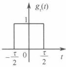
*（a）*

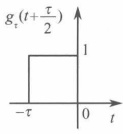
*（b）*

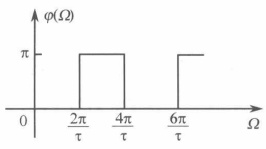
*（c）*

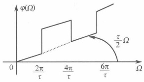
*（d）*

*图 3-19 例 3-9 的图*

**解：** 由门信号 $g_\tau(t)$ 的频谱可知，它的相位谱如图 3-19(c) 所示；根据时移特性知，$g_\tau\left(t+\frac{\tau}{2}\right)$ 的相位谱如图 3-19(d) 所示。

图 3-19 中只画了 $\Omega>0$ 的频谱，读者可以自行补充完整。

---

#mathf
## 例 3-10
?
**题目：** 求图 3-20(a) 所示信号的频谱。

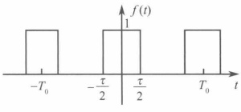
*（a）*

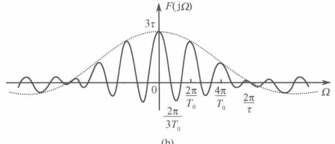
*（b）*

**解：** 因为
$$ f(t)=g_\tau(t+T_0)+g_\tau(t)+g_\tau(t-T_0) $$
所以
$$ \begin{aligned}F(\mathrm{j}\Omega)&=\tau\mathrm{Sa}\left(\frac{\Omega\tau}{2}\right)\mathrm{e}^{\mathrm{j}\Omega T_0}+\tau\mathrm{Sa}\left(\frac{\Omega\tau}{2}\right)+\tau\mathrm{Sa}\left(\frac{\Omega\tau}{2}\right)\mathrm{e}^{-\mathrm{j}\Omega T_0}\\&=\tau\mathrm{Sa}\left(\frac{\Omega\tau}{2}\right)\left(1+\mathrm{e}^{\mathrm{j}\Omega T_0}+\mathrm{e}^{-\mathrm{j}\Omega T_0}\right)\\&=\tau\mathrm{Sa}\left(\frac{\Omega\tau}{2}\right)\left(1+2\cos\Omega T_0\right)\end{aligned} $$
相应的频谱如图 3-20(b) 所示。当脉冲的数目增加时，信号的能量将向 $\Omega=\frac{2m\pi}{T_0}$ 处集中，在该频率处幅度增大，而在其他频率处幅度减小，甚至等于零。当脉冲个数无限增多时（这时就成为周期信号），则除 $\Omega=\frac{2m\pi}{T_0}$ 的各谱线外，其余频率分量均等于零，从而变成离散谱。这是从非周期信号变为周期信号时频谱函数变化的例子。
<!--SR:!2026-11-27,3,250-->

---

## 例 3-11

**题目：** 已知矩形调幅信号 $f(t)=g_\tau(t)\cos(\Omega_0 t)$，试求其频谱函数。

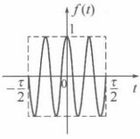
*（a）矩形调幅信号的波形*

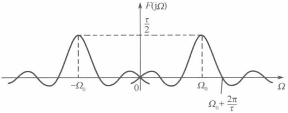
*（b）矩形调幅信号的频谱*

*图 3-21 例 3-11 的图*

**解：** 因为
$$ f(t)=\frac{1}{2}g_\tau(t)\left(\mathrm{e}^{\mathrm{j}\Omega_0 t}+\mathrm{e}^{-\mathrm{j}\Omega_0 t}\right) $$
$$ g_\tau(t)\longleftrightarrow\tau\mathrm{Sa}\left(\frac{\Omega\tau}{2}\right) $$
由频移特性得
$$ f(t)\longleftrightarrow\frac{1}{2}\tau\mathrm{Sa}\left[\frac{(\Omega-\Omega_0)\tau}{2}\right]+\frac{1}{2}\tau\mathrm{Sa}\left[\frac{(\Omega+\Omega_0)\tau}{2}\right] $$
其波形及频谱如图 3-21 所示。可见，调幅信号的频谱等于将 $g_\tau(t)$ 的频谱一分为二，各向左、右移载频 $\Omega_0$，进行了频谱搬移。

---

## 例 3-12

**题目：** 已知图 3-22(a) 的函数是宽度为 2 的门信号，即 $f_1(t)=g_2(t)$，其傅里叶变换 $F_1(\mathrm{j}\Omega)=2\mathrm{Sa}(\Omega)=\frac{2\sin\Omega}{\Omega}$，求图 3-22(b) 和 (c) 中函数 $f_2(t)$ 和 $f_3(t)$ 的傅里叶变换。

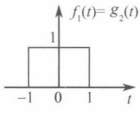
*（a）*

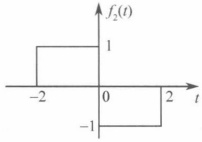
*（b）*

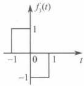
*（c）*

*图 3-22 例 3-12 的图*

**解：**

（1）图 3-22(b) 中函数 $f_2(t)$ 可表示为时移信号 $f_1(t+1)$ 与 $f_1(t-1)$ 之差，即
$$ f_2(t)=f_1(t+1)-f_1(t-1) $$
由傅里叶变换的线性和时移特性可得 $f_2(t)$ 的傅里叶变换
$$ F_2(\mathrm{j}\Omega)=F_1(\mathrm{j}\Omega)\mathrm{e}^{\mathrm{j}\Omega}-F_1(\mathrm{j}\Omega)\mathrm{e}^{-\mathrm{j}\Omega}=\frac{2\sin\Omega}{\Omega}\left(\mathrm{e}^{\mathrm{j}\Omega}-\mathrm{e}^{-\mathrm{j}\Omega}\right)=\mathrm{j}4\frac{\sin^2\Omega}{\Omega} $$

（2）图 3-22(c) 中的函数 $f_3(t)$ 是 $f_2(t)$ 的压缩，可写为
$$ f_3(t)=f_2(2t) $$
由时频展缩特性可得
$$ F_3(\mathrm{j}\Omega)=\frac{1}{2}F_2\left(\mathrm{j}\frac{\Omega}{2}\right)=\frac{1}{2}\mathrm{j}4\frac{\sin^2\left(\frac{\Omega}{2}\right)}{\Omega/2}=\mathrm{j}4\frac{\sin^2\left(\frac{\Omega}{2}\right)}{\Omega} $$

---

## 例 3-13

**题目：** 已知图 3-23(a) 所示信号的频谱函数为 $F_1(\mathrm{j}\Omega)=\tau^2\mathrm{Sa}^2\left(\frac{\Omega\tau}{2}\right)$，求图 3-23(b) 所示信号的频谱函数。

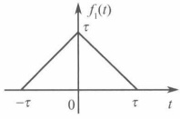
*（a）*

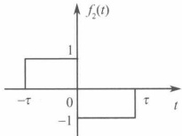
*（b）*

*图 3-23 例 3-13 的图*

**解：** 因为
$$ f_1(t)\longleftrightarrow\tau^2\mathrm{Sa}^2\left(\frac{\Omega\tau}{2}\right) $$
而
$$ f_2(t)=f_1'(t) $$
根据时域微分特性可得
$$ f_2(t)\longleftrightarrow F_2(\mathrm{j}\Omega)=\mathrm{j}\Omega\cdot\tau^2\mathrm{Sa}^2\left(\frac{\Omega\tau}{2}\right) $$

---

## 例 3-14

**题目：** 求 $f(t)=t$ 和 $f(t)=tU(t)$ 的频谱。

**解：** 因为
$$ \begin{aligned}1&\longleftrightarrow2\pi\delta(\Omega)\\t&\longleftrightarrow2\pi\mathrm{j}\delta'(\Omega)\\U(t)&\longleftrightarrow\pi\delta(\Omega)+\frac{1}{\mathrm{j}\Omega}\end{aligned} $$
又因
$$ tU(t)=t\cdot U(t)\longleftrightarrow\frac{1}{-\mathrm{j}}\frac{\mathrm{d}}{\mathrm{d}\Omega}\left[\pi\delta(\Omega)+\frac{1}{\mathrm{j}\Omega}\right]=\mathrm{j}\pi\delta'(\Omega)-\frac{1}{\Omega^2} $$

---

## 例 3-15

**题目：** 求图 3-24(a) 所示信号 $f(t)$ 的频谱 $F(\mathrm{j}\Omega)$。

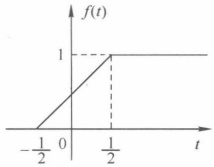
*（a）*

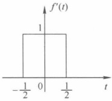
*（b）*

*图 3-24 例 3-15 的图*

**解：** 因为 $f'(t)=g_1(t)$，如图 3-24(b) 所示，有
$$ f'(t)\longleftrightarrow\mathrm{Sa}\left(\frac{\Omega}{2}\right)=F_1(\mathrm{j}\Omega) $$
又因 $F_1(0)=1\neq0$，所以
$$ F(\mathrm{j}\Omega)=\frac{1}{\mathrm{j}\Omega}F_1(\mathrm{j}\Omega)+\pi F_1(0)\delta(\Omega)=\frac{1}{\mathrm{j}\Omega}\mathrm{Sa}\left(\frac{\Omega}{2}\right)+\pi\delta(\Omega) $$

---

## 例 3-16

**题目：** 求图 3-25 所示信号 $f(t)$ 的频谱 $F(\mathrm{j}\Omega)$。

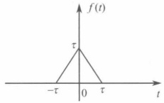
*图 3-25 例 3-16 的图*

**解：** 因为
$$ f(t)=g_\tau(t)*g_\tau(t) $$
$$ g_\tau(t)\longleftrightarrow\tau\mathrm{Sa}\left(\frac{\Omega\tau}{2}\right) $$
所以
$$ F(\mathrm{j}\Omega)=\left[\tau\mathrm{Sa}\left(\frac{\Omega\tau}{2}\right)\right]^2 $$
与例 3-13 的结果相同。

---

## 例 3-17

**题目：** 求图 3-26 所示信号 $f(t)$ 的频谱 $F(\mathrm{j}\Omega)$。

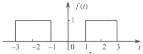
*图 3-26 例 3-17 的图*

**解：** 因为
$$ f(t)=g_2(t)\cdot\delta(t+2)+g_2(t)\cdot\delta(t-2) $$
所以
$$ \begin{aligned}F(\mathrm{j}\Omega)&=2\mathrm{Sa}(\Omega)\mathrm{e}^{\mathrm{j}2\Omega}+2\mathrm{Sa}(\Omega)\mathrm{e}^{-\mathrm{j}2\Omega}\\&=4\cos2\Omega\cdot\mathrm{Sa}(\Omega)\end{aligned} $$

---

## 例 3-18

**题目：** 求图 3-27 所示信号的频谱 $F(\mathrm{j}\Omega)$。其中 $f(t)=(1+\cos\pi t)g_2(t)$，式中 $g_2(t)$ 是宽度为 2 的门信号。

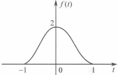
*图 3-27 例 3-18 的图*

**解：** 因为
$$ \begin{aligned}&g_2(t)\longleftrightarrow2\mathrm{Sa}(\Omega),\qquad 1\longleftrightarrow2\pi\delta(\Omega)\\&\cos\pi t\longleftrightarrow\pi\left[\delta(\Omega-\pi)+\delta(\Omega+\pi)\right]\end{aligned} $$
所以
$$ \begin{aligned}F(\mathrm{j}\Omega)&=\frac{1}{2\pi}\left\{2\mathrm{Sa}(\Omega)*\left[2\pi\delta(\Omega)+\pi\delta(\Omega-\pi)+\pi\delta(\Omega+\pi)\right]\right\}\\&=2\mathrm{Sa}(\Omega)+\mathrm{Sa}(\Omega-\pi)+\mathrm{Sa}(\Omega+\pi)\end{aligned} $$

---

## 例 3-19

**题目：** 求图 3-28 所示信号 $f(t)$ 的频谱 $F(\mathrm{j}\Omega)$，其中
$$ f(t)=f_1(t)\cdot f_2(t)=f_1(t)\cdot\cos(10\pi t) $$

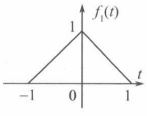
*（a）*

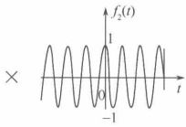
*（b）*

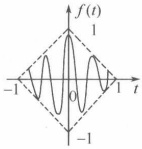
*（c）*

*图 3-28 例 3-19 的信号波形*

**解：** 由例 3-16 可知
$$ f_1(t)=g_1(t)*g_1(t),\qquad g_1(t)\longleftrightarrow\mathrm{Sa}\left(\frac{\Omega}{2}\right) $$
所以
$$ \begin{aligned}F(\mathrm{j}\Omega)&=\frac{1}{2\pi}\left\{\mathrm{Sa}^2\left(\frac{\Omega}{2}\right)*\left[\pi\delta(\Omega-10\pi)+\pi\delta(\Omega+10\pi)\right]\right\}\\&=\frac{1}{2}\mathrm{Sa}^2\left(\frac{\Omega-10\pi}{2}\right)+\frac{1}{2}\mathrm{Sa}^2\left(\frac{\Omega+10\pi}{2}\right)\end{aligned} $$
相应的频谱如图 3-29 所示。

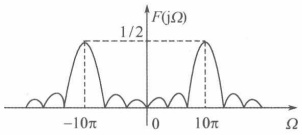
*图 3-29 例 3-19 中 $f(t)$ 的频谱*

---

## 例 3-20

**题目：** 已知 $f(t)=10\mathrm{e}^{-t}U(t)\ \mathrm{V}$，求 $f(t)$ 所包含的能量。

**解：** 因为
$$ E=\int_{-\infty}^{\infty}\left[f(t)\right]^2\mathrm{d}t=\int_{0}^{\infty}\left(10\mathrm{e}^{-t}\right)^2\mathrm{d}t=100\int_{0}^{\infty}\mathrm{e}^{-2t}\mathrm{d}t=50\ \mathrm{J} $$
又因
$$ f(t)\longleftrightarrow F(\mathrm{j}\Omega)=\frac{10}{1+\mathrm{j}\Omega} $$
$$ \left|F(\mathrm{j}\Omega)\right|=\frac{10}{\sqrt{1+\Omega^2}} $$
所以
$$ E=\frac{1}{2\pi}\int_{-\infty}^{\infty}\frac{100}{1+\Omega^2}\mathrm{d}\Omega=\frac{50}{\pi}\left[\arctan\Omega\right]_{-\infty}^{\infty}=\frac{50}{\pi}\left[\frac{\pi}{2}-\left(-\frac{\pi}{2}\right)\right]=50\ \mathrm{J} $$

---

## 例 3-21

**题目：** 计算积分 $\int_{-\infty}^{\infty}\mathrm{Sa}^2(at)\,\mathrm{d}t$。

**解：** 因为
$$ \mathrm{Sa}(at)\longleftrightarrow F(\mathrm{j}\Omega)=\begin{cases}\dfrac{\pi}{a}, & |\Omega|<a\\[4pt]0, & |\Omega|>a\end{cases} $$
所以
$$ \int_{-\infty}^{\infty}\mathrm{Sa}^2(at)\,\mathrm{d}t=\frac{1}{2\pi}\int_{-a}^{a}\left(\frac{\pi}{a}\right)^2\mathrm{d}\Omega=\frac{\pi}{a} $$
