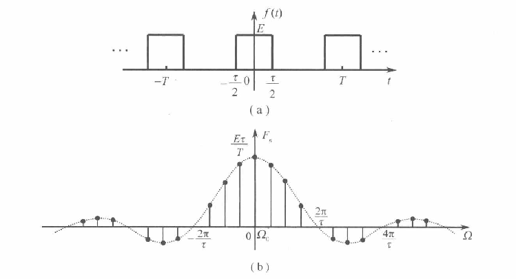
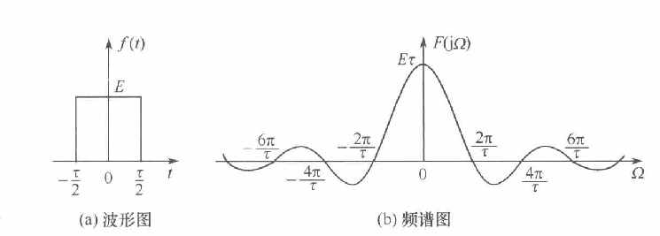
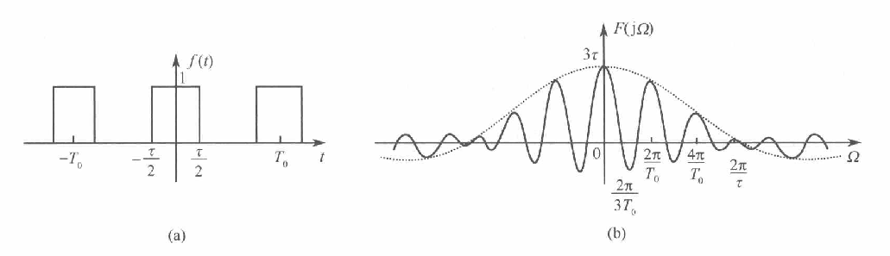

#flashcards
## 矩形脉冲信号
?
### 周期矩形脉冲信号 的傅里叶级数：

- 傅里叶级数是离散的，每个数值的间隔 $\Omega_{0}=2\pi/T$。

### 单个矩形脉冲信号 的傅里叶变换：

- $F(j\Omega)$ 与 傅里叶级数的走向一致，只是从离散变成了连续，数值上乘以周期 $T$。

### 三个矩形脉冲信号 的傅里叶变换：

- 图中虚线为 单个矩形脉冲信号 的傅里叶变换，可以看到走向仍然一致。
- 但是 信号的能量向 $\Omega=\frac{2m\pi}{T_0}$ 处集中，也就是越来越接近 傅里叶级数。最终 $\Omega=\frac{2m\pi}{T_0}$ 处将变成冲激信号。
<!--SR:!2026-11-28,4,270-->

---

