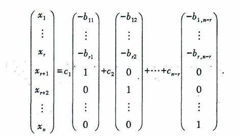

#mathf
##### 约定
?
通常情况下，列向量是一个小写字母 $a, b, \alpha, \beta$ ，而行向量是它的转置 $a^T, b^T, \alpha^T, \beta^T$，没有指明时都当作列向量。
<!--SR:!2026-12-05,15,290-->

---

#mathf
## 定义1
?
给定向量组  $A: a_{1}, a_{2}, \cdots, a_{m}$，对于任何一组实数  $k_{1}, k_{2}, \cdots, k_{m}$，表达式
$$k_{1}a_{1} + k_{2}a_{2} + \cdots + k_{m}a_{m}$$
称为向量组 A 的一个**线性组合**

### 线性表示

给定向量组  $A:a_{1},a_{2},\cdots,a_{m}$ 和向量 b，若存在一组数  $\lambda_{1},\lambda_{2},\cdots,\lambda_{m}$，使
$$ b=\lambda_{1}a_{1}+\lambda_{2}a_{2}+\cdots+\lambda_{m}a_{m} $$
即方程组 $x_{1}a_{1}+x_{2}a_{2}+\cdots+x_{m}a_{m}=b$ 有解

则向量  $\boldsymbol{b}$ 是向量组 A 的**线性组合**，这时称向量  $\boldsymbol{b}$ 能由向量组 A **线性表示**.
<!--SR:!2026-12-06,16,290-->

---

## 定理1 
向量 b 能由向量组  $A: a_{1}, a_{2}, \cdots, a_{m}$ 线性表示的**充分必要条件**是矩阵  $A = (a_{1}, a_{2}, \cdots, a_{m})$ 的秩等于矩阵  $B = (a_{1}, a_{2}, \cdots, a_{m}, b)$ 的秩（方程组有解的充要条件）

## 定义2
设有两个向量组  $A: a_{1}, a_{2}, \cdots, a_{m}$ 及  $B: b_{1}, b_{2}, \cdots, b_{l}$，
若向量组 B 中的每个向量都能由向量组 A 线性表示，则称向量组 B 能由向量组 A 线性表示。
若向量组 A 与向量组 B 能相互线性表示，则称这两个**向量组等价**。

#mathf
#### 具体表达式
?
把向量组 A 和 B 所构成的矩阵依次记作  $A = (a_{1}, a_{2}, \cdots, a_{m})$ 和  $B = (b_{1}, b_{2}, \cdots, b_{l})$，向量组 B 能由向量组 A 线性表示，即：
$$ (\boldsymbol{b}_{1},\boldsymbol{b}_{2},\cdots,\boldsymbol{b}_{l})=(\boldsymbol{a}_{1},\boldsymbol{a}_{2},\cdots,\boldsymbol{a}_{m})\left(\begin{array}{c c c c}k_{11}&k_{12}&\cdots&k_{1l}\\ k_{21}&k_{22}&\cdots&k_{2l}\\ \vdots&\vdots&&\vdots\\ k_{m1}&k_{m2}&\cdots&k_{m l}\end{array}\right), $$
这里，矩阵  $\boldsymbol{K}_{m \times l} = (k_{ij})$ 称为这一线性表示的系数矩阵.

由此可知，若  $C_{m\times n}=A_{m\times l}B_{l\times n}$，则矩阵 C 的列向量组能由矩阵 A 的**列向量组**线性表示，
同时，C 的行向量组能由 B 的**行向量组**线性表示
<!--SR:!2026-12-05,15,290-->

---

#mathf
#### 引理
?
设矩阵 A 与 B 行等价，即矩阵 A 经初等行变换变成矩阵 B。于是 A 的行向量组与 B 的行向量组等价。

类似可知，若矩阵 A 与 B 列等价，则 A 的列向量组与 B 的列向量组等价.
<!--SR:!2026-12-04,14,290-->

---

按定义 3，向量组  $B: b_{1}, b_{2}, \cdots, b_{l}$ 能由向量组  $A: a_{1}, a_{2}, \cdots, a_{m}$ 线性表示，其含义是存在矩阵  $K_{m \times l}$，使  $(b_{1}, b_{2}, \cdots, b_{l}) = (a_{1}, a_{2}, \cdots, a_{m})K$，也就是矩阵方程
$$ (a_{1},a_{2},\cdots,a_{m})X=(b_{1},b_{2},\cdots,b_{1}) $$ 
有解. 由上章定理 6, 立即可得

#mathf
## 定理2
?
向量组  $B: b_{1}, b_{2}, \cdots, b_{l}$ 能由向量组  $A: a_{1}, a_{2}, \cdots, a_{m}$ 线性表示的**充分必要条件**是矩阵  $A = (a_{1}, a_{2}, \cdots, a_{m})$ 的秩等于矩阵  $(A, B) = (a_{1}, a_{2}, \cdots, a_{m}, b_{1}, b_{2}, \cdots, b_{l})$ 的秩，即  $R(A) = R(A, B)$.

**推论** 向量组  $A:a_{1},a_{2},\cdots,a_{m}$ 与向量组  $B:b_{1},b_{2},\cdots,b_{l}$ 等价的充分必要条件是
$$ \boldsymbol{R}(\boldsymbol{A})=\boldsymbol{R}(\boldsymbol{B})=\boldsymbol{R}(\boldsymbol{A},\boldsymbol{B}) $$
<!--SR:!2026-11-27,7,250-->

---

## 定理3 
设向量组  $B: b_{1}, b_{2}, \cdots, b_{l}$ 能由向量组  $A: a_{1}, a_{2}, \cdots, a_{m}$ 线性表示，则  $R(b_{1}, b_{2}, \cdots, b_{l}) \leqslant R(a_{1}, a_{2}, \cdots, a_{m})$.

#mathf
## 综合
?
向量组  $B:b_{1},b_{2},\cdots,b_{l}$ 能由向量组  $A:a_{1},a_{2},\cdots,a_{m}$ 线性表示

⇔ 有矩阵 $K$，使 $B=AK$

⇔ 方程 $AX = B$ 有解.

上述对应的三种叙述都可对应到**充分必要条件**:  $R(A) = R(A, B)$，并都有**必要条件**:  $R(A) \geq R(B)$.
<!--SR:!2026-11-29,9,250-->

---

#mathf
## §2 向量组的线性相关性
?
>**直觉**：线性相关表示信息冗余，多余的向量是其他的线性表示。

定义 4 给定向量组  $A: \alpha_{1}, \alpha_{2}, \cdots, \alpha_{m}$，若存在不全为零的数  $k_{1}, k_{2}, \cdots, k_{m}$，使
$$ \boldsymbol{k}_{1}\boldsymbol{a}_{1}+\boldsymbol{k}_{2}\boldsymbol{a}_{2}+\cdots+\boldsymbol{k}_{m}\boldsymbol{a}_{m}=\mathbf{0}$$
则称向量组 A 是**线性相关**的, 否则称它线性无关.
<!--SR:!2026-11-24,4,270-->

---

### 几何意义
对于含两个向量  $a_{1}, a_{2}$ 的向量组，它线性相关的充分必要条件是  $a_{1}, a_{2}$ 的分量对应成比例，其几何意义是两向量共线。三个向量线性相关的几何意义是三向量共面。

### 线性表示
若向量组 A 线性相关，则有不全为 0 的数  $k_{1}, k_{2}, \cdots, k_{m}$ 使  $k_{1}a_{1} + k_{2}a_{2} + \cdots + k_{m}a_{m} = 0$。因  $k_{1}, k_{2}, \cdots, k_{m}$ 不全为 0，不妨设  $k_{1} \neq 0$，于是便有
$$ \boldsymbol{a}_{1}=-\frac{1}{k_{1}}\left(k_{2}\boldsymbol{a}_{2}+k_{3}\boldsymbol{a}_{3}+\cdots+k_{m}\boldsymbol{a}_{m}\right), $$
即 $a_{1}$ 能由  $a_{2}, a_{3}, \cdots, a_{m}$ **线性表示**.

#mathf
### 定理4
?
>由方程 $\boldsymbol{k}_{1}\boldsymbol{a}_{1}+\boldsymbol{k}_{2}\boldsymbol{a}_{2}+\cdots+\boldsymbol{k}_{m}\boldsymbol{a}_{m}=\mathbf{0}$ 是否有非零解得出。

- 向量组  $A:a_{1},a_{2},\cdots,a_{m}$ **线性相关的充分必要条件**是它所构成的矩阵                              $A=(a_{1},a_{2},\cdots,a_{m})$ 的秩小于向量个数 m （方程有无穷解，也就是有非零解）
- 向量组 A **线性无关的充分必要条件**是  $R(A)=m$ （方程只有一个解，也就是零解）
<!--SR:!2026-11-21,3,250-->

---

#mathf
### 定理 5
?
(1) 若向量组  $A:a_{1},a_{2},\cdots,a_{m}$ 线性相关，则向量组  $B:a_{1},a_{2},\cdots,a_{m},a_{m+1}$ 也线性相关. 反之，若向量组 B 线性无关，则向量组 A 也线性无关.

(2) m 个 n 维向量组成的向量组；当维数 n 小于向量个数 m 时一定线性相关。特别地， $n+1$ 个 n 维向量一定线性相关。

(3) 设向量组  $A:a_{1},a_{2},\cdots,a_{m}$ 线性无关，而向量组  $B:a_{1},a_{2},\cdots,a_{m},b$ 线性相关，则向量 b 必能由向量组 A 线性表示，且表示式是惟一的.
<!--SR:!2026-11-22,4,270-->

---

#mathf
### 定理x
?
**初等行变换 不改变矩阵列向量之间的线性关系**。

#### 直观理解
设原向量组为 $A$，初等行变换后的为 $B$。
设方程组 $Ax = 0$ , $Bx=0$

对 $A$ 做初等行变换 使 $A\to B$ **等价于** 对 $Ax = 0$ 做初等变换 使 $Ax = 0 \to Bx = 0$

也就是说 $Ax = 0$ 和 $Bx=0$ 同解，即线性关系不变：
$$\{\boldsymbol x\mid A\boldsymbol x=\boldsymbol 0\}=\{\boldsymbol x\mid B\boldsymbol x=\boldsymbol 0\}$$

- $x_1\boldsymbol a_1+x_2\boldsymbol a_2+\cdots+x_n\boldsymbol a_n=\boldsymbol 0$ 就是 $A$ 的一个线性关系。
- $\{\boldsymbol x\mid A\boldsymbol x=\boldsymbol 0\} = \text{「所有线性关系（的系数向量）」的集合}.$
<!--SR:!2026-11-23,3,250-->

---

## 向量组的秩

设有向量组 A，如果在 A 中能选出 r 个向量  $a_{1}, a_{2}, \cdots, a_{r}$，满足

(i) 向量组  $A_{0}: a_{1}, a_{2}, \cdots, a_{r}$ 线性无关；

(ii) 向量组 A 中任意  $r+1$ 个向量（如果 A 中有  $r+1$ 个向量的话）都线性相关，那么称向量组  $A_{0}$ 是向量组 A 的一个 **最大线性无关向量组**（简称 **最大无关组**），最大无关组所含向量的个数 r 称为 **向量组 A 的秩**，记作  $R_{A}$.

只含零向量的向量组没有最大无关组，规定它的秩为0.

向量组 A 和它自己的最大无关组  $A_{0}$ 是等价的.这是因为向量组  $A_{0}$ 是向量组 A 的一个部分组，故向量组  $A_{0}$ 总能由向量组 A 线性表示 

### 定理 6 
矩阵的秩等于它的列向量组的秩，也等于它的行向量组的秩.

## 向量空间

设 V 为 n 维向量的集合，如果集合 V 非空，且集合 V 对于向量的 **加法** 及 **数乘**两种运算封闭，那么就称集合 V 为**向量空间**.

所谓**封闭**，是指在集合V中可以进行向量的加法及数乘两种运算.具体地说，就是：若 $a\in V,b\in V$，则 $a+b\in V$；若 $a\in V,\lambda\in\mathbb{R}$，则 $\lambda a\in V$。

### 子空间
设有向量空间  $V_1$ 及  $V_2$，若  $V_1 \subseteq V_2$，就称  $V_1$ 是  $V_2$ 的**子空间**。

### 向量空间的维数 
设 $V$ 为向量空间，如果 $r$ 个向量 $a_1, a_2, \cdots, a_r \in V$，且满足

(i) $a_{1}, a_{2}, \cdots, a_{r}$ 线性无关;

(ii) V中任一向量都可由 $a_{1},a_{2},\cdots,a_{r}$ 线性表示，

那么向量组  $a_{1}, a_{2}, \cdots, a_{r}$ 称为向量空间 V 的 一个基，r 称为向量空间 V 的 **维数**，记为  $\dim V = r$，并称 V 为 r维向量空间。

### 向量空间的基

如果在向量空间 V 中取定一个基 $a_{1}, a_{2}, \cdots, a_{r}$，那么 V 中任一向量 x 可惟一地表示为

$$ x=\lambda_{1}a_{1}+\lambda_{2}a_{2}+\cdots+\lambda_{r}a_{r}, $$

这个有序数组 $\lambda_{1}, \lambda_{2}, \cdots, \lambda_{r}$ 称为向量 x 在**基** $a_{1}, a_{2}, \cdots, a_{r}$ 下的**坐标**，并记作 $(\lambda_{1}, \lambda_{2}, \cdots, \lambda_{r})^{\mathrm{T}}$。

特别地，在 n 维向量空间 $\mathbb{R}^{n}$ 中取单位坐标向量组 $e_{1}, e_{2}, \cdots, e_{n}$ 为基，则以 $x_{1}, x_{2}, \cdots, x_{n}$ 为分量的向量 x 可表示为
$$ x=x_{1}e_{1}+x_{2}e_{2}+\cdots+x_{n}e_{n}, $$

可见向量在基 $e_1, e_2, \cdots, e_n$ 下的坐标就是该向量的分量。因此，$e_1, e_2, \cdots, e_n$ 叫做 $\mathbb{R}^n$ 中的**自然基**。

#mathf 
### 过渡矩阵
?
在向量空间 $V$ 中取定两个基 $a_1, a_2, \cdots, a_n$ 与 $b_1, b_2, \cdots, b_n$。设 $b_i = p_{1i} a_1 + p_{2i} a_2 + \cdots + p_{ni} a_n$（$i = 1, 2, \cdots, n$），则
$$ \left\{\begin{array}{l}\boldsymbol{b}_{1}=p_{11}\boldsymbol{a}_{1}+p_{21}\boldsymbol{a}_{2}+\cdots+p_{n1}\boldsymbol{a}_{n},\\\boldsymbol{b}_{2}=p_{12}\boldsymbol{a}_{1}+p_{22}\boldsymbol{a}_{2}+\cdots+p_{n2}\boldsymbol{a}_{n},\\\cdots\cdots\cdots\cdots\\\boldsymbol{b}_{n}=p_{1n}\boldsymbol{a}_{1}+p_{2n}\boldsymbol{a}_{2}+\cdots+p_{nn}\boldsymbol{a}_{n},\end{array}\right. $$

利用矩阵，也可形式地写为
$$ (\boldsymbol{b}_{1},\boldsymbol{b}_{2},\cdots,\boldsymbol{b}_{n})=(\boldsymbol{a}_{1},\boldsymbol{a}_{2},\cdots,\boldsymbol{a}_{n})\boldsymbol{P}, $$

这里
$$ P=\begin{pmatrix}p_{11}&p_{12}&\cdots&p_{1n}\\p_{21}&p_{22}&\cdots&p_{2n}\\\vdots&\vdots&&\vdots\\p_{n1}&p_{n2}&\cdots&p_{nn}\end{pmatrix}, $$

此式即称为**基变换公式**，矩阵 $\boldsymbol{P}$ 称为从基 $a_{1}, a_{2}, \cdots, a_{n}$ 到基 $b_{1}, b_{2}, \cdots, b_{n}$ 的**过渡矩阵**。

#### 过渡矩阵的应用

设 $a_1, a_2, \cdots, a_n$ 与 $b_1, b_2, \cdots, b_n$ 是向量空间 $V$ 的两个基。$\forall \alpha \in V$，设 $\alpha$ 在基 $a_1, a_2, \cdots, a_n$ 下的坐标为 $x$，在基 $b_1, b_2, \cdots, b_n$ 下的坐标为 $y$，即

$$ \boldsymbol{\alpha} = \left(\boldsymbol{a}_{1},\boldsymbol{a}_{2},\cdots,\boldsymbol{a}_{n}\right)\boldsymbol{x},\quad\boldsymbol{x}=\left(\begin{array}{c}x_{1}\\ x_{2}\\ \vdots\\ x_{n}\end{array}\right), $$

$$ \boldsymbol{\alpha} = (\boldsymbol{b}_{1},\boldsymbol{b}_{2},\cdots,\boldsymbol{b}_{n})\boldsymbol{y},\quad\boldsymbol{y}=\begin{pmatrix}y_{1}\\ y_{2}\\ \vdots\\ y_{n}\end{pmatrix}. $$

若从 $a_{1}, a_{2}, \cdots, a_{n}$ 到 $b_{1}, b_{2}, \cdots, b_{n}$ 的过渡矩阵为 $\boldsymbol{P}$，则

$$ \boldsymbol{\alpha}=\left(b_{1},b_{2},\cdots,b_{n}\right)\boldsymbol{y}=\left(a_{1},a_{2},\cdots,a_{n}\right)\boldsymbol{P}\boldsymbol{y}, $$

从而 $\boldsymbol{x}=\boldsymbol{P}\boldsymbol{y}$，此即称为**坐标变换公式**。

---

## 线性方程组的解
>齐次方程组为 $Ax=0$ ，非齐次方程组为 $Ax=b$

设有齐次线性方程组
$$  \left\{\begin{array}{l}{a_{11}x_{1}+a_{12}x_{2}+\cdots+a_{1n}x_{n}=0,}\\ {a_{21}x_{1}+a_{22}x_{2}+\cdots+a_{2n}x_{n}=0,}\\ {\cdots\cdots\cdots\cdots}\\ {a_{m1}x_{1}+a_{m2}x_{2}+\cdots+a_{mn}x_{n}=0,}\end{array}\right.   \tag*{(1)}$$

设 系数矩阵A的秩为r，并不妨设A的前r个列向量线性无关，于是A的行最简形矩阵为：
 $$ \boldsymbol{B}=\left(\begin{matrix}{1}&{\cdots}&{0}&{b_{11}}&{\cdots}&{b_{1,n-r}}\\ {\vdots}&{}&{\vdots}&{\vdots}&{}&{\vdots}\\ {0}&{\cdots}&{1}&{b_{r1}}&{\cdots}&{b_{r,n-r}}\\ {0}&{}&{}&{\cdots}&{}&{0}\\ {\vdots}&{}&{}&{}&{}&{\vdots}\\ {0}&{}&{}&{\cdots}&{}&{0}\\ \end{matrix}\right), $$

也就得到了通解：

把上式记作
$$\boldsymbol{x}=\boldsymbol{c}_{1}\boldsymbol{\xi}_{1}+\boldsymbol{c}_{2}\boldsymbol{\xi}_{2}+\cdots+\boldsymbol{c}_{n-r}\boldsymbol{\xi}_{n-r}, $$
所以每一个解 $x$ 能由基底 $\xi_1, \xi_2, \cdots, \xi_{n-r}$ 线性表示，
即知 $\xi_1, \xi_2, \cdots, \xi_{n-r}$ 是解空间 $S$ 的一个基，即 $\xi_1, \xi_2, \cdots, \xi_{n-r}$ 是原方程组的基础解系。

### 定理 7 
>一共 n 个未知数，能解出 r 个，剩下 $n-r$ 个自由未知数。

设  $m \times n$ 矩阵 A 的秩  $R(A) = r$，则 n 元齐次线性方程组 Ax = 0 的解空间 S 的维数  $\dim S = n - r$（即该齐次线性方程组的自由未知数的个数）.

