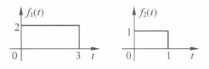
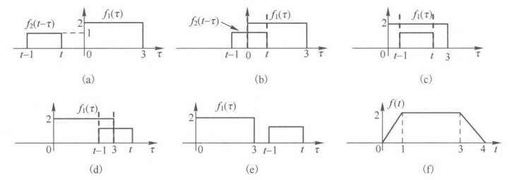

## CNN卷积和数学卷积

数学上的卷积定义：
$$f_1(t) * f_2(t) = \int_{-\infty}^{\infty} f_1(\tau) \cdot f_2(t-\tau) \, d\tau = \int_{-\infty}^{\infty} f_1(t-\tau) \cdot f_2(\tau) \, d\tau$$
而CNN的卷积是 一个卷积核 和 图像每个对应部分 分别相乘，实际上是一样的东西。
区别在于：
1. 数学上的卷积的积分区间在 $(-\infty, +\infty)$，而图像卷积是有限的。
2. 数学卷积是连续的，图像卷积是离散的。

为了理解这一点，我们需要了解卷积积分的图解法

### 卷积的图解法
假设 $f_1(t)$ 和 $f_2(t)$ 如图所示，尝试计算 $f(t)=f_1(t) *f_2(t)$

我们可以把 $f_2(t-\tau)$ 看作卷积核，$f_1(\tau)$ 看作图像。这正对应于图像卷积
事实上，数学上的函数很多定义域在 $(-\infty, +\infty)$，导致卷积很不直观，就是这一点影响了我们的理解。

我已读完 [[深度学习基础/CNN与傅里叶变换.md]]：笔记目前只写到「CNN 卷积 vs 数学卷积 + 图解法」，后面的「傅里叶变换」一节还是空的。下面按**与笔记的衔接顺序**整理了搜到的文章，从「补基础」到「前沿结构」，每条都标了它和笔记哪一部分对应。

---

## 一、先补上「傅里叶变换」这一节的基础

**1. 《第八章：滤波和卷积》— ThinkDSP 中文版**
https://thinkdsp-cn.readthedocs.io/zh_CN/latest/08-filtering-and-convolution.html
- 最贴合你笔记缺口的一篇：用「平滑窗 × 信号」一步步推出**卷积定理** $f*g \leftrightarrow F\cdot G$，并说明「时域卷积 = 频域相乘」。
- 关键结论：**窗函数（卷积核）的 DFT 就是滤波器**；矩形窗旁瓣大（$1/f$ 衰减），高斯窗衰减小、滤波更干净。这正好解释为什么 CNN 里 3×3 小核堆叠比大核更「平滑」。

**2. 《从频域角度看 CNN 的卷积操作》— 知乎**
https://zhuanlan.zhihu.com/p/461105044
- 把笔记里的「卷积核」直接翻译成信号处理语言：**卷积核本质是滤波器**，分低通（留低频）、高通（留高频）、带通。
- 图像频率的直观含义：平坦区域=低频，边缘/噪声=高频；图像主要能量在低频。文中给出高通核「锐化」的示意，可直接作为你笔记的配图思路。

**3. 《深度学习 - 卷积神经网络中的傅里叶变换》— SegmentFault**
https://segmentfault.com/a/1190000041948759
- 偏实操：对特征图做 FFT、加低通掩码（中心为 1、外围为 0）再逆变换，观察特征变化；并指出「梯度越强 → 频率越高」。
- 适合你想在笔记里加一段「用代码验证卷积核频谱」的附录。

> 一个可以补进笔记的细节：严格说 CNN（PyTorch `Conv2d`）算的是**互相关（cross-correlation）**，没有翻转核；数学卷积要翻转。核对称时两者相同，频域上对应「乘共轭」。你的笔记说「实际上是一样的东西」，建议加一句限定，避免和《信号与系统》里的定义冲突。

---

## 二、CNN 的频率特性：它到底在学什么频段

**4. 《如何从频域的角度解释 CNN》— 腾讯云开发者社区（含许志钦 F-Principle 介绍与实验图）**
https://developer.cloud.tencent.com/article/1745804
- 中文长文，一次覆盖三件事：
  - 严格低通滤波后，图像只剩「彩色球体」，模型在 ImageNet 上仍有 **>30%** 准确率；
  - 严格高通滤波后，人几乎看不见内容，模型仍有 **>50%** 准确率（需归一化才能可视化）；
  - 引出 **F-Principle（频率原则）** 与 *A Fourier Perspective on Model Robustness*。
- 这篇文章基本可以作为你「傅里叶变换」小节的骨架。

**5. 《High-Frequency Component Helps Explain the Generalization of CNN》— Wang et al., CVPR 2020 (Oral)**
论文 PDF：https://openaccess.thecvf.com/content_CVPR_2020/papers/Wang_High-Frequency_Component_Helps_Explain_the_Generalization_of_Convolutional_Neural_Networks_CVPR_2020_paper.pdf
中文复现笔记：https://blog.csdn.net/Brikie/article/details/113052716
- 核心观点：**CNN 能捕捉人眼不可见的高频成分**，并会「用高频换准确率」——这解释了对抗样本（扰动多是高频）、标签打乱数据也能记住等现象。
- 还指出：若希望模型忽略高频，可以让卷积核在频域高端权重趋零，即**核越平滑 → 高频越少**。这一句和你笔记里「卷积核」的讨论直接呼应。

**6. 《A Fourier Perspective on Model Robustness in Computer Vision》— Yin et al., NeurIPS 2019**
https://arxiv.org/abs/1906.08988
- 从「噪声的频谱」看鲁棒性：高斯噪声集中在高频，雾/对比度变化集中在低频；高斯增强与对抗训练提升高频鲁棒性，却牺牲低频鲁棒性。
- 适合放在笔记的「应用/延伸」里，说明频谱视角不只是解释，还能指导数据增强。

---

## 三、训练动力学：频率原则 / 谱偏差（最核心的一条主线）

**7. 《Overview of frequency principle / spectral bias in deep learning》— 许志钦（综述）**
https://arxiv.org/abs/2201.07395
- F-Principle 的官方综述：DNN 训练时**先拟合低频、再拟合高频**；低频隐式偏好既解释了泛化好，也解释了高频难学。
- 中文科普版：《上交大许志钦：神经网络中的奥卡姆剃刀》 https://hub.baai.ac.cn/view/14269
  —— 「如无必要，勿增频率」，并给出多尺度网络学高频的算法设计。
- 维基条目（英文，适合查引用）：https://en.wikipedia.org/wiki/Frequency_principle/spectral_bias

**8. 《On the Spectral Bias of Neural Networks》— Rahaman et al., ICML 2019**
https://arxiv.org/abs/1806.08734
- 「spectral bias」这个名称的来源：用傅里叶分析证明 ReLU 网络偏向低频函数，高频需要精细调参才能表达；并讨论数据流形复杂度会让高频更容易学。

**9. 《On the Spectral Bias of Convolutional Neural Tangent and Gaussian Process Networks》— NeurIPS 2022**
https://proceedings.neurips.cc/paper_files/paper/2022/file/48fd58527b29c5c0ef2cae43065636e6-Paper-Conference.pdf
- 把谱偏差专门落到 **CNN** 上：CNN 同样偏低频，但**局部集中的高频比分散的高频学得快**——这解释了卷积的「局部性」在频域上的优势。是笔记里「CNN 与全连接网络频率行为有何不同」的好素材。

---

## 四、采样、混叠与平移不变性（频谱视角的「翻车」案例）

**10. 《Why do deep convolutional networks generalize so poorly to small image transformations?》— Azulay & Weiss, JMLR 2019**
https://arxiv.org/abs/1805.12177
- 卷积结构并不自动带来平移不变性：**stride/pooling 前没有低通滤波 → 混叠（aliasing）**，高频被误认成低频；ReLU 又会把高频重新引入。
- 这篇是「CNN 频谱」话题里被引最多的工作之一，和你的「卷积=滤波器」正好形成闭环。

**11. 《Making Convolutional Networks Shift-Invariant Again》— Zhang, ICML 2019**
https://richzhang.github.io/antialiased-cnns/resources/camera-ready.pdf
- 解决上一条的方案：下采样前先模糊（BlurPool），即**显式加低通滤波**。可作为笔记的「工程启示」。

---

## 五、直接把「频域」做进网络结构

**12. OctConv《Drop an Octave》— Chen et al., ICCV 2019**
https://openaccess.thecvf.com/content_ICCV_2019/papers/Chen_Drop_an_Octave_Reducing_Spatial_Redundancy_in_Convolutional_Neural_Networks_ICCV_2019_paper.pdf
- 把特征图按频率拆成高/低两组（相差一个八度），低频图降分辨率处理，省算力又扩大感受野。是「CNN 特征图存在频段分离」的最直观证据。

**13. GFNet《Global Filter Networks》— Rao et al., NeurIPS 2021**
https://arxiv.org/abs/2107.00645
- 结构就三步：**2D FFT → 频域逐点乘可学习全局滤波器 → IFFT**，复杂度 $O(L\log L)$，替代 Transformer 的自注意力。是「卷积定理」在现代架构里的直接落地。
- 同源工作 FNet（用傅里叶变换替代 attention）：https://arxiv.org/abs/2105.03824

**14. Fourier Neural Operator（FNO）— Li et al., 2020**
https://arxiv.org/abs/2010.08895
- 在频域学习线性算子（只保留低模态），用于求解 PDE。如果你后续要写「频域深度学习」的综述，这是必引的一条。

**15.（可选，偏诊断）《Watch Your Up-Convolution》— Durall et al., CVPR 2020**
https://openaccess.thecvf.com/content_CVPR_2020/papers/Durall_Watch_Your_Up-Convolution_CNN_Based_Generative_Deep_Neural_Networks_Are_CVPR_2020_paper.pdf
- 转置卷积/上采样会造成**频谱失真**（高频异常），可直接用来检测 GAN 生成图。是「频谱作为分析工具」的漂亮案例。

---

## 建议的阅读顺序

1. 先读 **1、2**（补卷积定理 + 卷积核=滤波器）——直接填你笔记的空节；
2. 再读 **4**（中文、图文最全）→ **7**（F-Principle 主线）；
3. 然后 **5、6**（高频与泛化/鲁棒性）；
4. 最后 **10、12、13**（采样混叠、OctConv、GFNet），作为「从理解到设计」的收尾。

## 一点说明

- 极市的那篇《如何从频域的角度解释 CNN》（https://www.cvmart.net/community/detail/3427）抓取时返回失败，内容与腾讯云第 4 篇高度重合，建议直接用腾讯云版本。
- Wang et al. 的 arXiv 编号我没能二次确认，所以给的是 CVF 官方 PDF 链接；其余 arXiv 链接均已核对可访问。

如果你愿意，我可以按上面的结构，把「傅里叶变换」一节草拟成完整笔记（卷积定理 → 图像频率含义 → 卷积核即滤波器 → 频率原则 → 频谱视角的泛化/鲁棒性），先给你看草稿，不直接改动原文件。

