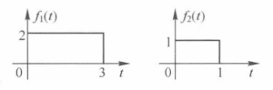
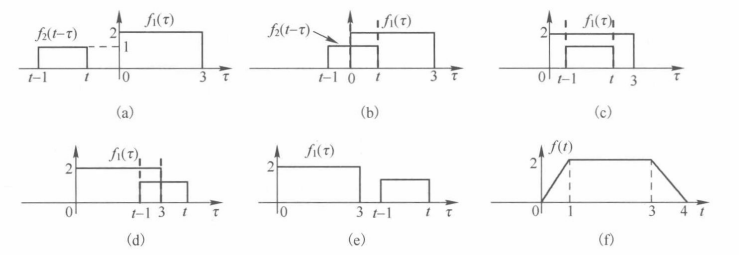

## CNN卷积和数学卷积

数学上的卷积定义：
$$f_1(t) * f_2(t) = \int_{-\infty}^{\infty} f_1(\tau) \cdot f_2(t-\tau) \, d\tau = \int_{-\infty}^{\infty} f_1(t-\tau) \cdot f_2(\tau) \, d\tau$$
而CNN的卷积是一个卷积核和 图像每个对应部分分别相乘。感觉是八竿子打不着的事情，但实际上是一样的。
为了理解这一点，我们需要了解卷积积分的图解法

### 卷积的图解法
假设 $f_1(t)$ 和 $f_2(t)$ 如图所示，尝试计算 $f(t)=f_1(t) *f_2(t)$

