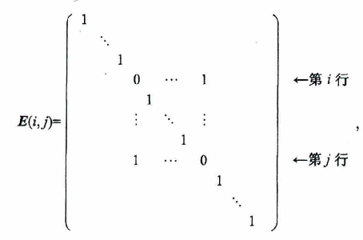

#mathf
## 1. 矩阵的标准形（定理 0）
?
对于 $m \times n$ 矩阵 $\boldsymbol{A}$，总可经过初等变换把它化为**标准形**：

$$
\boldsymbol{F}=\begin{pmatrix}\boldsymbol{E}_{r} & \boldsymbol{O}\\ \boldsymbol{O} & \boldsymbol{O}\end{pmatrix}_{m\times n}
$$
- 一般要经过 行变换 和 列变换 两者
- 如果只进行 行变换 只能是 行最简形

> 标准形由 $\boldsymbol{A}$ 的秩 $r$ 唯一确定：左上角为 $r$ 阶单位矩阵 $\boldsymbol{E}_{r}$，其余元素全为 $0$。
<!--SR:!2026-11-11,4,270-->

---

#mathf
## 2. 等价矩阵（定理 1）
?
设 $\boldsymbol{A}$ 与 $\boldsymbol{B}$ 为 $m \times n$ 矩阵，那么

- (i) $\boldsymbol{A} \overset{r}{\sim} \boldsymbol{B}$ 的充分必要条件是存在 $m$ 阶可逆矩阵 $\boldsymbol{P}$，使 $\boldsymbol{PA}=\boldsymbol{B}$；
- (ii) $\boldsymbol{A} \overset{c}{\sim} \boldsymbol{B}$ 的充分必要条件是存在 $n$ 阶可逆矩阵 $\boldsymbol{Q}$，使 $\boldsymbol{AQ}=\boldsymbol{B}$；
- (iii) $\boldsymbol{A} \sim \boldsymbol{B}$ 的充分必要条件是存在 $m$ 阶可逆矩阵 $\boldsymbol{P}$ 及 $n$ 阶可逆矩阵 $\boldsymbol{Q}$，使 $\boldsymbol{PAQ}=\boldsymbol{B}$

> 记号说明：$\boldsymbol{A} \overset{r}{\sim} \boldsymbol{B}$ 表示 $\boldsymbol{A}$ 经有限次**初等行变换**化为 $\boldsymbol{B}$；$\boldsymbol{A} \overset{c}{\sim} \boldsymbol{B}$ 表示经有限次**初等列变换**化为 $\boldsymbol{B}$；$\boldsymbol{A} \sim \boldsymbol{B}$ 表示 $\boldsymbol{A}$ 与 $\boldsymbol{B}$ **等价**（可经行、列初等变换互化）。
<!--SR:!2026-11-10,4,270-->

---

为证明定理 1，我们引进初等矩阵的知识。

## 3. 初等矩阵

由单位矩阵 $\boldsymbol{E}$ 经过**一次**初等变换得到的矩阵称为**初等矩阵**（Elementary Matrix）。三种初等变换对应三种初等矩阵。

### 3.1 对换两行（列）

把单位矩阵中第 $i,j$ 两行对换（或第 $i,j$ 两列对换），得初等矩阵

用 $m$ 阶初等矩阵 $\boldsymbol{E}_{m}(i,j)$ 左乘矩阵 $\boldsymbol{A}=(a_{ij})_{m\times n}$，得

 $$ \boldsymbol{E}_{m}(i,j)\boldsymbol{A}=\begin{pmatrix}
\rule[-0.75em]{0pt}{1.5em}a_{11} & a_{12} & \cdots & a_{1n}\\
\rule[-0.75em]{0pt}{1.5em}\vdots & \vdots & & \vdots\\
\rule[-0.75em]{0pt}{1.5em}a_{j1} & a_{j2} & \cdots & a_{jn}\\
\rule[-0.75em]{0pt}{1.5em}\vdots & \vdots & & \vdots\\
\rule[-0.75em]{0pt}{1.5em}a_{i1} & a_{i2} & \cdots & a_{in}\\
\rule[-0.75em]{0pt}{1.5em}\vdots & \vdots & & \vdots\\
\rule[-0.75em]{0pt}{1.5em}a_{m1} & a_{m2} & \cdots & a_{mn}
\end{pmatrix}
\begin{array}{l}
\rule[-0.75em]{0pt}{1.5em}\\
\rule[-0.75em]{0pt}{1.5em}\\
\rule[-0.75em]{0pt}{1.5em}\leftarrow 第 i 行\\
\rule[-0.75em]{0pt}{1.5em}\\
\rule[-0.75em]{0pt}{1.5em}\leftarrow 第 j 行\\
\rule[-0.75em]{0pt}{1.5em}\\
\rule[-0.75em]{0pt}{1.5em}\\
\end{array} $$

其结果相当于对矩阵 $\boldsymbol{A}$ 施行第一种初等行变换：把 $\boldsymbol{A}$ 的第 $i$ 行与第 $j$ 行对换 $(r_{i} \leftrightarrow r_{j})$。

类似地，以 $n$ 阶初等矩阵 $\boldsymbol{E}_{n}(i,j)$ 右乘矩阵 $\boldsymbol{A}$，其结果相当于对矩阵 $\boldsymbol{A}$ 施行第一种初等列变换：把 $\boldsymbol{A}$ 的第 $i$ 列与第 $j$ 列对换 $(c_{i} \leftrightarrow c_{j})$。

### 3.2 某行（列）乘非零数

以数 $k$（$k\neq 0$）乘单位矩阵的第 $i$ 行（或第 $i$ 列），得初等矩阵

 $$ \boldsymbol{E}(i(k))=\begin{pmatrix}
\rule[-0.75em]{0pt}{1.5em}1 & & & & & & \\
\rule[-0.75em]{0pt}{1.5em} & \ddots & & & & & \\
\rule[-0.75em]{0pt}{1.5em} & & 1 & & & & \\
\rule[-0.75em]{0pt}{1.5em} & & & k & & & \\
\rule[-0.75em]{0pt}{1.5em} & & & & 1 & & \\
\rule[-0.75em]{0pt}{1.5em} & & & & & \ddots & \\
\rule[-0.75em]{0pt}{1.5em} & & & & & & 1
\end{pmatrix}
\begin{array}{l}
\rule[-0.75em]{0pt}{1.5em}\\
\rule[-0.75em]{0pt}{1.5em}\\
\rule[-0.75em]{0pt}{1.5em}\\
\rule[-0.75em]{0pt}{1.5em}\leftarrow 第 i 行\\
\rule[-0.75em]{0pt}{1.5em}\\
\rule[-0.75em]{0pt}{1.5em}\\
\rule[-0.75em]{0pt}{1.5em}\\
\end{array} $$

可以验知：以 $\boldsymbol{E}_{m}(i(k))$ 左乘矩阵 $\boldsymbol{A}$，其结果相当于以数 $k$ 乘 $\boldsymbol{A}$ 的第 $i$ 行 $(r_{i} \times k)$；以 $\boldsymbol{E}_{n}(i(k))$ 右乘矩阵 $\boldsymbol{A}$，其结果相当于以数 $k$ 乘 $\boldsymbol{A}$ 的第 $i$ 列 $(c_{i} \times k)$。

### 3.3 某行（列）乘 $k$ 加到另一行（列）

以 $k$ 乘单位矩阵的第 $j$ 行加到第 $i$ 行上，或以 $k$ 乘单位矩阵的第 $i$ 列加到第 $j$ 列上，得初等矩阵

$$ \boldsymbol{E}(ij(k))=\begin{pmatrix}
\rule[-0.75em]{0pt}{1.5em}1 & & & & & & \\
\rule[-0.75em]{0pt}{1.5em} & \ddots & & & & & \\
\rule[-0.75em]{0pt}{1.5em} & & 1 & \cdots & k & & \\
\rule[-0.75em]{0pt}{1.5em} & & & \ddots & \vdots & & \\
\rule[-0.75em]{0pt}{1.5em} & & & & 1 & & \\
\rule[-0.75em]{0pt}{1.5em} & & & & & \ddots & \\
\rule[-0.75em]{0pt}{1.5em} & & & & & & 1
\end{pmatrix}
\begin{array}{l}
\rule[-0.75em]{0pt}{1.5em}\\
\rule[-0.75em]{0pt}{1.5em}\\
\rule[-0.75em]{0pt}{1.5em}\leftarrow 第 i 行\\
\rule[-0.75em]{0pt}{1.5em}\\
\rule[-0.75em]{0pt}{1.5em}\leftarrow 第 j 行\\
\rule[-0.75em]{0pt}{1.5em}\\
\rule[-0.75em]{0pt}{1.5em}\\
\end{array}. $$

可以验知：以 $\boldsymbol{E}_{m}(ij(k))$ 左乘矩阵 $\boldsymbol{A}$，其结果相当于把 $\boldsymbol{A}$ 的第 $j$ 行乘 $k$ 加到第 $i$ 行上 $(r_{i}+kr_{j})$；以 $\boldsymbol{E}_{n}(ij(k))$ 右乘矩阵 $\boldsymbol{A}$，其结果相当于把 $\boldsymbol{A}$ 的第 $i$ 列乘 $k$ 加到第 $j$ 列上 $(c_{j}+kc_{i})$。

---

#mathf
## 4. 初等变换与初等矩阵的对应（性质 1）
?
设 $\boldsymbol{A}$ 是一个 $m \times n$ 矩阵，对 $\boldsymbol{A}$ 施行一次初等行变换，相当于在 $\boldsymbol{A}$ 的左边乘相应的 $m$ 阶初等矩阵；对 $\boldsymbol{A}$ 施行一次初等列变换，相当于在 $\boldsymbol{A}$ 的右边乘相应的 $n$ 阶初等矩阵。

显然初等矩阵都是可逆的，且其逆矩阵是同一类型的初等矩阵：
$$
\boldsymbol{E}(i,j)^{-1}=\boldsymbol{E}(i,j),\qquad
\boldsymbol{E}(i(k))^{-1}=\boldsymbol{E}\!\left(i\!\left(\tfrac{1}{k}\right)\right),\qquad
\boldsymbol{E}(ij(k))^{-1}=\boldsymbol{E}(ij(-k)).
$$

>对于 $\boldsymbol{E}(i,j)^{-1} \boldsymbol{E}(i,j)E = E$，可以认为 $\boldsymbol{E}(i,j)$ 交换 E 的 i 和 j 行，然后 $\boldsymbol{E^{-1}}(i,j)$ 又把它换回来了。以这种思路可以很容易想到初等矩阵的逆。
<!--SR:!2026-11-09,3,250-->

---

#mathf
## 5. 可逆矩阵的初等矩阵分解（性质 2）
?
方阵 $\boldsymbol{A}$ 可逆的充分必要条件是存在有限个初等矩阵 $\boldsymbol{P}_{1}, \boldsymbol{P}_{2}, \cdots, \boldsymbol{P}_{l}$，使
$$ \boldsymbol{A}=\boldsymbol{P}_{1}\boldsymbol{P}_{2}\cdots\boldsymbol{P}_{l}. $$

相当于 $\boldsymbol{A}=\boldsymbol{P}_{1}\boldsymbol{P}_{2}\cdots\boldsymbol{P}_{l}E$，即 $\boldsymbol{P^{-1}}_{l}\cdots \boldsymbol{P^{-1}}_{2}\boldsymbol{P^{-1}}_{1}\boldsymbol{A}=E$，也就是说 A 可以经过 有限次初等行变换 转成 E（或者说 E 可以转成 A）。和 [7. 推论：可逆 ⇔ 与 E 行（列）等价](#7.%20推论：可逆%20⇔%20与%20E%20行（列）等价) 是一个意思
<!--SR:!2026-11-12,4,270-->

---

## 6. 定理 1 的证明

下面应用初等矩阵的知识来证明定理 1。

**证（i）** 依据 $\boldsymbol{A} \overset{r}{\sim} \boldsymbol{B}$ 的定义和初等矩阵的性质，有

- $\boldsymbol{A} \overset{r}{\sim} \boldsymbol{B} \Leftrightarrow \boldsymbol{A}$ 经有限次初等行变换变成 $\boldsymbol{B}$；
- $\Leftrightarrow$ 存在有限个 $m$ 阶初等矩阵 $\boldsymbol{P}_{1}, \boldsymbol{P}_{2}, \cdots, \boldsymbol{P}_{l}$，使 $\boldsymbol{P}_{l}\cdots\boldsymbol{P}_{2}\boldsymbol{P}_{1}\boldsymbol{A}=\boldsymbol{B}$；
- $\Leftrightarrow$ 存在 $m$ 阶可逆矩阵 $\boldsymbol{P}$，使 $\boldsymbol{PA}=\boldsymbol{B}$。

类似可证明 (ii) 和 (iii)。

证毕。

定理 1 把矩阵的初等变换与矩阵的乘法联系了起来，从而可以依据矩阵乘法的运算规律得到初等变换的运算规律，也可以利用矩阵的初等变换去研究矩阵的乘法。下面先给出定理 1 的一个推论，然后介绍一种利用初等变换求逆矩阵的方法。

---

#mathf
## 7. 推论：可逆 ⇔ 与 E 行（列）等价
?
方阵 $\boldsymbol{A}$ 可逆的充分必要条件是 $\boldsymbol{A} \overset{r}{\sim} \boldsymbol{E}$。

**即** $\boldsymbol{A}$ 可逆 $\Leftrightarrow$ 存在可逆矩阵 $\boldsymbol{P}$，使 $\boldsymbol{PA}=\boldsymbol{E} \Leftrightarrow \boldsymbol{A} \overset{r}{\sim} \boldsymbol{E}$。
<!--SR:!2026-11-12,4,270-->

---

dd#mathf
## 8. 用初等行变换求 P
?
定理 1 表明，如果 $\boldsymbol{A} \sim \boldsymbol{B}$，即 $\boldsymbol{A}$ 经一系列初等行变换变为 $\boldsymbol{B}$，则有可逆矩阵 $\boldsymbol{P}$，使 $\boldsymbol{PA}=\boldsymbol{B}$。那么，如何去求出这个可逆矩阵 $\boldsymbol{P}$？

由于
$$
\boldsymbol{PA}=\boldsymbol{B}
\Leftrightarrow \begin{cases} \boldsymbol{PA}=\boldsymbol{B}, \\ \boldsymbol{PE}=\boldsymbol{P} \end{cases}
\Leftrightarrow \boldsymbol{P}(\boldsymbol{A} , \boldsymbol{E})=(\boldsymbol{B} , \boldsymbol{P})
\Leftrightarrow (\boldsymbol{A} , \boldsymbol{E}) \overset{r}{\sim} (\boldsymbol{B} , \boldsymbol{P}),
$$
- 其中 $P = A^{-1}B$，也就是说这种方法可以求 $A^{-1}B$
- 事实上可以先求 $A^{-1}$，在求 P。A化成E 比 化成B简单。 

设 B 为单位矩阵 E，那么 $P = A^{-1}$，即 A 的逆矩阵
因此，如果对矩阵 $(\boldsymbol{A} , \boldsymbol{E})$ 作初等行变换，那么当把 $\boldsymbol{A}$ 变为 $\boldsymbol{E}$ 时，$\boldsymbol{E}$ 就变为 $A^{-1}$。用这种方法可以简便的求逆矩阵。
<!--SR:!2026-11-09,3,250-->

---
