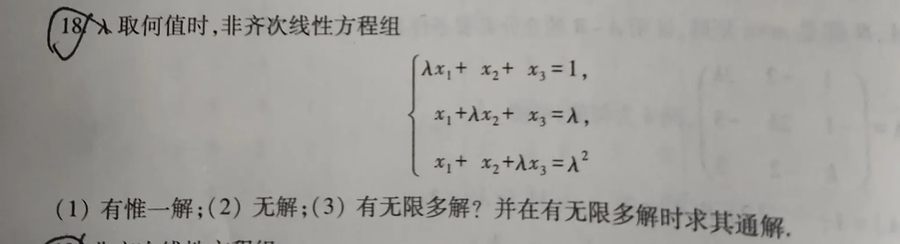

#mathf
## 题1

?
**解**：

很容易求出 $|A|$ 的值：
$$
|A| = (\lambda+2) \begin{vmatrix} 1 & 1 & 1 \\ 0 & \lambda-1 & 0 \\ 0 & 0 & \lambda-1 \end{vmatrix} = (\lambda+2)(\lambda-1)^2
$$

有唯一解时，$|A|$ 必须 $\ne$ 0，也就是 **$\lambda \neq -2$ 且 $\lambda \neq 1$**。
而 对于 无解 和 无限多解，都需要 $|A| = 0$。这只有两种情况 **$\lambda = -2$ 或 $\lambda = 1$**，分别代入检查即可。

>可以看出：当 未知数个数 等于 方程个数时，有唯一解是普遍情况；而 无解 或 无限多解 只是个别特殊情形。
<!--SR:!2026-11-24,12,270-->

---
