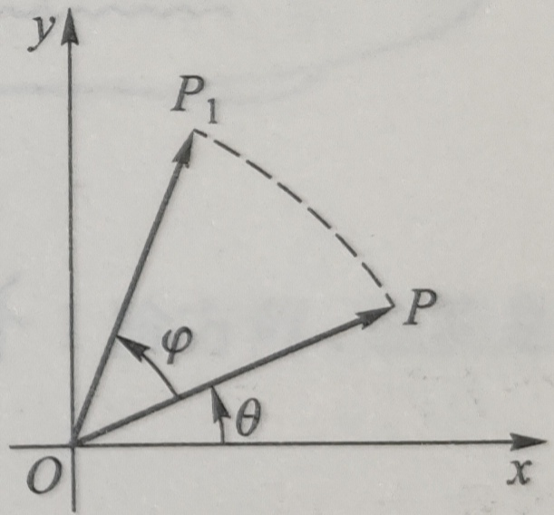

#math

# 旋转矩阵 (Rotation Matrix)

## 1. 旋转变换的定义

矩阵

$$
\begin{pmatrix}\cos\varphi & -\sin\varphi \\ \sin\varphi & \cos\varphi\end{pmatrix}
$$

对应的线性变换为

$$
\begin{cases}
x_{1}=x\cos\varphi-y\sin\varphi, \\
y_{1}=x\sin\varphi+y\cos\varphi
\end{cases}
$$

它把 $xOy$ 平面上的向量 $\overrightarrow{OP} = \begin{pmatrix} x \\ y \end{pmatrix}$ 变换为向量 $\overrightarrow{OP_1} = \begin{pmatrix} x_1 \\ y_1 \end{pmatrix}$。

## 2. 几何意义

设 $\overrightarrow{OP}$ 的长度为 $r$，辐角为 $\theta$，即 $x = r \cos \theta$，$y = r \sin \theta$，那么

$$
\begin{aligned}
x_{1} &= r\left(\cos\varphi\cos\theta-\sin\varphi\sin\theta\right) = r\cos\left(\theta+\varphi\right), \\
y_{1} &= r\left(\sin\varphi\cos\theta+\cos\varphi\sin\theta\right) = r\sin\left(\theta+\varphi\right).
\end{aligned}
$$

表明 $\overrightarrow{OP_1}$ 的长度为 $r$ 而辐角为 $\theta + \varphi$。因此，这是把向量 $\overrightarrow{OP}$（依逆时针方向）旋转 $\varphi$ 角（即把点 $P$ 以原点为中心逆时针旋转 $\varphi$ 角）的旋转变换（参看图 2.3）。

图 2.3

## 3. 旋转矩阵的幂

进一步还可推知，用 $A^{n}=\begin{pmatrix}\cos\varphi & -\sin\varphi \\ \sin\varphi & \cos\varphi\end{pmatrix}^{n}$ 左乘向量 $\overrightarrow{OP}$，相当于把向量 $\overrightarrow{OP}$ 按逆时针方向旋转 $n$ 个 $\varphi$ 角，即旋转 $n\varphi$ 角；而旋转 $n\varphi$ 角的变换所对应的矩阵为 $\begin{pmatrix}\cos n\varphi & -\sin n\varphi \\ \sin n\varphi & \cos n\varphi\end{pmatrix}$，亦即成立

$$
\begin{pmatrix}\cos\varphi & -\sin\varphi \\ \sin\varphi & \cos\varphi\end{pmatrix}^{n}
= \begin{pmatrix}\cos n\varphi & -\sin n\varphi \\ \sin n\varphi & \cos n\varphi\end{pmatrix}
$$

> 上式也可以按矩阵幂的定义来证明。
